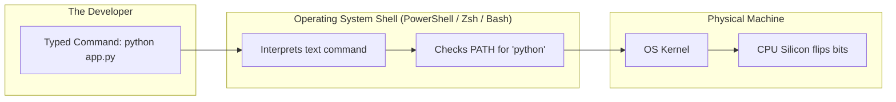
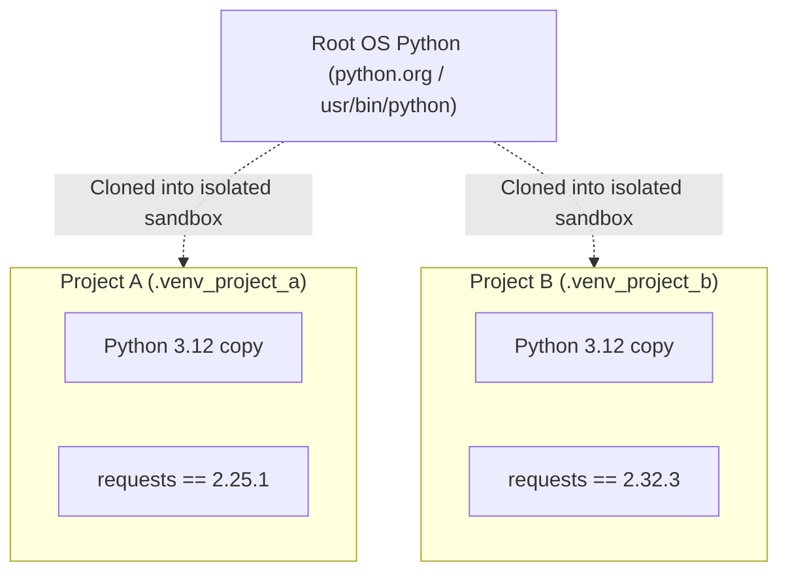

# Chapter 00-A: Zero-Prerequisite Developer Environment, Terminal & Execution Primer

> **What you will be able to do:** Set up a clean Python 3.12+ engineering environment from scratch, master the command line (Terminal/PowerShell/Bash), configure VS Code, isolate dependencies with virtual environments (`venv`), execute scripts with arguments, and decipher Python error tracebacks line-by-line without fear.
> **What you must already know:** Absolutely nothing. You only need a laptop running Windows, macOS, or Linux.

---

> **The Difference Between Users and Programmers**
> A computer user clicks icons on a Graphical User Interface (GUI). When something breaks, they are helpless.
> A software engineer talks directly to the operating system through text. The **Terminal** is your steering wheel, and Python is your engine.
> 
> If you have never typed a command into a black terminal window before, this chapter will walk you through every single step with zero jargon. By the end, you will feel completely at home running code like a professional.

---

## 1. What is the Terminal? (The Text Steering Wheel)

A **Graphical User Interface (GUI)** shows pretty windows, folders, and buttons. When you double-click a folder named `Projects`, the computer sends an internal signal to the operating system kernel: *"Open directory C:\Users\Alice\Projects"*.

The **Terminal** (also called the Console, Shell, or Command Line) lets you type that command directly without wasting CPU cycles rendering windows.



### The 6 Essential Terminal Commands (Memorize These)

Depending on your operating system, open:
* **Windows:** Press `Win + R`, type `powershell`, and press Enter (or use the built-in terminal in VS Code).
* **macOS:** Press `Cmd + Space`, type `Terminal`, and press Enter.
* **Linux:** Press `Ctrl + Alt + T`.

| Action | Windows (PowerShell) | macOS / Linux (Bash/Zsh) | What It Does | Real-World Metaphor |
| :--- | :--- | :--- | :--- | :--- |
| **Where am I?** | `pwd` | `pwd` | **P**rint **W**orking **D**irectory (shows your current location). | Looking at a GPS map pin: *"You are here."* |
| **What is here?** | `dir` or `ls` | `ls` | **L**i**s**t files and folders in current directory. | Opening your filing cabinet drawer to see files. |
| **Change location** | `cd folder_name` | `cd folder_name` | **C**hange **D**irectory (moves into that folder). | Walking into another room in your house. |
| **Go up one level** | `cd ..` | `cd ..` | Moves up to the parent folder. | Stepping backward out of the room into the hallway. |
| **Create a folder** | `mkdir my_project` | `mkdir my_project` | **M**a**k**e **Dir**ectory (creates a brand-new folder). | Buying a fresh empty folder binder. |
| **Clear screen** | `clear` or `cls` | `clear` | Clears all text clutter from your screen. | Wiping the whiteboard clean. |

---

## 2. Installing Python & Verifying the `PATH`

### Step 1: Install Python
* Go to the official website: [python.org/downloads](https://www.python.org/downloads/).
* Download the latest stable Python 3 release (3.12 or 3.13).
* > [!IMPORTANT]
  > **Crucial for Windows Users:** On the very first screen of the Windows installer, you MUST check the box that says:  
  > `☑ Add python.exe to PATH`  
  > If you forget this checkbox, your terminal will report: `'python' is not recognized as an internal or external command`.

### Step 2: What is `PATH`? (The Address Book Metaphor)
When you type `python` in your terminal, how does the computer know where `python.exe` is stored among 500,000 files on your 1-Terabyte SSD?

It consults an environment variable called **`PATH`**. Think of `PATH` as the computer's quick-dial phone book. It contains a list of folder paths. When you type any command name, the operating system checks those folders one-by-one until it finds a matching program!

### Step 3: Verify Your Installation
In your terminal, type:
```bash
python --version
```
*(On some macOS and Linux distributions, type `python3 --version`)*.

You should see output similar to:
```text
Python 3.12.6
```
If you see that version number, congratulations! Python is properly installed and talking to your terminal.

---

## 3. Interactive REPL vs. Script Files (`.py`)

There are two primary ways to run Python code:

### Mode 1: The Interactive REPL (Read-Eval-Print Loop)
Type `python` into your terminal with no arguments and hit Enter:
```text
$ python
Python 3.12.6 (main) [MSC v.1940 64 bit (AMD64)] on win32
Type "help", "copyright", "credits" or "license" for more information.
>>> 
```
The `>>>` prompt means Python is waiting for your immediate instruction.
* **R (Read):** Python reads what you type.
* **E (Eval):** Python executes the instruction.
* **P (Print):** Python prints the result to your screen.
* **L (Loop):** Python loops back and waits for your next instruction.

Try typing:
```text
>>> 2 + 2
4
>>> name = "Karthik"
>>> print(f"Hello, {name}!")
Hello, Karthik!
```
To exit the REPL and return to your operating system shell, type `exit()` and press Enter (or press `Ctrl + Z` on Windows, `Ctrl + D` on macOS/Linux).

> **When to use the REPL:** For quick 10-second experiments, testing a mathematical formula, or checking a function's behavior.

### Mode 2: Script Files (`.py`)
In real production engineering, you never write code in a live REPL that disappears when you close your window. You save your instructions into a plain text file ending in `.py`.

---

## 4. Setting Up VS Code & Your First Python File

1. Download and install **Visual Studio Code (VS Code)** from [code.visualstudio.com](https://code.visualstudio.com/).
2. Open VS Code, press `Ctrl + Shift + X` (or `Cmd + Shift + X` on Mac) to open Extensions, search for **Python** (by Microsoft), and click **Install**.
3. Create a clean project folder on your computer:
   ```bash
   mkdir python_playground
   cd python_playground
   ```
4. Open this folder in VS Code:
   ```bash
   code .
   ```
5. Create a new file called `hello.py` and enter:
   ```python
   # hello.py
   import sys

   print("=" * 40)
   print("Welcome to Professional Python Engineering!")
   print(f"Running on Python version: {sys.version.split()[0]}")
   print(f"Platform: {sys.platform}")
   print("=" * 40)
   ```
6. Open the integrated terminal in VS Code (`Ctrl + ~` or `Cmd + ~`) and run:
   ```bash
   python hello.py
   ```

---

## 5. Virtual Environments (`venv`): Protecting Your Machine

> **The Golden Rule of Professional Python:**  
> **Never install packages globally into your operating system's root Python installation.**

### Why Do We Need Virtual Environments?
Imagine you are building two projects:
* **Project A (Internal Company Tool):** Built 2 years ago, requires `requests version 2.25`.
* **Project B (New High-Performance Agent):** Built today, requires `requests version 2.32`.

If you install packages globally (`pip install requests`), Project B's installation will overwrite Project A's version. Suddenly, Project A crashes with incompatibility errors!

A **Virtual Environment** is a self-contained, isolated folder containing its own dedicated copy of Python and its own private library folder (`site-packages`).



### The 3-Step Virtual Environment Ritual

Every time you start a new Python project, execute these 3 commands:

```bash
# Step 1: Create the isolated virtual environment folder named .venv
python -m venv .venv

# Step 2: Activate it
# On Windows (PowerShell):
.venv\Scripts\Activate.ps1
# On macOS / Linux:
source .venv/bin/activate

# Step 3: Verify activation!
# Notice the (.venv) prefix on your terminal prompt!
```

When activated, typing `python` automatically uses the sandboxed Python binary inside `.venv`. When you are done working, simply type `deactivate` to return to your normal terminal.

---

## 6. Anatomy of a Production Python Script

Here is how a real-world Python script is structured:

```python
# script_anatomy.py
"""
Script Header: Documents what this program accomplishes.
Accepts a name and a count from command line, and prints greetings.
"""

import sys  # Standard library module for interacting with Python runtime

def generate_greeting(name: str, count: int) -> list[str]:
    """Pure function: takes inputs, returns outputs, has zero side-effects."""
    if count <= 0:
        raise ValueError(f"Count must be a positive integer, got: {count}")
    return [f"Greeting #{i + 1}: Hello, {name}!" for i in range(count)]

def main() -> int:
    """The central entry point function of the program."""
    # sys.argv is a list containing the command-line arguments passed to this script!
    # sys.argv[0] is always the script name itself ('script_anatomy.py')
    print(f"[INFO] Invoked script with {len(sys.argv)} argument(s): {sys.argv}")
    
    # Provide sensible defaults if user ran without arguments
    name = sys.argv[1] if len(sys.argv) > 1 else "World"
    count = int(sys.argv[2]) if len(sys.argv) > 2 else 3

    greetings = generate_greeting(name, count)
    for g in greetings:
        print(f"  -> {g}")
    
    return 0  # Standard Unix exit code: 0 means SUCCESS

if __name__ == "__main__":
    # Guard: only execute main() if this file was run directly from terminal!
    exit_code = main()
    sys.exit(exit_code)
```

### The `if __name__ == "__main__":` Secret
Every beginner asks: *"Why do people write `if __name__ == '__main__':` at the bottom of Python files?"*
* When you run a file directly from the terminal (`python script.py`), Python automatically assigns the special internal string `"__main__"` to `__name__`.
* But if another file **imports** this file (`import script_anatomy`), Python sets `__name__ = "script_anatomy"`.
* The `if` check ensures that your script runs its demo only when executed directly, preventing it from accidentally running if imported as a library by another program!

---

## 7. Deciphering Python Tracebacks (The Error Rosetta Stone)

When your code crashes, Python prints a **Traceback**. Beginners often panic when they see red text.
**Never fear a traceback.** A traceback is not an insult; it is a crime-scene investigation report with exact GPS coordinates.

### How to Read a Traceback (Bottom-to-Top)
Always look at the **very last line first**. That tells you *what* went wrong. Then look right above it to find *which file and line number* caused it.

```text
Traceback (most recent call last):
  File "calculator.py", line 14, in <module>
    result = compute_average([10, 20])
  File "calculator.py", line 8, in compute_average
    return total / len(items)
ZeroDivisionError: division by zero
```

1. **The Last Line:** `ZeroDivisionError: division by zero` $\rightarrow$ You attempted to divide a number by 0.
2. **The Line Above It:** `File "calculator.py", line 8, in compute_average` $\rightarrow$ The crash happened on line 8 of `calculator.py`.

### The 6 Most Common Python Errors Explained

| Exception | What It Means in Plain English | Concrete Bug Example | The Fix |
| :--- | :--- | :--- | :--- |
| **`SyntaxError`** | Grammar mistake. Python couldn't even compile the file. | `if x == 5` *(missing colon `:` at end)* | Add the missing colon or parenthesis. |
| **`NameError`** | You used a variable name that was never created or imported. | `print(user_name)` *(before defining it)* | Check for typos in variable names or missing `import` statements. |
| **`TypeError`** | Wrong data type passed to an operation or function. | `"Total: " + 42` *(cannot add string to int)* | Convert the type: `"Total: " + str(42)`. |
| **`AttributeError`** | You tried to access a property or method that doesn't exist on that object. | `num = 42; num.append(5)` *(integers have no `.append()`)* | Verify what class the object belongs to. |
| **`IndexError`** | You tried to access a list index that doesn't exist. | `items = ["apple"]; print(items[5])` | Check the length: `len(items)`. |
| **`KeyError`** | You tried to look up a dictionary key that isn't in the dictionary. | `user = {"id": 1}; print(user["email"])` | Use `.get("email", None)` or check `if "email" in user:`. |

---

## 8. Automated Verification Lab

Here is a self-contained script testing environment configuration, argument parsing, and exception catching:

```python
# test_environment_lab.py
import sys
import os

def test_python_version_supported():
    """Verify that Python 3.10+ is running."""
    major, minor = sys.version_info[:2]
    assert major == 3 and minor >= 10, f"Require Python 3.10+, got {major}.{minor}"
    print(f"[OK] Python version verified: {sys.version.split()[0]}")

def test_argument_handling():
    """Simulate command-line arguments."""
    simulated_args = ["test_script.py", "--env", "production", "--port", "8000"]
    parsed = {}
    for i in range(1, len(simulated_args), 2):
        key = simulated_args[i].lstrip("-")
        val = simulated_args[i + 1]
        parsed[key] = val
    
    assert parsed["env"] == "production"
    assert parsed["port"] == "8000"
    print("[OK] Argument parser logic verified.")

def test_traceback_interception():
    """Demonstrate clean error handling without unhandled crashes."""
    def fragile_divider(a: float, b: float) -> float:
        if b == 0:
            raise ZeroDivisionError("Denominator cannot be zero in financial calculation")
        return a / b

    caught = False
    try:
        fragile_divider(100.0, 0.0)
    except ZeroDivisionError as err:
        caught = True
        assert "Denominator cannot be zero" in str(err)
    
    assert caught, "ZeroDivisionError was not caught!"
    print("[OK] Defensive exception interception verified.")

if __name__ == "__main__":
    test_python_version_supported()
    test_argument_handling()
    test_traceback_interception()
    print("\n[ALL FOUNDATIONAL ENVIRONMENT CHECKS PASSED]")
```

---

## Check Yourself

1. **Why does running `python -m venv .venv` prevent the "dependency hell" where two projects need different versions of the same library?**
   - *Answer:* It creates an isolated directory containing its own Python executable and private `site-packages` library folder, preventing library version conflicts across projects.
2. **What does the environment variable `PATH` do when you type `python` in your terminal?**
   - *Answer:* It supplies the operating system with an ordered list of directories to search through in order to locate the `python` executable on disk.
3. **If you encounter a `TypeError: can only concatenate str (not "int") to str`, what is the quickest fix?**
   - *Answer:* Wrap the integer in `str(val)` or use an f-string: `f"{prefix}{val}"`.
4. **What is the difference between `sys.argv[0]` and `sys.argv[1]`?**
   - *Answer:* `sys.argv[0]` is always the script file name itself; `sys.argv[1]` is the first actual user-supplied argument.

---

## References & Further Reading

- [Official Python Tutorial: The Python Interpreter](https://docs.python.org/3/tutorial/interpreter.html)
- [Python Standard Library: `sys` module](https://docs.python.org/3/library/sys.html)
- [PEP 405 – Python Virtual Environments](https://peps.python.org/pep-0405/)
- [VS Code Python Documentation](https://code.visualstudio.com/docs/python/python-tutorial)
