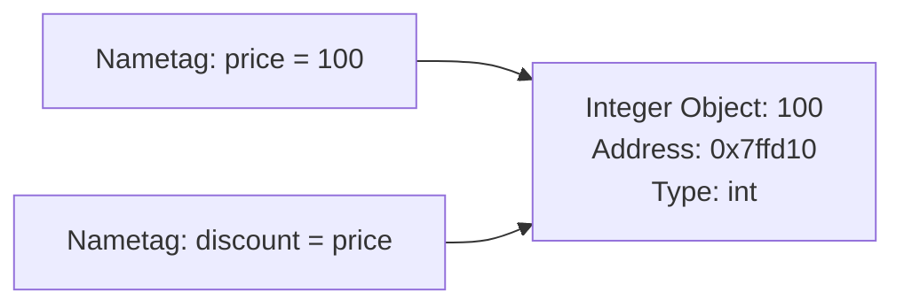
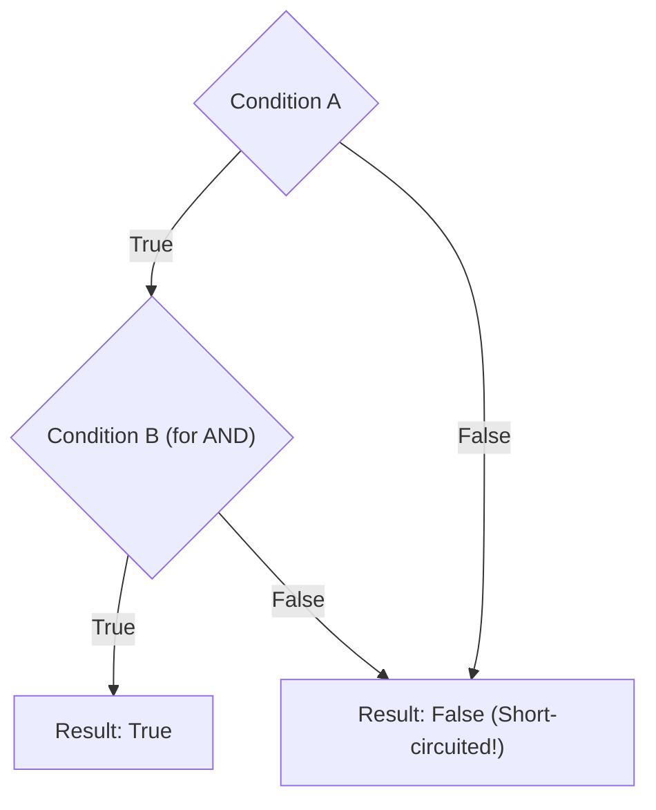
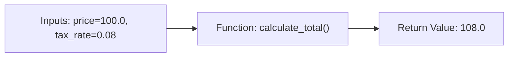

# Chapter 00-B: Zero-Prerequisite Programming 101: Syntax, Control Flow & Functions

> **What you will be able to do:** Master variables and primitives from the silicon up, evaluate boolean logic and truthiness without confusion, control execution with `if/elif/else`, iterate through data with `for` and `while` loops, craft clean reusable functions with arguments and return values, manipulate lists and dictionaries, and write defensive `try/except` blocks.
> **What you must already know:** Chapter 00-A's terminal and file execution fundamentals.

---

> **The Universal Grammar of All Software**
> Every software program on Earth—whether it is a simple $10$ calculator, the Instagram backend, or an autonomous AI agent—is built out of only **three fundamental building blocks**:
> 1. **State (Variables & Data Structures):** Remembering information in memory.
> 2. **Decisions (Conditionals):** Choosing different paths based on conditions (`if this, do that`).
> 3. **Repetition (Loops & Functions):** Doing work repeatedly without copy-pasting code.
> 
> Once you master these three building blocks, you have unlocked the DNA of all programming. This chapter builds that foundation from the ground up.

---

## 1. Variables & Fundamental Types from the Silicon Up

### What is a Variable? (Nametag vs Box)
In languages like C or Java, a variable is like a physical cardboard box with a fixed size carved into memory.
In Python, **a variable is simply a nametag pinned onto an object floating in heap memory!**



When you write `discount = price`, Python does NOT photocopy the number `100`. It simply pins a second nametag (`discount`) onto the exact same integer object!

### The 5 Primitive Data Types in Python

```python
# primitives_demo.py
# 1. Integer (int): Whole numbers of unlimited size
user_age = 28
cpu_cores = 16

# 2. Floating-Point (float): Decimal numbers (IEEE 754 64-bit double precision)
account_balance = 12450.75
pi_approx = 3.14159

# 3. String (str): Immutable sequence of Unicode characters
user_name = "Karthik"
welcome_message = 'Welcome to Python Engineering!'

# 4. Boolean (bool): Truth values (True or False - Capitalized!)
is_authenticated = True
has_premium_access = False

# 5. NoneType (None): Represents the intentional absence of a value
current_order = None  # User hasn't placed an order yet
```

### Type Checking & Type Casting
Python is dynamically typed (it detects types automatically), but strongly typed (it will not silently convert types if an operation is illegal):

```python
# Type Inspection
user_age = 28
print(type(user_age))         # <class 'int'>
print(isinstance(user_age, int)) # True

# Type Casting (Explicit Conversion)
raw_input_str = "42"
parsed_int = int(raw_input_str)       # Converts "42" -> 42
parsed_float = float(raw_input_str)   # Converts "42" -> 42.0
back_to_str = str(parsed_int)         # Converts 42 -> "42"

assert parsed_int + 8 == 50
```

---

## 2. Operators & Boolean Logic

### 1. Arithmetic Operators
* `+` : Addition (`5 + 3 == 8`)
* `-` : Subtraction (`10 - 4 == 6`)
* `*` : Multiplication (`4 * 3 == 12`)
* `/` : True Division (always returns a `float`: `7 / 2 == 3.5`)
* `//` : Floor/Integer Division (discards remainder: `7 // 2 == 3`)
* `%` : Modulo (returns the remainder: `7 % 2 == 1`)
* `**` : Exponentiation / Power (`2 ** 8 == 256`)

### 2. Comparison Operators
Comparison operators evaluate expressions and return a boolean (`True` or `False`):
* `==` : Equality check (Does left equal right?)
* `!=` : Not equal to
* `<` / `<=` : Less than / Less than or equal to
* `>` / `>=` : Greater than / Greater than or equal to

### 3. Boolean Logic & Short-Circuit Evaluation
Combine boolean expressions using `and`, `or`, and `not`:



* **`and`**: Returns `True` ONLY if **both** sides are `True`. If the left side is `False`, Python stops immediately (**Short-Circuit**) because the result cannot possibly be `True`.
* **`or`**: Returns `True` if **at least one** side is `True`. If the left side is `True`, Python stops immediately without evaluating the right side!
* **`not`**: Inverts the boolean (`not True` becomes `False`).

### Truthiness: What Evaluates to False in Python?
In Python, every object has an inherent boolean truth value. The following are considered **Falsy**:
* Numerical zeroes: `0`, `0.0`
* Empty collections: `""` (empty string), `[]` (empty list), `{}` (empty dict), `()` (empty tuple), `set()`
* The singleton: `None`
* The boolean: `False`

Everything else in Python is **Truthy**!

---

## 3. Decision Making: Conditionals (`if / elif / else`)

Conditionals allow your code to take different execution branches based on live runtime data:

```python
# conditional_branching.py
def evaluate_credit_tier(score: int, annual_income: float) -> str:
    """Classify a loan applicant into risk tiers."""
    if score >= 750 and annual_income >= 100_000:
        tier = "TIER_1_PRIME"
    elif score >= 650 or annual_income >= 80_000:
        tier = "TIER_2_NEAR_PRIME"
    elif score >= 550:
        tier = "TIER_3_SUBPRIME"
    else:
        tier = "TIER_4_REJECTED"
    
    return tier

assert evaluate_credit_tier(780, 120_000) == "TIER_1_PRIME"
assert evaluate_credit_tier(600, 30_000) == "TIER_3_SUBPRIME"
```

### The Ternary Expression (One-Line If/Else)
For concise variable assignments based on a condition:
```python
status_code = 200
status_message = "SUCCESS" if status_code == 200 else "ERROR"
```

---

## 4. Repetition & Iteration: Loops

### 1. The `while` Loop (Condition-Based Iteration)
Executes repeatedly as long as a condition evaluates to `True`. Used when you do not know in advance how many iterations will be required:

```python
# Retry with exponential backoff simulation
attempt = 1
max_attempts = 4
success = False

while attempt <= max_attempts and not success:
    print(f"Network request attempt #{attempt}...")
    if attempt == 3:
        success = True  # Network finally recovered!
    attempt += 1

assert success == True
```

### 2. The `for` Loop (Sequence-Based Iteration)
In Python, a `for` loop is a **for-each loop**. It iterates over any iterable collection (lists, strings, ranges, dictionaries):

```python
# 1. Iterating over a range of numbers: range(start, stop_exclusive, step)
total_sum = 0
for i in range(1, 6): # 1, 2, 3, 4, 5
    total_sum += i
assert total_sum == 15

# 2. Iterating over a list of items
servers = ["web-01", "web-02", "web-03"]
for server in servers:
    print(f"Checking health of {server}...")
```

### 3. Loop Control: `break` and `continue`
* `break`: Immediately terminates the loop and jumps to the code following it.
* `continue`: Skips the remainder of the current iteration and jumps directly to the next loop step.

```python
numbers = [1, 2, 3, 4, 5, 6, 7, 8, 9, 10]
even_squares = []

for n in numbers:
    if n % 2 != 0:
        continue  # Skip odd numbers!
    if n > 8:
        break     # Stop loop entirely once number exceeds 8!
    even_squares.append(n * n)

assert even_squares == [4, 16, 36, 64]
```

### 4. Production Looping Superpowers: `enumerate()` and `zip()`
Never write C-style indexing loops like `for i in range(len(items)): item = items[i]`. Use Python's built-in iterator utilities:

```python
# enumerate() yields (index, item) pairs simultaneously
languages = ["Python", "Rust", "Go"]
for index, lang in enumerate(languages):
    print(f"Rank #{index + 1}: {lang}")

# zip() iterates through multiple sequences in parallel lockstep
names = ["Alice", "Bob", "Charlie"]
scores = [95, 88, 92]
for name, score in zip(names, scores):
    print(f"Student: {name} | Score: {score}")
```

---

## 5. Functions 101: Building Reusable Blocks

A **Function** is a named, reusable sequence of instructions. It takes inputs (**Parameters**), executes logic, and optionally yields outputs (**Return Value**).



```python
# functions_deep_dive.py

# 1. Function definition with type annotations and docstring
def calculate_invoice_total(subtotal: float, tax_rate: float = 0.05, discount: float = 0.0) -> float:
    """
    Calculate the final invoice total after applying discounts and taxes.
    
    :param subtotal: Base price of items.
    :param tax_rate: Fractional tax rate (defaults to 5%).
    :param discount: Flat discount amount to deduct.
    :return: Rounded total amount payable.
    """
    discounted_price = max(0.0, subtotal - discount)
    total_with_tax = discounted_price * (1.0 + tax_rate)
    return round(total_with_tax, 2)

# Invocation using Positional Arguments
res1 = calculate_invoice_total(100.0, 0.10, 10.0) # subtotal=100, tax=10%, discount=10
assert res1 == 99.0

# Invocation using Keyword Arguments (Self-documenting!)
res2 = calculate_invoice_total(subtotal=200.0, discount=50.0) # uses default tax_rate=0.05
assert res2 == 157.50
```

### Flexible Arguments: `*args` and `**kwargs`
* `*args`: Collects any number of extra positional arguments into a `tuple`.
* `**kwargs`: Collects any number of extra keyword arguments into a `dict`.

```python
def flexible_logger(level: str, *messages, **metadata):
    combined_message = " ".join(str(m) for m in messages)
    print(f"[{level.upper()}] {combined_message} | Metadata: {metadata}")

# Accepts variable arguments cleanly
flexible_logger("info", "User", 101, "logged in from IP", ip="192.168.1.1", browser="Chrome")
```

---

## 6. Fundamental Collections: Lists, Dictionaries, Sets, & Tuples

### 1. Lists (`list`): Ordered, Mutable Sequences
Lists are dynamic arrays storing ordered items:

```python
# Creating and modifying lists
fruits = ["apple", "banana", "cherry"]

fruits.append("date")        # Adds to end: O(1)
fruits.insert(1, "blueberry") # Inserts at index 1: O(N)
removed_item = fruits.pop()  # Removes and returns last item: O(1)

# Powerful List Slicing: list[start:stop:step]
numbers = [0, 1, 2, 3, 4, 5, 6, 7, 8, 9]
first_three = numbers[:3]       # [0, 1, 2]
middle_slice = numbers[3:7]     # [3, 4, 5, 6]
every_second = numbers[::2]     # [0, 2, 4, 6, 8]
reversed_list = numbers[::-1]   # [9, 8, 7, 6, 5, 4, 3, 2, 1, 0]

assert reversed_list[0] == 9
```

### 2. Dictionaries (`dict`): High-Speed Key-Value Maps
Dictionaries store key-value mappings with $O(1)$ constant-time lookup:

```python
# Creating a dictionary
user_profile = {
    "user_id": 4092,
    "username": "alex_dev",
    "is_active": True,
    "roles": ["admin", "developer"]
}

# Accessing keys safely using .get() (prevents KeyError!)
email = user_profile.get("email", "no-email@company.com")
assert email == "no-email@company.com"

# Modifying and adding keys
user_profile["last_login"] = "2026-10-12"

# Iterating over key-value pairs
for key, value in user_profile.items():
    print(f"{key}: {value}")
```

### 3. Sets (`set`): Unique, Unordered Collections
Sets automatically eliminate duplicate items and support mathematical set operations:

```python
raw_tags = ["python", "ai", "python", "backend", "ai", "docker"]
unique_tags = set(raw_tags)
assert len(unique_tags) == 4 # Only {'python', 'ai', 'backend', 'docker'}

# Mathematical Set Operations
team_a_skills = {"python", "sql", "git"}
team_b_skills = {"docker", "kubernetes", "python"}

common_skills = team_a_skills & team_b_skills # Intersection: {'python'}
all_skills = team_a_skills | team_b_skills    # Union: {'python', 'sql', 'git', 'docker', 'kubernetes'}
assert "python" in common_skills
```

---

## 7. Defensive Error Handling: `try / except / else / finally`

Never let an unexpected runtime glitch crash your server process. Wrap fragile operations in structured exception handling:

```python
def safe_parse_integer(raw_value: str, fallback_default: int = 0) -> int:
    """Safely parse an integer with complete lifecycle guarantees."""
    try:
        # Code that might raise an exception
        result = int(raw_value)
    except (ValueError, TypeError) as err:
        # Handles specific known failure modes cleanly
        print(f"[WARN] Failed to parse '{raw_value}': {err}. Using fallback {fallback_default}.")
        return fallback_default
    else:
        # Executes ONLY if try block succeeded with zero exceptions!
        print(f"[INFO] Successfully parsed: {result}")
        return result
    finally:
        # ALWAYS executes under all circumstances (even if an unhandled error occurred!)
        # Used for cleanup: closing open file handles, releasing locks, terminating sockets.
        pass

assert safe_parse_integer("123") == 123
assert safe_parse_integer("corrupted_text", fallback_default=-1) == -1
```

---

## 8. Automated Verification Lab

Here is a self-contained script testing all fundamental programming concepts end-to-end:

```python
# test_programming_101_lab.py

def test_primitives_and_truthiness():
    # Verify truthiness invariants
    falsy_values = [0, 0.0, "", [], {}, set(), None, False]
    for val in falsy_values:
        assert not bool(val), f"Expected {val} to be Falsy!"
    
    truthy_values = [1, -5, "hello", [0], {"k": "v"}, True]
    for val in truthy_values:
        assert bool(val), f"Expected {val} to be Truthy!"
    print("[OK] Primitives and Truthiness invariants verified.")

def test_collections_and_slicing():
    # Test array slicing
    seq = list(range(10))
    assert seq[2:5] == [2, 3, 4]
    assert seq[::-1][0] == 9

    # Test dictionary hashing
    registry = {}
    for i in range(100):
        registry[f"user_{i}"] = i * 10
    assert registry.get("user_42") == 420
    assert registry.get("non_existent", -1) == -1
    print("[OK] Collection manipulation and slicing verified.")

def test_function_closures_and_args():
    def accumulator(base: int, *additions: int, multiplier: int = 1) -> int:
        return (base + sum(additions)) * multiplier

    assert accumulator(10, 2, 3, 5, multiplier=2) == 40
    print("[OK] Function arguments and keyword handling verified.")

if __name__ == "__main__":
    test_primitives_and_truthiness()
    test_collections_and_slicing()
    test_function_closures_and_args()
    print("\n[ALL PROGRAMMING 101 VERIFICATIONS PASSED SUCCESSFULLY]")
```

---

## 9. The 10 Essential Muscle-Memory Fluency Drills

Reading code creates an illusion of understanding. True mastery only happens when your fingers type the logic on a blank canvas. 

Here are the **10 fundamental fluency drills** that bridge the gap between basic syntax and professional systems programming. Run this block to verify all 10 self-grading assertions pass on your machine:

```python
# The 10 Essential Muscle-Memory Fluency Drills

def drill_01_fizzbuzz(n: int) -> list[str]:
    """Drill 1: Pure control flow & modulo invariants."""
    res = []
    for i in range(1, n + 1):
        if i % 15 == 0:
            res.append("FizzBuzz")
        elif i % 3 == 0:
            res.append("Fizz")
        elif i % 5 == 0:
            res.append("Buzz")
        else:
            res.append(str(i))
    return res

def drill_02_is_palindrome(s: str) -> bool:
    """Drill 2: Two-pointer string validation without slicing shortcuts."""
    cleaned = [c.lower() for c in s if c.isalnum()]
    left, right = 0, len(cleaned) - 1
    while left < right:
        if cleaned[left] != cleaned[right]:
            return False
        left += 1
        right -= 1
    return True

def drill_03_word_frequencies(words: list[str]) -> dict[str, int]:
    """Drill 3: Dictionary accumulation using safe default fallback."""
    counts = {}
    for w in words:
        counts[w] = counts.get(w, 0) + 1
    return counts

def drill_04_find_duplicates(nums: list[int]) -> set[int]:
    """Drill 4: O(1) set membership to detect duplicate items."""
    seen = set()
    dups = set()
    for n in nums:
        if n in seen:
            dups.add(n)
        seen.add(n)
    return dups

def drill_05_square_evens(nums: list[int]) -> list[int]:
    """Drill 5: Idiomatic list comprehension combining filtering and transformation."""
    return [x * x for x in nums if x % 2 == 0]

def drill_06_safe_nested_get(d: dict, *keys, default=None):
    """Drill 6: Defensive navigation through arbitrarily nested JSON/dictionaries."""
    curr = d
    for k in keys:
        if isinstance(curr, dict) and k in curr:
            curr = curr[k]
        else:
            return default
    return curr

def drill_07_flatten_matrix(matrix: list[list[int]]) -> list[int]:
    """Drill 7: Nested iteration flattening a 2D grid into a 1D sequence."""
    out = []
    for row in matrix:
        for val in row:
            out.append(val)
    return out

def drill_08_fibonacci(count: int) -> list[int]:
    """Drill 8: Iterative state accumulation avoiding recursive stack overflow."""
    if count <= 0:
        return []
    if count == 1:
        return [0]
    fib = [0, 1]
    while len(fib) < count:
        fib.append(fib[-1] + fib[-2])
    return fib

def drill_09_metrics_collector(service_name: str, *measurements: float, **tags) -> dict:
    """Drill 9: Dynamic argument aggregation using *args and **kwargs."""
    return {
        "service": service_name,
        "count": len(measurements),
        "avg": (sum(measurements) / len(measurements)) if measurements else 0.0,
        "tags": tags
    }

def drill_10_safe_divide(a: float, b: float) -> tuple[bool, float]:
    """Drill 10: Complete try/except/else error recovery pattern."""
    try:
        val = a / b
    except ZeroDivisionError:
        return (False, 0.0)
    else:
        return (True, val)

# Self-grading execution verification
assert drill_01_fizzbuzz(5) == ["1", "2", "Fizz", "4", "Buzz"]
assert drill_02_is_palindrome("A man, a plan, a canal: Panama") is True
assert drill_02_is_palindrome("race a car") is False
assert drill_03_word_frequencies(["apple", "banana", "apple"]) == {"apple": 2, "banana": 1}
assert drill_04_find_duplicates([1, 2, 3, 2, 4, 1]) == {1, 2}
assert drill_05_square_evens([1, 2, 3, 4, 5]) == [4, 16]
payload = {"user": {"profile": {"age": 28}}}
assert drill_06_safe_nested_get(payload, "user", "profile", "age") == 28
assert drill_06_safe_nested_get(payload, "user", "settings", default=-1) == -1
assert drill_07_flatten_matrix([[1, 2], [3, 4]]) == [1, 2, 3, 4]
assert drill_08_fibonacci(7) == [0, 1, 1, 2, 3, 5, 8]
m = drill_09_metrics_collector("auth_svc", 10.0, 20.0, 30.0, env="prod")
assert m["avg"] == 20.0 and m["tags"]["env"] == "prod"
assert drill_10_safe_divide(10, 2) == (True, 5.0)
assert drill_10_safe_divide(10, 0) == (False, 0.0)
print("[OK] All 10 Fundamental Fluency Drills Passed Cleanly!")
```

---

## Check Yourself

1. **Why does Python not copy the integer `42` when you write `b = a` where `a = 42`?**
   - *Answer:* Python uses nametag reference binding; `b` and `a` both point to the same immutable integer object `42` in heap memory.
2. **What is the difference between `/` and `//` in Python?**
   - *Answer:* `/` performs true float division (e.g. `7 / 2 == 3.5`), while `//` performs floor division (e.g. `7 // 2 == 3`).
3. **What does `dict.get("key", default)` do when `"key"` is missing from the dictionary?**
   - *Answer:* It returns `default` without raising a `KeyError`.
4. **When does the `finally:` block in a `try/except` construct execute?**
   - *Answer:* It is guaranteed to execute under all circumstances, whether an exception occurred, was handled, or was unhandled.

---

## References & Further Reading

- [Official Python Tutorial: More Control Flow Tools](https://docs.python.org/3/tutorial/controlflow.html)
- [Official Python Tutorial: Data Structures](https://docs.python.org/3/tutorial/datastructures.html)
- [PEP 8 – Style Guide for Python Code](https://peps.python.org/pep-0008/)
