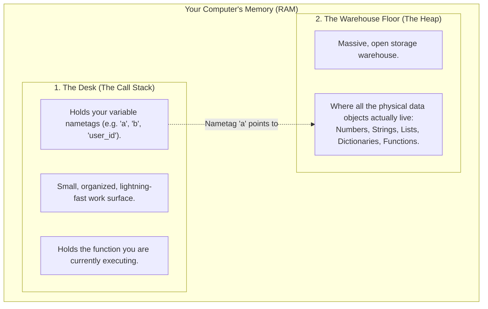
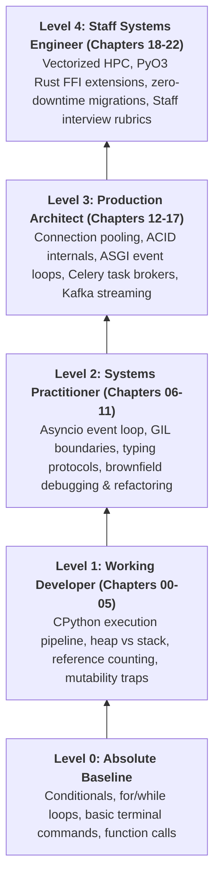
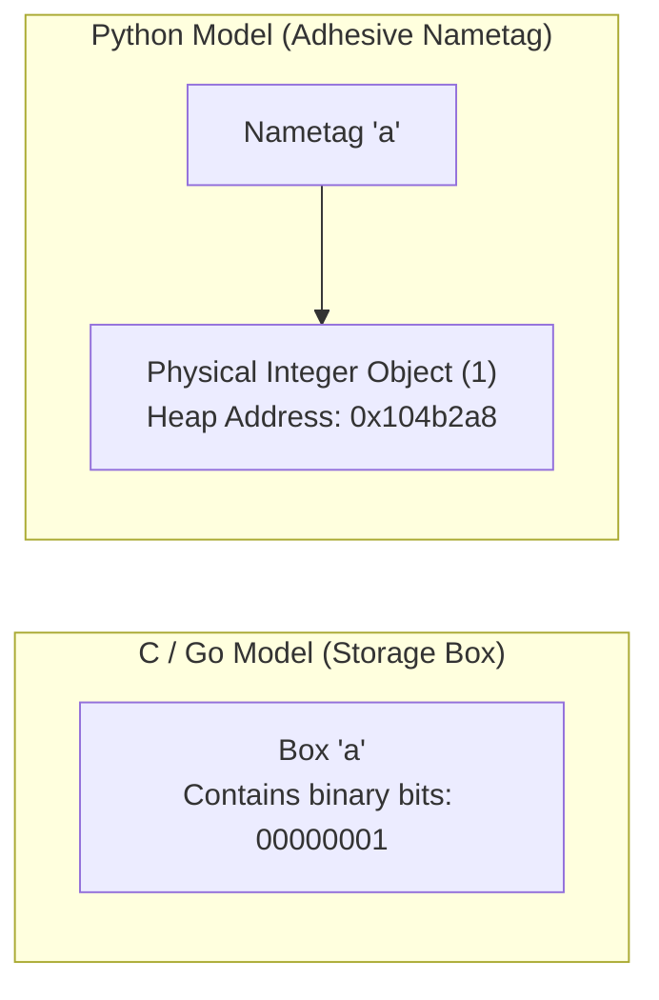
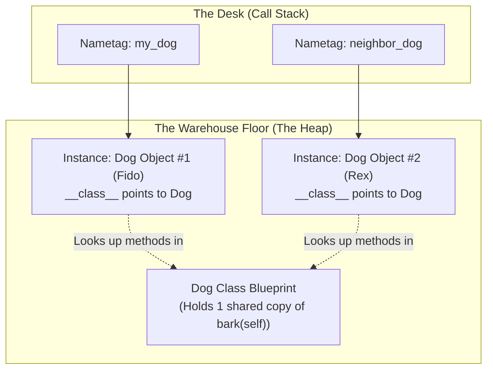
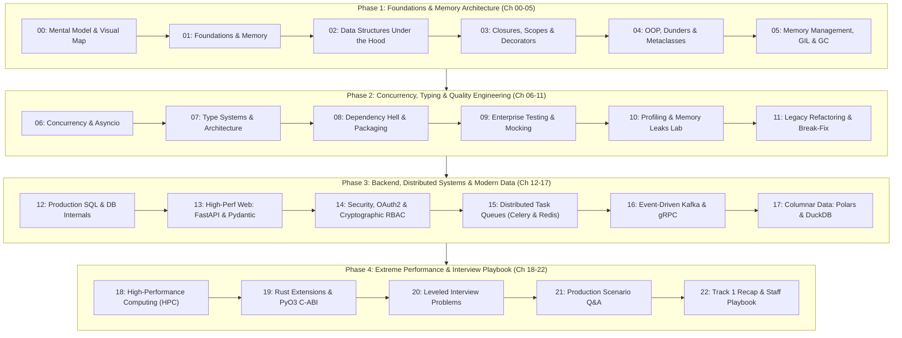

# Chapter 0: The Unified Python Mental Map & Intuitive Primer

> **What you will be able to do:** Form an indestructible, intuitive mental model of Python execution, trace variable nametags to heap objects, pinpoint where variables live across function calls, calibrate your learning path across all 23 chapters, and assess your current baseline with a 15-question placement diagnostic.
> **What you must already know:** Basic programming concepts (what variables, loops, and functions are in any language) and comfort running basic commands in a terminal.

---

## 0. Zero-Prerequisite Primer: What on Earth is "The Heap"?

Before we look at Python's rules, let's understand how your computer's memory (RAM) actually works. 

Whenever your computer runs a program, it carves its memory into two main areas: **The Desk** and **The Warehouse**.



1. **The Desk (The Call Stack):** 
   Imagine a small wooden desk where you sit. When you are calculating a math problem or running a function, you write small scratch notes right on your desk. It is organized, neat, and very fast, but it is small.
2. **The Warehouse Floor (The Heap):** 
   Behind your desk is a massive, cavernous warehouse with virtually unlimited open floor space. When you build a giant Lego castle, buy a refrigerator, or create a list of 10,000 customer names, you cannot fit it on your tiny desk! You place it out on the **Warehouse Floor**. In computer science, this open warehouse is called **The Heap**.

> [!NOTE]
> **Summary for Beginners:**
> * **The Heap** simply means: *"The big open storage area in your computer's RAM where objects live."*
> * When you type `x = [1, 2, 3]`, Python constructs the list `[1, 2, 3]` out on the **Warehouse Floor (The Heap)**, and hands you a small sticky note labeled `x` on your **Desk** that points to it!

### "If Both Are in RAM, Why Do We Need Two Separate Things?"

A brilliant question every great engineer asks: *“My computer only has RAM sticks plugged into the motherboard. If both the Stack and the Heap live inside that same RAM, why did computer scientists invent two different zones?”*

Here is the secret: **The Stack and the Heap have completely opposite strengths and weaknesses. Neither one can survive without the other.**

| Dimension | The Stack (The Desk) | The Heap (The Warehouse Floor) |
| :--- | :--- | :--- |
| **Speed** | **Blazingly Fast (1 CPU cycle / < 1 ns)**. Just moves a single pointer register (`SP`). | **Slower (Dozens to hundreds of CPU cycles)**. Must search free-lists and allocate blocks. |
| **Lifespan** | **Strict & Temporary**. Data dies the microsecond the function finishes and returns. | **Flexible & Persistent**. Data lives as long as you need it, across any function or thread. |
| **Size Flexibility** | **Rigid & Fixed**. Must know exact size upfront. Cannot easily grow or shrink. | **Completely Dynamic**. A list can start with 0 items and grow to 10,000,000 items on the fly. |
| **Cleanup Cost** | **Zero Cost**. Automatically wiped when function pops off. No GC needed. | **Requires Management**. Needs reference counting and cyclical garbage collection. |

#### Why You Cannot Use ONLY the Stack:
1. **Death upon Return:** The Stack works like a stack of cafeteria plates (Last In, First Out). When a function `load_user_profile()` finishes and exits, its stack frame is instantly vaporized. If your user data lived on the stack, it would be deleted before the caller could even read it! You could never pass data upward or share objects across functions.
2. **Dynamic Growth:** How much memory does a user's uploaded photo take? How many items will be in a shopping cart? You don't know until the program runs! If you tried to grow a list in the middle of a stack, it would overwrite the variables of other functions sitting right above it.

#### Why You Cannot Use ONLY the Heap:
1. **Extreme Slowness:** Searching for open memory slots on the heap takes real time. If every tiny temporary counter `i = 0` in a `for` loop required a heap search, your programs would run 50x slower.
2. **Memory Fragmentation & GC Meltdown:** Allocating and freeing millions of tiny variables on the heap creates scattered "Swiss cheese" holes in RAM. The Garbage Collector would spend 90% of its CPU time cleaning up scraps instead of executing your business logic.

#### The Perfect Division of Labor:
* The **Call Stack** manages **order of execution and temporary nametags** with lightspeed efficiency.
* The **Heap** stores the **actual data objects** that need to grow, shrink, and outlive the functions that created them.
* **The Bridge:** Your Desk (Stack) holds a tiny 8-byte claim ticket (pointer). The physical luggage sits in the Warehouse (Heap). When the function ends, the desk is wiped clean—but if you handed that claim ticket to the caller, the luggage stays safely in the warehouse!

### "Wait, What Software Engine is Running This?" (Python vs. CPython)

Before we look at the 3 Golden Rules, let's clear up a common beginner question: *“When I type `python script.py` into my terminal, what is actually executing my code?”*

* **Python** is the **Language Specification** (The Recipe): It defines the rules, grammar, and syntax (`def`, `class`, `for`, `print`). It is an abstract set of instructions written down on paper.
* **CPython** is the **Official Engine** (The Master Chef): It is the actual software program written in the **C programming language** that reads your Python code, manages the Stack and the Heap, and executes instructions on your physical CPU.

> [!TIP]
> Whenever you download Python from `python.org` or run `python` in your terminal, you are running **CPython**. Throughout this guide, when we peek under the hood of how Python works, we are looking at the CPython engine—the world's most popular Python implementation powering Google, Netflix, Instagram, and OpenAI!

---

## 1. Prerequisite Ladder & Learning Milestones

To get the absolute maximum value from this track without stalling, verify where you stand on the **Prerequisite Ladder**:



### Estimated Study Time & Curriculum Matrix

Each chapter is designed for deep focus. Use this matrix to schedule your prep:

| Chapter | Title | Level | Est. Time | Prerequisites | Core Milestone |
| :---: | :--- | :---: | :---: | :--- | :--- |
| **00** | Mental Model & Visual Map | Foundational | 1.0 hr | Basic programming concepts | Grasp the Heap, Stack, and CPython engine |
| **01** | Foundations & Syntax Primitives | Foundational | 1.5 hrs | Ch 00 | Master name binding, mutability, and small-int caching |
| **02** | Data Structures Under The Hood | Core | 2.0 hrs | Ch 01 | Internal arrays of lists, open addressing hash tables |
| **03** | Functions, Closures & Decorators | Core | 2.0 hrs | Ch 01 | `PyCellObject`, lexical scoping, stacked decorators |
| **04** | OOP, Dunders & Metaprogramming | Core | 2.5 hrs | Ch 02, 03 | `__new__` vs `__init__`, Descriptors, Metaclasses |
| **05** | Memory Management, GIL & GC | Core Systems | 2.5 hrs | Ch 01, 04 | Obmalloc, arenas, pools, 3-gen GC, GIL semantics |
| **06** | Concurrency: Asyncio & Threads | Core Systems | 3.0 hrs | Ch 05 | Epoll loop, thread switching, IPC vs shared memory |
| **07** | Type System & Modern Architecture | Core Systems | 2.0 hrs | Ch 04 | Covariance/contravariance, Protocols, PEP 695 generics |
| **08** | Packaging & Dependency Hell | Applied | 2.0 hrs | Ch 01 | Wheels, manylinux, pip dependency resolver, pyproject.toml |
| **09** | Enterprise Testing & Async Mocking | Applied | 2.5 hrs | Ch 06 | Fixtures, event loop isolation, hypothesis property tests |
| **10** | Production Profiling & Leaks Lab | Systems Lab | 2.5 hrs | Ch 05 | cProfile, tracemalloc, memray, py-spy sampling |
| **11** | Legacy Refactoring & Break-Fix | Systems Lab | 2.5 hrs | Ch 09, 10 | Strangler fig, AST codemods, shadow verification |
| **12** | Production SQL & DB Internals | Backend | 3.0 hrs | Ch 02 | Connection pools, MVCC, N+1 query elimination, Alembic |
| **13** | Web Architecture: FastAPI & Pydantic | Backend | 3.0 hrs | Ch 06, 07 | ASGI spec, Rust-backed Pydantic V2 serialization |
| **14** | Security, OAuth2 & Cryptographic RBAC | Backend | 2.5 hrs | Ch 13 | Constant-time comparisons, JWT claims, PBKDF2/argon2 |
| **15** | Distributed Task Queues: Celery & Redis | Distributed | 3.0 hrs | Ch 06, 12 | Prefetch counts, ACK-late, Redis memory fragmentation |
| **16** | Event-Driven: Kafka & gRPC | Distributed | 3.0 hrs | Ch 06, 15 | Protobuf serialization, consumer group rebalance, backpressure |
| **17** | Columnar Data: Polars & DuckDB | Data Systems | 2.5 hrs | Ch 02 | Apache Arrow columnar format, SIMD predicates, out-of-core |
| **18** | High-Performance Computing (HPC) | Extreme Perf | 3.0 hrs | Ch 05, 06 | Numba JIT, Cython, subinterpreters (PEP 684), Tier-2 JIT |
| **19** | Rust Extensions: PyO3 & C ABI | Extreme Perf | 3.5 hrs | Ch 05, 18 | Rust borrow checker, PyO3 macros, GIL release in FFI |
| **20** | Leveled Interview Practice Problems | Capstone | 3.5 hrs | All chapters | 15+ coding problems across Junior to Staff rubrics |
| **21** | Production Scenario Interview Q&A | Capstone | 3.5 hrs | All chapters | 15+ live production incidents & root cause postmortems |
| **22** | Track 1 Recap & Staff Playbook | Capstone | 2.0 hrs | All chapters | Comprehensive synthesis, trade-off matrices & cheatsheets |

---

## 2. Comprehensive Python Systems Glossary

Before diving into deeper chapters, bookmark this glossary. These 16 concepts form the bedrock of Staff-level Python conversations:

1. **CPython**: The standard, reference implementation of the Python programming language written in ANSI C. It compiles Python source code into bytecode and runs it in an evaluation loop (`_PyEval_EvalFrameDefault`).
2. **Abstract Syntax Tree (AST)**: A tree representation of the abstract syntactic structure of source code. Python's parser converts tokens into an AST (`ast` module) before compiling to bytecode.
3. **Bytecode**: The intermediate, platform-independent instruction set executed by the CPython virtual machine (e.g., `LOAD_FAST`, `STORE_FAST`, `BINARY_OP`). Viewable via `dis.dis()`.
4. **Stack Frame (`PyFrameObject`)**: The CPython data structure created for each active function call. Contains the local variable array, value stack, instruction pointer, and evaluation context.
5. **Name Binding**: The process of associating an identifier (nametag) with an object in a namespace dictionary or local frame array (`FAST` locals). Variables in Python are pointers, never memory containers.
6. **PyObject**: The foundational C `struct` that every Python object shares. Contains at least an object header with `ob_refcnt` (reference count) and `ob_type` (pointer to the type object).
7. **`ob_refcnt` & `ob_type`**: The twin fields in every `PyObject`. `ob_refcnt` tracks how many names or containers refer to this object; `ob_type` points to the `PyTypeObject` defining its methods and behavior.
8. **Free Lists**: CPython optimization pools that retain freed memory blocks for specific built-in types (e.g., floats, lists, dicts, frames) to avoid calling the OS allocator repeatedly.
9. **Obmalloc (Arenas, Pools, Blocks)**: CPython's specialized small-object allocator for requests $\le 512$ bytes. Memory is organized hierarchically into 256KB Arenas, 4KB Pools, and fixed-size Blocks.
10. **Descriptor Protocol**: The mechanism behind properties, methods, `classmethod`, and `staticmethod`. Any object defining `__get__`, `__set__`, or `__delete__` acts as a descriptor.
11. **Method Resolution Order (MRO / C3 Linearization)**: The deterministic algorithm Python uses to compute class inheritance hierarchies and resolve attribute lookups when multiple inheritance is involved. Viewable via `cls.mro()`.
12. **Global Interpreter Lock (GIL)**: A mutual exclusion lock used by CPython to prevent multiple native OS threads from executing Python bytecode simultaneously, safeguarding non-thread-safe reference counts.
13. **Generational Cyclical Garbage Collector (GC)**: The background collector that detects isolated islands of mutually referencing objects that reference counting alone cannot reclaim. Operates across three generations (Gen 0, 1, 2).
14. **Coroutine**: A specialized function declared with `async def` that can suspend its execution via `await` and resume later, implemented internally as an enhanced generator.
15. **Event Loop & `epoll` / `kqueue`**: The single-threaded multiplexer that monitors file descriptors and network sockets using OS kernel primitives (`epoll` on Linux, `kqueue` on macOS, IOCP on Windows) to drive non-blocking I/O.
16. **Protocol & Structural Subtyping**: Static typing paradigm (PEP 544) where class compatibility is determined by available methods and attributes rather than explicit inheritance from an abstract base class.

---

## 3. The 3 Golden Rules of Python's Mental Model

Keep these three rules etched in your mind:

### Rule 1: Variables Are Sticky Nametags, NOT Storage Boxes

In languages like C or Go, a variable is a physical metal box etched into memory. When you assign `x = 5`, the number 5 is placed inside box `x`.

In Python, **variables are thin adhesive paper nametags**. Objects are physical items sitting on the warehouse floor (the Heap). Assignment (`=`) simply peels a nametag and slaps it onto an object.



### Rule 2: Multiple Nametags Can Stick to the Exact Same Tray

When you write `b = a`, Python does **not** duplicate the object. It creates a second nametag `b` and slaps it onto the exact same physical tray on the warehouse floor.

```python
a = [1, 2, 3]
b = a
b.append(4)
print(a)  # [1, 2, 3, 4] - mutating the shared heap object affects both!
```

### Rule 3: Methods Live on the Class Blueprint, NOT the Instance

Instances do not duplicate method code. When you call `dog.bark()`, Python looks up the method on `Dog` and passes `dog` as the first argument (`self`):

```python
class Dog:
    def __init__(self, name: str):
        self.name = name

    def bark(self):
        return f"{self.name} says woof!"

my_dog = Dog("Fido")
neighbor_dog = Dog("Rex")

# What you write:
res1 = my_dog.bark()

# What Python translates and executes under the hood:
res2 = Dog.bark(my_dog)

assert res1 == res2 == "Fido says woof!"
```



---

## 4. The Master Architecture Map of Track 1

Here is your complete 4-phase, 23-chapter roadmap to Staff-level Python engineering:



---

## 5. Diagnostic Placement Quiz

Take this 15-question placement diagnostic to identify your exact starting point and pinpoint blind spots before diving in.

<details>
<summary><strong>Question 1: What is the output of <code>a = [1, 2]; b = a; b += [3]; print(a)</code> versus <code>a = (1, 2); b = a; b += (3,); print(a)</code>?</strong></summary>

**Answer:** 
- In the list case, `a` prints `[1, 2, 3]`. For mutable lists, `+=` invokes `__iadd__` in-place, modifying the shared heap object.
- In the tuple case, `a` prints `(1, 2)`. Tuples are immutable; `+=` constructs a *brand-new* tuple object on the heap and reassigns `b` to it, leaving `a` pointing to the original object.
*Master this in [Chapter 01: Foundations & Syntax](01-Foundations-Syntax-Primitives.md).*

</details>

<details>
<summary><strong>Question 2: Why is <code>def append_to(val, target=[]): target.append(val); return target</code> a catastrophic bug?</strong></summary>

**Answer:** 
Default argument expressions are evaluated **once at function definition time** (when the bytecode is loaded into memory), not on each call. The empty list is constructed once and stored in `append_to.__defaults__`. All subsequent calls without an explicit argument mutate that exact same shared list.
*Master this in [Chapter 01: Foundations & Syntax](01-Foundations-Syntax-Primitives.md).*

</details>

<details>
<summary><strong>Question 3: Why does appending to a Python list run in amortized $O(1)$ time rather than strictly $O(1)$?</strong></summary>

**Answer:** 
A Python `list` is a contiguous dynamic array of pointers (`PyObject**`). When the allocated capacity is exhausted, CPython over-allocates according to a geometric growth pattern ($\sim 1.125\times + 6$). Reallocation copies pointers to a new contiguous memory block ($O(N)$), but this happens infrequently enough that the average cost per append is $O(1)$.
*Master this in [Chapter 02: Data Structures Under The Hood](02-Data-Structures-Under-The-Hood.md).*

</details>

<details>
<summary><strong>Question 4: What is the time complexity difference between <code>list.pop(0)</code> and <code>collections.deque.popleft()</code>?</strong></summary>

**Answer:** 
- `list.pop(0)` is $O(N)$ because all remaining $N-1$ pointers in the contiguous array must be shifted left by one slot via `memmove`.
- `deque.popleft()` is $O(1)$ because `deque` is implemented as a doubly linked list of 64-element memory blocks; removing the head simply advances a pointer within the head block.
*Master this in [Chapter 02: Data Structures Under The Hood](02-Data-Structures-Under-The-Hood.md).*

</details>

<details>
<summary><strong>Question 5: Where does a closure keep its enclosed variables after the enclosing outer function returns?</strong></summary>

**Answer:** 
In heap-allocated `PyCellObject` instances stored in the inner function's `__closure__` tuple. Both the outer function's local frame and the inner closure point to this cell object. When the outer stack frame terminates, the cell object stays alive on the heap because the inner function retains a reference to it.
*Master this in [Chapter 03: Functions, Scopes & Closures](03-Functions-Functional-Closures-Decorators.md).*

</details>

<details>
<summary><strong>Question 6: When subclassing, what is the exact difference between <code>__new__</code> and <code>__init__</code>?</strong></summary>

**Answer:** 
`__new__` is the static constructor that physically allocates the object memory on the heap and returns the newly instantiated `PyObject*`. `__init__` is the instance initializer that receives the created instance as `self` and populates attributes. When creating immutable singletons or subclassing immutable primitives like `int` or `tuple`, `__new__` must be overridden.
*Master this in [Chapter 04: OOP & Metaprogramming](04-OOP-Dunder-Metaprogramming.md).*

</details>

<details>
<summary><strong>Question 7: How does a Python descriptor determine whether attribute access falls back to instance <code>__dict__</code>?</strong></summary>

**Answer:** 
A descriptor that defines `__set__` (or `__delete__`) is a **Data Descriptor**. Data descriptors take absolute precedence over the instance's `__dict__`. If a descriptor only defines `__get__`, it is a **Non-Data Descriptor** (such as regular methods), and an entry in `instance.__dict__` overrides it.
*Master this in [Chapter 04: OOP & Metaprogramming](04-OOP-Dunder-Metaprogramming.md).*

</details>

<details>
<summary><strong>Question 8: Why can't reference counting alone collect two objects that point to each other in a cycle?</strong></summary>

**Answer:** 
If object $A$ references $B$, and $B$ references $A$, their reference counts remain at least 1 even after all external references from the stack and globals are deleted. CPython's generational cyclical garbage collector solves this by maintaining doubly-linked lists of container objects and temporarily subtracting internal references to find unreachable cycles.
*Master this in [Chapter 05: Memory Management, GIL & GC](05-Memory-Management-GIL-Garbage-Collection.md).*

</details>

<details>
<summary><strong>Question 9: If Python has a GIL, why is <code>counter += 1</code> across two threads still unsafe without a lock?</strong></summary>

**Answer:** 
The GIL only guarantees that *one bytecode instruction* executes at a time. The operation `counter += 1` compiles to multiple bytecode instructions: `LOAD_FAST`, `LOAD_CONST (1)`, `BINARY_OP (+)`, and `STORE_FAST`. An OS thread switch can happen between `LOAD_FAST` and `STORE_FAST`, producing classic lost-update race conditions.
*Master this in [Chapter 06: Concurrency & Asyncio](06-Concurrency-Asyncio-Threading-Multiprocessing.md).*

</details>

<details>
<summary><strong>Question 10: What happens if you execute <code>time.sleep(5)</code> inside an <code>async def</code> coroutine in an asyncio service?</strong></summary>

**Answer:** 
`time.sleep(5)` blocks the OS thread running the single-threaded asyncio event loop. No other coroutines, network socket readers, or scheduled tasks can execute for 5 seconds, causing latency spikes and timeouts across all connected clients. The non-blocking equivalent is `await asyncio.sleep(5)` or delegating to `asyncio.to_thread(time.sleep, 5)`.
*Master this in [Chapter 06: Concurrency & Asyncio](06-Concurrency-Asyncio-Threading-Multiprocessing.md).*

</details>

<details>
<summary><strong>Question 11: In static typing, why is <code>list[Dog]</code> not a valid subtype of <code>list[Animal]</code> even if <code>Dog</code> is a subtype of <code>Animal</code>?</strong></summary>

**Answer:** 
Because mutable containers are **invariant**. If `list[Dog]` were accepted where `list[Animal]` is expected, the receiving function could legally do `animals.append(Cat())`, corrupting the dog list with a cat object. Immutable sequences like `Sequence[Animal]` can be **covariant**.
*Master this in [Chapter 07: Type Systems & Modern Architecture](07-Type-System-Modern-Python-Architecture.md).*

</details>

<details>
<summary><strong>Question 12: How does Python's <code>tracemalloc</code> trace memory leaks back to exact source file lines without runtime overhead?</strong></summary>

**Answer:** 
`tracemalloc` hooks into CPython's internal memory allocators (`PyMem_Malloc`, `PyMem_RawMalloc`) and captures the current Python execution traceback whenever a memory block is allocated, storing the allocation address and backtrace in an internal hash table.
*Master this in [Chapter 10: Production Profiling & Memory Leaks](10-Production-Debugging-Profiling-And-Memory-Leaks-Lab.md).*

</details>

<details>
<summary><strong>Question 13: What is the N+1 query problem in SQLAlchemy/Django ORM, and how do you resolve it at the protocol level?</strong></summary>

**Answer:** 
The N+1 problem occurs when an application executes 1 query to fetch $N$ parent records, and then executes $N$ additional separate queries in a loop to fetch related child records. It is resolved using eager loading: `joinedload` (SQL `LEFT OUTER JOIN` in 1 query) or `selectinload` (a second query using `WHERE parent_id IN (...)`).
*Master this in [Chapter 12: Production SQL & DB Internals](12-Production-SQL-And-Database-Internals.md).*

</details>

<details>
<summary><strong>Question 14: Why can a Celery worker crash or hang if tasks are CPU-bound and using prefork concurrency with shared database connections?</strong></summary>

**Answer:** 
Forking a process after database connection pools or thread locks are created duplicates file descriptors and socket handles across parent and child without reinitializing locks, resulting in corrupted connection state, deadlocks, and missed heartbeats.
*Master this in [Chapter 15: Distributed Task Queues](15-Distributed-Task-Queues-Celery-Redis.md).*

</details>

<details>
<summary><strong>Question 15: How does Apache Arrow's columnar memory format (used in Polars) achieve 10x-50x speedups over row-oriented Python objects?</strong></summary>

**Answer:** 
Arrow stores data contiguously by column rather than scattered by row. This enables CPU cache locality, vectorization via SIMD (Single Instruction, Multiple Data) instructions, zero-copy slice operations, and avoids the 28-to-56-byte per-object CPython boxing overhead for numbers and strings.
*Master this in [Chapter 17: Columnar Data: Polars & DuckDB](17-Modern-Columnar-Data-Engineering-Polars-And-DuckDB.md).*

</details>

### Placement Scoring & Study Pathways

- **Score 0 – 5 (Foundational Track)**:
  - *Recommendation*: Read sequentially from **Chapter 00 through 06**. Do not skip the labs and exercises. Focus on building mental models of memory allocation, scoping, and the GIL before moving to backend chapters.
- **Score 6 – 11 (Systems Practitioner Track)**:
  - *Recommendation*: Skim Chapters 01–04 for CPython internals, then focus deeply on **Chapters 05, 06, 07, 10, 11, and 12**. Practice the async starvation and memory leak labs.
- **Score 12 – 15 (Staff & Interview Fast-Track)**:
  - *Recommendation*: Target **Chapters 05, 06, 11, 15, 18, 19, and the Capstone Chapters 20–22**. Use the leveled interview rubrics in Chapter 20 and incident scenarios in Chapter 21 to sharpen Staff-level trade-off communication.

---

## 6. Your Learning Rhythm (How to Study Without Burnout)

1. **One Chapter at a Time (30–60 minutes)**: Take notes on *why* CPython was designed this way, not just *how* syntax works.
2. **Execute Every Code Block**: Open your terminal, run `python`, and verify object memory addresses with `id()` and `sys.getsizeof()`.
3. **Complete the Graded Exercises**: Use `python exercises/run.py --init` to create exercise stubs and test your solutions against hidden verification suites.

---

## Exercises

Three graded exercises for this chapter (two coding, one debugging) with hidden tests:

```bash
python exercises/run.py --init   # once: creates exercises/ch00.py stubs
python exercises/run.py 00       # run the hidden tests against your solution
```

Attempt first; the reference solutions are in `exercises/_answers/ch00.py`.

---

## Version Notes

- **Python 3.11**: Introduced Adaptive Specializing Interpreter (PEP 659), replacing generic bytecode instructions with specialized variants at runtime (e.g., `BINARY_OP_ADD_INT`), giving 10–60% execution speedups.
- **Python 3.12**: Implemented isolated per-interpreter GIL (PEP 684), allowing subinterpreters to run concurrently on separate CPU cores without GIL contention. Improved error messages with syntax suggestions.
- **Python 3.13**: Introduced experimental free-threaded CPython build (`--disable-gil` / PEP 703) eliminating the Global Interpreter Lock, and introduced the experimental Tier-2 JIT compiler (PEP 744).
- **Python 3.14**: Introduces deferred evaluation of annotations (PEP 649 / PEP 749) and template strings (`t-strings`, PEP 750) for secure query and markup construction.

---

## Further Reading

- [Python Data Model: Objects, Values and Types](https://docs.python.org/3/reference/datamodel.html#objects-values-and-types)
- [CPython Internals Source Guide (devguide.python.org)](https://devguide.python.org/internals/exploring-the-cpython-source-code/)
- [Ned Batchelder: Facts and Myths about Python Names and Values](https://nedbatchelder.com/text/names.html)

---

## Check Yourself

Answer in your head or on paper first, then open each answer.

<details>
<summary><strong>1.</strong> In `a = [1, 2]; b = a; b.append(3)`, what is `a`, and why?</summary>

`[1, 2, 3]`. Names are labels attached to objects; `b = a` attaches a second label to the same list, so mutation through either name is visible through both.

</details>

<details>
<summary><strong>2.</strong> What is the difference between `is` and `==`?</summary>

`==` compares values (calls `__eq__`); `is` compares object identity (same object in memory). Use `is` only for singletons such as `None`.

</details>

<details>
<summary><strong>3.</strong> Where do local variables live versus the objects they refer to?</summary>

Names live in a frame's namespace on the call stack; the objects they refer to live on the heap. Returning a name from a function keeps the object alive via its reference count.

</details>

<details>
<summary><strong>4.</strong> Why does `sys.getrefcount(x)` print one more than you expect?</summary>

Passing `x` as an argument creates a temporary extra reference for the duration of the call.

</details>
