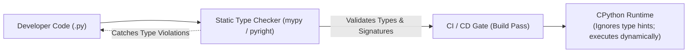
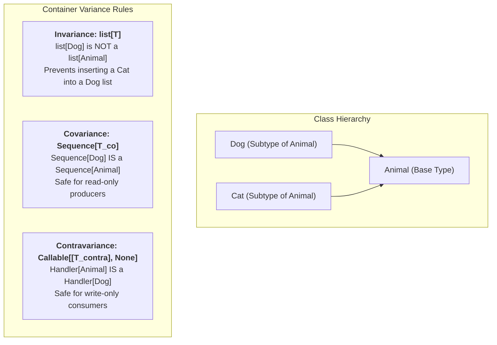
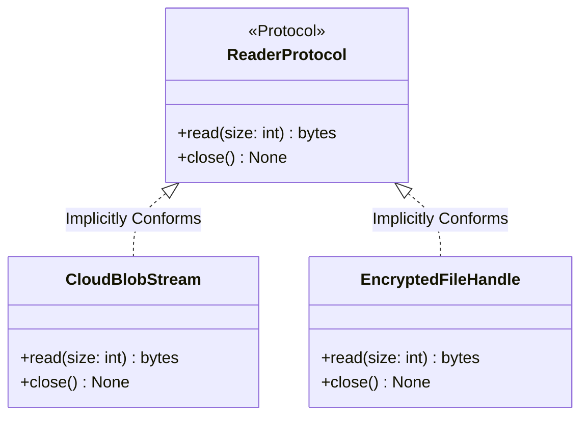

# Chapter 07: Type Systems, Protocols & Modern Python Architecture

> **What you will be able to do:** Architect large codebases using static type annotations, apply covariance and contravariance correctly with `TypeVar`, leverage PEP 695 generic syntax and PEP 544 Protocols for structural duck-typing, and type higher-order functions with `ParamSpec` and `Concatenate`.
> **What you must already know:** Chapter 04 OOP inheritance, duck typing, and abstract base classes.

---

> **Core Learning Objective:** Write robust, self-documenting, production-grade Python. Master gradual typing, covariant/contravariant generics, structural subtyping via `typing.Protocol`, Pydantic v2 data validation, and clean architectural separation.

---

## 1. The Modern Python Type System

Python remains a dynamically typed runtime, but large-scale enterprise codebases rely on **Static Type Analysis** (`mypy`, `pyright`) to eliminate entire categories of production bugs before deployment.



### Essential Typing Primitives (Python 3.10+)
```python
from typing import Literal, Annotated, Optional
from dataclasses import dataclass

# Modern Union syntax uses the pipe '|' operator instead of Union[X, Y]
def parse_status(code: int | str) -> bool:
    return str(code) == "200"

# Literal restricts values to specific exact constants
Environment = Literal["development", "staging", "production"]

def deploy(env: Environment) -> None:
    print(f"Deploying application to {env} cluster...")

# Annotated allows attaching rich metadata for validation frameworks
PositiveInt = Annotated[int, "Value must be strictly greater than 0"]
```

---

## 2. Generics & Variance Deep Dive: Invariance, Covariance, and Contravariance

Generics enable you to write reusable algorithms while preserving type safety across diverse data types. However, understanding **Variance** is what separates junior type users from principal system architects.



### 1. Invariance (`TypeVar('T')`)
Mutable containers must be invariant. If `list[Dog]` were accepted where `list[Animal]` is expected, the receiving function could legally append a `Cat`, corrupting the original list.

```python
from typing import TypeVar, Generic

T = TypeVar("T")  # Invariant by default

class BoundedStack(Generic[T]):
    def __init__(self, max_capacity: int = 100):
        self._items: list[T] = []
        self._max = max_capacity

    def push(self, item: T) -> None:
        if len(self._items) >= self._max:
            raise OverflowError("Stack is at maximum capacity.")
        self._items.append(item)

    def pop(self) -> T:
        if not self._items:
            raise IndexError("Stack is empty.")
        return self._items.pop()

int_stack: BoundedStack[int] = BoundedStack()
int_stack.push(42)
val: int = int_stack.pop()
assert val == 42
```

### 2. Covariance (`TypeVar('T_co', covariant=True)`)
Covariance applies to **read-only producers**. If a class only returns `T` and never accepts `T` as an argument, it can safely be covariant:

```python
from typing import TypeVar, Generic, Sequence

T_co = TypeVar("T_co", covariant=True)

class ReadOnlyStream(Generic[T_co]):
    def __init__(self, items: Sequence[T_co]):
        self._items = list(items)
        self._cursor = 0

    def next_item(self) -> T_co | None:
        if self._cursor >= len(self._items):
            return None
        val = self._items[self._cursor]
        self._cursor += 1
        return val

class Animal: pass
class Dog(Animal): pass

# A stream of Dogs can safely be passed to a function expecting a stream of Animals!
dog_stream: ReadOnlyStream[Dog] = ReadOnlyStream([Dog(), Dog()])
animal_stream: ReadOnlyStream[Animal] = dog_stream  # Valid under covariant typing
```

### 3. Contravariance (`TypeVar('T_contra', contravariant=True)`)
Contravariance applies to **write-only consumers / sinks**. If a function accepts an `Animal` to log or serialize it, it can safely process a `Dog`:

```python
from typing import TypeVar, Generic

T_contra = TypeVar("T_contra", contravariant=True)

class Sink(Generic[T_contra]):
    def consume(self, item: T_contra) -> None:
        print(f"Consumed: {item}")

# A sink that can consume ANY Animal can safely be used where a Dog sink is expected!
animal_sink: Sink[Animal] = Sink()
dog_sink: Sink[Dog] = animal_sink  # Valid under contravariant typing
```

---

## 3. Python 3.12 PEP 695: Modern Type Parameter Syntax

Python 3.12 revolutionized typing by eliminating the verbose `TypeVar` declarations in favor of inline square bracket syntax `[T]`:

```python
import sys

# Modern PEP 695 Generic Function (Python 3.12+)
# Before:
# T = TypeVar('T')
# def first(items: list[T]) -> T | None: ...

# In Python 3.12+, you can define generic functions and classes directly:
# def first[T](items: list[T]) -> T | None:
#     return items[0] if items else None

# PEP 695 Type Alias syntax:
# type JsonValue = None | bool | int | float | str | list[JsonValue] | dict[str, JsonValue]
# type Matrix[T] = list[list[T]]

# Backward-compatible equivalent for 3.10 - 3.11:
from typing import TypeAlias, Union, TypeVar

T = TypeVar("T")
Matrix: TypeAlias = list[list[T]]
```

---

## 4. Higher-Order Decorator Typing: `ParamSpec` & `Concatenate`

A major pain point in Python typing has always been typing decorators that preserve exact function argument signatures and return types. PEP 612 solved this with `ParamSpec` and `Concatenate`:

```python
from typing import Callable, TypeVar, ParamSpec, Concatenate
import functools
import time

P = ParamSpec("P")
R = TypeVar("R")

def timing_decorator(func: Callable[P, R]) -> Callable[P, R]:
    """Decorator that perfectly preserves argument types, keyword args, and return type."""
    @functools.wraps(func)
    def wrapper(*args: P.args, **kwargs: P.kwargs) -> R:
        start = time.perf_counter()
        result = func(*args, **kwargs)
        duration = time.perf_counter() - start
        # Preserves original function's IDE autocomplete and parameter names
        return result
    return wrapper

@timing_decorator
def calculate_tax(subtotal: float, rate: float = 0.08) -> float:
    return subtotal * rate

assert round(calculate_tax(100.0, 0.05), 2) == 5.0
```

### Injecting Dependencies with `Concatenate`
If a decorator consumes or injects an argument (such as an active database session or authentication context), use `Concatenate`:

```python
class DbContext:
    def execute(self, query: str) -> str:
        return f"result_of_{query}"

def with_db(func: Callable[Concatenate[DbContext, P], R]) -> Callable[P, R]:
    """Injects DbContext as the first argument, removing it from caller requirements."""
    @functools.wraps(func)
    def wrapper(*args: P.args, **kwargs: P.kwargs) -> R:
        ctx = DbContext()
        return func(ctx, *args, **kwargs)
    return wrapper

@with_db
def get_user_name(db: DbContext, user_id: int) -> str:
    return db.execute(f"SELECT name FROM users WHERE id = {user_id}")

# Caller does not pass 'db'; mypy verifies that user_id is the first required argument!
res = get_user_name(42)
assert res == "result_of_SELECT name FROM users WHERE id = 42"
```

---

## 5. Structural Subtyping: `typing.Protocol` (Formalized Duck Typing)

In classic OOP, a class must explicitly inherit from an Abstract Base Class (`class SqlDb(DatabaseABC): ...`) to be recognized as satisfying an interface (**Nominal Subtyping**).

**Structural Subtyping (`Protocol`)** decouples implementations: any class that possesses the required methods and attributes automatically satisfies the Protocol, **with zero inheritance needed**:



```python
from typing import Protocol, runtime_checkable

@runtime_checkable
class DocumentStorage(Protocol):
    """Any object with these methods satisfies this protocol."""
    def save(self, doc_id: str, payload: bytes) -> bool: ...
    def retrieve(self, doc_id: str) -> bytes | None: ...

# Independent implementation 1: S3 Storage (No inheritance from DocumentStorage!)
class S3Storage:
    def save(self, doc_id: str, payload: bytes) -> bool:
        return True
        
    def retrieve(self, doc_id: str) -> bytes | None:
        return b"file_contents"

# Independent implementation 2: Redis Storage (No inheritance!)
class RedisStorage:
    def save(self, doc_id: str, payload: bytes) -> bool:
        return True
        
    def retrieve(self, doc_id: str) -> bytes | None:
        return b"file_contents"

def persist_audit_log(storage: DocumentStorage, log_data: bytes) -> bool:
    return storage.save("audit_001", log_data)

# Both work seamlessly and pass static type checks!
assert persist_audit_log(S3Storage(), b"Login event") is True
assert persist_audit_log(RedisStorage(), b"Login event") is True
```

---

## 6. Runtime Model Trade-offs: TypedDict vs NamedTuple vs Dataclass vs Pydantic

When choosing a data container in production, understand the architectural trade-offs between memory footprint, validation overhead, and mutation safety:

| Structure | Memory Overhead | Creation Speed | Type Validation | Mutability | Ideal Production Use Case |
| :--- | :---: | :---: | :---: | :---: | :--- |
| **`dict` / `TypedDict`** | High ($\sim 232$ bytes) | Blazingly Fast ($<50$ ns) | Static Only | Mutable | High-throughput internal JSON maps |
| **`namedtuple`** | Minimal ($\sim 48$ bytes) | Fast ($\sim 80$ ns) | Static Only | Immutable | Lightweight read-only record sequences |
| **`dataclass(slots=True)`**| Minimal ($\sim 48$ bytes) | Fast ($\sim 100$ ns) | Static Only | Configurable | Domain entities, internal service state |
| **`pydantic.BaseModel`** | Moderate ($\sim 120$ bytes) | Moderate ($\sim 500$ ns)| Runtime Coercion | Configurable | Network boundaries, HTTP REST payloads |

```python
from dataclasses import dataclass
from typing import TypedDict, NamedTuple
import sys

class UserDict(TypedDict):
    id: int
    name: str

class UserTuple(NamedTuple):
    id: int
    name: str

@dataclass(slots=True)
class UserDataClass:
    id: int
    name: str

ud = UserDict(id=1, name="Alice")
ut = UserTuple(id=1, name="Alice")
uc = UserDataClass(id=1, name="Alice")

# Memory inspection:
assert sys.getsizeof(ut) <= sys.getsizeof(ud)
```

---

## 7. Enterprise Exception Hierarchies & Exception Groups

### 1. Unified Exception Trees
Never raise generic `Exception` or `RuntimeError` in production libraries. Define a domain-specific hierarchy:

```python
class AppBaseException(Exception):
    """Root exception for all application errors."""
    def __init__(self, message: str, error_code: str = "INTERNAL_ERROR"):
        super().__init__(message)
        self.error_code = error_code

class DatabaseError(AppBaseException):
    """Database query or connection failure."""

class RecordNotFoundError(DatabaseError):
    """Requested database entity does not exist."""

# Exception Chaining: Preserves root cause debug trace
try:
    try:
        raise ConnectionResetError("TCP socket closed by peer")
    except ConnectionResetError as root_err:
        raise DatabaseError("Unable to execute query", error_code="DB_UNAVAILABLE") from root_err
except DatabaseError as err:
    assert isinstance(err.__cause__, ConnectionResetError)
    assert err.error_code == "DB_UNAVAILABLE"
```

### 2. Exception Groups & `except*` (Python 3.11+)
When multiple concurrent tasks crash inside `asyncio.TaskGroup`, multiple independent exceptions occur simultaneously. Python handles this with **Exception Groups**:

```python
caught_types = []
try:
    raise ExceptionGroup(
        "Multiple background job failures",
        [
            ValueError("Invalid payload format"),
            ConnectionError("DB connection dropped"),
            ValueError("Negative value rejected")
        ]
    )
except* ValueError as eg:
    caught_types.append("ValueError")
    assert len(eg.exceptions) == 2
except* ConnectionError as eg:
    caught_types.append("ConnectionError")
    assert len(eg.exceptions) == 1

assert caught_types == ["ValueError", "ConnectionError"]
```

---

## Version Notes

- **Python 3.10**: Introduced union operator `X | Y` (PEP 604) replacing `Union[X, Y]`, `TypeGuard` (PEP 647), and `dataclass(slots=True, kw_only=True)`.
- **Python 3.11**: Introduced `typing.Self` (PEP 673), `typing.Never`, `typing.LiteralString` (PEP 675 for SQL injection mitigation), `dataclass_transform` (PEP 681), and native Exception Groups with `except*` (PEP 654).
- **Python 3.12**: Implemented PEP 695 type parameter syntax (`type Alias[T] = ...`, `def func[T](...)`), and `typing.override` decorator (PEP 698) to verify base class method overrides.
- **Python 3.13**: Implemented TypeVar defaults (PEP 696), `typing.TypeIs` (PEP 742 narrower type predicates), and `warnings.deprecated` decorator (PEP 702).
- **Python 3.14**: Deferred evaluation of annotations (PEP 649 / PEP 749) makes `from __future__ import annotations` obsolete, inspecting annotations lazily only when requested via `annotationlib`.

---

## Exercises

Three graded exercises for this chapter (two coding, one debugging) with hidden tests:

```bash
python exercises/run.py --init   # once: creates exercises/ch07.py stubs
python exercises/run.py 07       # run the hidden tests against your solution
```

Attempt first; the reference solutions are in `exercises/_answers/ch07.py`.

---

## Further Reading

- [PEP 484: Type Hints](https://peps.python.org/pep-0484/)
- [PEP 544: Protocols: Structural Subtyping](https://peps.python.org/pep-0544/)
- [PEP 612: Parameter Specification Variables (ParamSpec)](https://peps.python.org/pep-0612/)
- [PEP 695: Type Parameter Syntax](https://peps.python.org/pep-0695/)
- [PEP 649: Deferred Evaluation of Annotations](https://peps.python.org/pep-0649/)

---

## Check Yourself

Answer in your head or on paper first, then open each answer.

<details>
<summary><strong>1.</strong> Does the interpreter enforce type hints at runtime?</summary>

No. Hints are metadata checked by tools such as mypy/pyright (or libraries like Pydantic that choose to validate).

</details>

<details>
<summary><strong>2.</strong> What does `Protocol` give you that an abstract base class does not?</summary>

Structural subtyping: any class with the right methods satisfies it without inheriting from it.

</details>

<details>
<summary><strong>3.</strong> When would you use a `dataclass(frozen=True, slots=True)`?</summary>

For immutable, hashable, memory-light value objects; `frozen` blocks assignment and `slots` removes the per-instance dict.

</details>

<details>
<summary><strong>4.</strong> What is `TypeVar` variance and why does `list[T]` have to be invariant?</summary>

Variance determines how subtyping between type arguments relates to subtyping between generic containers. `list[T]` must be invariant because it is mutable: if `list[Dog]` were accepted as `list[Animal]`, code could insert a `Cat` into it, violating type safety.

</details>
