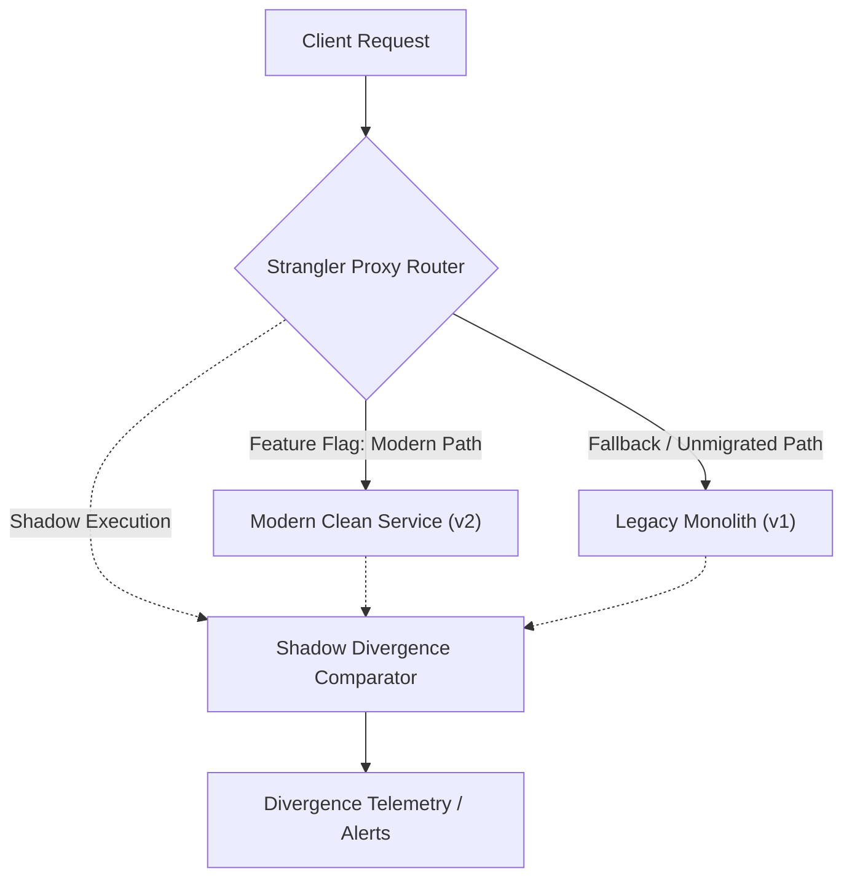
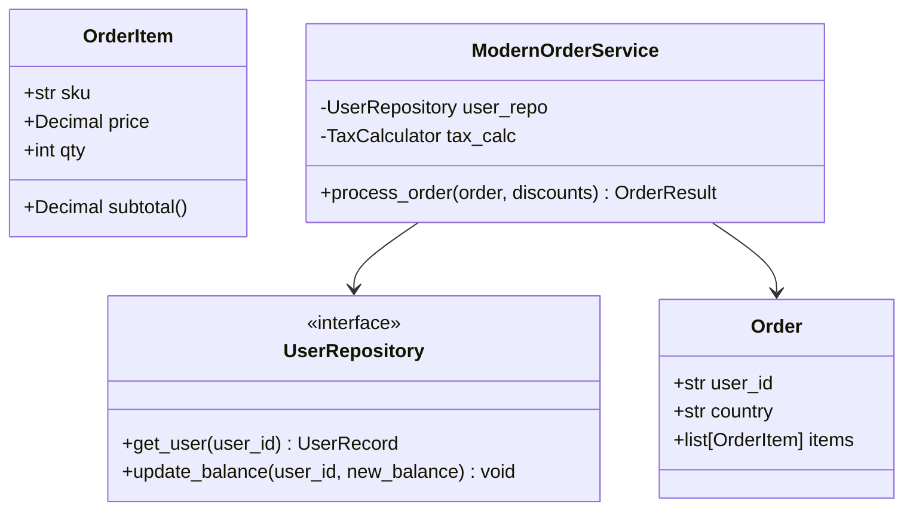

# Chapter 11: Legacy Monolith Refactoring & Break-Fix Engineering Lab

> **What you will be able to do:** Safely refactor high-risk brownfield Python monoliths using the Strangler Fig pattern, implement shadow validation pipelines with divergence metrics, automate codebase transforms using Python's `ast` module, and eliminate dead code safely with zero downtime.
> **What you must already know:** Chapter 07 static typing contracts and Chapter 09 automated regression testing suites.

---

> **Brownfield vs. Greenfield**
> In school and online tutorials, you always start with an empty `main.py`. In an enterprise role, you will almost never touch an empty file. You will inherit a 1,500-line function written four years ago by an engineer who left the company, full of mutable defaults, hidden global mutations, unhandled exception swallows, and zero unit tests.
> 
> This lab teaches you the principal engineer's methodology for refactoring hazardous legacy code into pristine, testable, modern Python without causing a production outage.

---

## 1. The Hazardous Legacy Codebase

Examine this order processing script taken from an actual real-world legacy code pattern:

```python
# legacy_order_processor.py
import datetime
import smtplib
import sqlite3

# HAZARD 1: Global mutable state
GLOBAL_TAX_CACHE = {}
TOTAL_ORDERS_PROCESSED = 0

class OrderProcessor:
    # HAZARD 2: Mutable default argument!
    def __init__(self, db_conn=None, discounts=[]):
        self.db = db_conn
        self.discounts = discounts  # Mutating this will poison all instances!

    # HAZARD 3: God-method with high cyclomatic complexity (Nested 5 levels deep)
    def process(self, order_data):
        global TOTAL_ORDERS_PROCESSED
        TOTAL_ORDERS_PROCESSED += 1

        # HAZARD 4: Hardcoded direct DB coupling
        if not self.db:
            self.db = sqlite3.connect(":memory:")  # default safe fallback
        
        cursor = self.db.cursor()
        
        # HAZARD 5: SQL Injection vulnerability via string formatting
        user_query = f"SELECT balance, email FROM users WHERE id = '{order_data['user_id']}'"
        cursor.execute(user_query)
        user = cursor.fetchone()
        
        if user:
            balance = user[0]
            email = user[1]
            total = 0.0
            for item in order_data['items']:
                total += item['price'] * item.get('qty', 1)

            # Apply discounts
            for d in self.discounts:
                total -= d

            # HAZARD 6: Hidden side effect mutating a global cache
            if order_data.get('country') not in GLOBAL_TAX_CACHE:
                if order_data.get('country') == "CA":
                    GLOBAL_TAX_CACHE["CA"] = 0.13
                else:
                    GLOBAL_TAX_CACHE[order_data.get('country')] = 0.05
            
            tax_rate = GLOBAL_TAX_CACHE[order_data.get('country')]
            total += total * tax_rate

            if balance >= total:
                new_balance = balance - total
                cursor.execute(f"UPDATE users SET balance = {new_balance} WHERE id = '{order_data['user_id']}'")
                self.db.commit()

                # HAZARD 7: External network call inside the transaction loop
                try:
                    # Simulated network call
                    pass
                except Exception:
                    # HAZARD 8: Silent error swallowing!
                    pass 
                
                return {"status": "SUCCESS", "total": total, "remaining_balance": new_balance}
            else:
                return {"status": "INSUFFICIENT_FUNDS"}
        else:
            return {"status": "USER_NOT_FOUND"}
```

---

## 2. Characterization Tests (Pinning the Legacy Baseline)

> [!CAUTION]
> **Never refactor code without a safety net.**
> Before altering a single character of production code, write **Characterization Tests** (also called "Pinning Tests"). The goal is not to test what the code *should* do, but to lock down what it *currently* does, bugs and all, so any behavioral change is immediately flagged.

```python
# continues from legacy_order_processor above
import sqlite3

def run_characterization_test():
    # Setup isolated in-memory db
    conn = sqlite3.connect(":memory:")
    c = conn.cursor()
    c.execute("CREATE TABLE users (id TEXT, balance REAL, email TEXT)")
    c.execute("INSERT INTO users VALUES ('u1', 100.0, 'alice@example.com')")
    c.execute("INSERT INTO users VALUES ('u2', 10.0, 'bob@example.com')")
    conn.commit()

    GLOBAL_TAX_CACHE.clear()
    proc = OrderProcessor(db_conn=conn, discounts=[5.0])
    
    order = {
        "user_id": "u1",
        "country": "CA",
        "items": [{"price": 20.0, "qty": 2}]
    }
    
    res = proc.process(order)
    assert res["status"] == "SUCCESS"
    assert round(res["total"], 2) == 39.55
    assert round(res["remaining_balance"], 2) == 60.45
    print("Characterization test passed: baseline behavior pinned.")

run_characterization_test()
```

---

## 3. The Strangler Fig Pattern: Zero-Downtime Migration

The **Strangler Fig Pattern** incrementally replaces legacy system components by creating a routing proxy that diverts traffic to modern implementations while leaving unmigrated paths untouched.



### Runnable Strangler Proxy with Shadow Execution
```python
import logging
from typing import Any, Callable, Dict

class StranglerProxyRouter:
    """Routes requests between legacy and modern paths with shadow validation."""
    def __init__(self, legacy_fn: Callable, modern_fn: Callable, rollout_percentage: float = 0.0):
        self.legacy_fn = legacy_fn
        self.modern_fn = modern_fn
        self.rollout_percentage = rollout_percentage
        self.divergence_count = 0

    def execute(self, payload: Dict[str, Any], user_id_int: int) -> Dict[str, Any]:
        use_modern = (user_id_int % 100) < (self.rollout_percentage * 100)
        
        # In shadow mode or canary rollout:
        if use_modern:
            try:
                return self.modern_fn(payload)
            except Exception as e:
                # Automatic fail-safe fallback to legacy if modern errors!
                logging.error(f"Modern path failed, falling back to legacy: {e}")
                return self.legacy_fn(payload)
        else:
            legacy_res = self.legacy_fn(payload)
            # Run modern in shadow mode to compare divergence without user impact
            self._shadow_compare(payload, legacy_res)
            return legacy_res

    def _shadow_compare(self, payload: Dict[str, Any], legacy_res: Dict[str, Any]):
        try:
            modern_res = self.modern_fn(payload)
            # Verify status matches
            if legacy_res.get("status") != modern_res.get("status"):
                self.divergence_count += 1
                logging.warning(f"Shadow divergence detected! Legacy={legacy_res} Modern={modern_res}")
        except Exception:
            self.divergence_count += 1

def legacy_calc(data): return {"status": "SUCCESS", "val": data["x"] * 2}
def modern_calc(data): return {"status": "SUCCESS", "val": data["x"] * 2}

router = StranglerProxyRouter(legacy_calc, modern_calc, rollout_percentage=0.5)
assert router.execute({"x": 10}, user_id_int=10)["val"] == 20
assert router.execute({"x": 10}, user_id_int=80)["val"] == 20
assert router.divergence_count == 0
```

---

## 4. Automated Codebase Modernization: AST Codemods

When modernizing thousands of files across an enterprise repository, manual edits introduce human error. Staff engineers write automated **AST Codemods** using Python's standard `ast` module.

### Automated Transformer: Fixing Mutable Default Arguments
Below is a complete, runnable AST script that detects functions with mutable list/dict defaults (`def func(items=[]):`) and rewrites them into safe defaults (`def func(items=None):`):

```python
import ast

class MutableDefaultFixer(ast.NodeTransformer):
    """Replaces mutable default arguments `x=[]` or `x={}` with `x=None`."""
    def visit_FunctionDef(self, node: ast.FunctionDef) -> ast.AST:
        self.generic_visit(node)
        new_defaults = []
        for default in node.args.defaults:
            if isinstance(default, (ast.List, ast.Dict, ast.Set)):
                # Replace with None
                new_defaults.append(ast.Constant(value=None))
            else:
                new_defaults.append(default)
        node.args.defaults = new_defaults
        return node

# Test code containing the classic anti-pattern:
source_code = """
def fetch_users(query, cache=[], tags={}):
    pass
"""

tree = ast.parse(source_code)
transformer = MutableDefaultFixer()
modified_tree = transformer.visit(tree)
ast.fix_missing_locations(modified_tree)

# Convert AST back to clean Python code (Python 3.9+)
clean_code = ast.unparse(modified_tree)
assert "cache=None" in clean_code
assert "tags=None" in clean_code
print("AST Codemod successfully transformed source:")
print(clean_code)
```

---

## 5. The Pristine Refactored Architecture

Using Dependency Injection, Protocols, and exact `Decimal` arithmetic:



```python
from dataclasses import dataclass
from decimal import Decimal, ROUND_HALF_UP
from enum import Enum
from typing import Protocol, Sequence, Optional

class OrderStatus(str, Enum):
    SUCCESS = "SUCCESS"
    INSUFFICIENT_FUNDS = "INSUFFICIENT_FUNDS"
    USER_NOT_FOUND = "USER_NOT_FOUND"

@dataclass(frozen=True)
class OrderItem:
    sku: str
    price: Decimal
    qty: int = 1

    @property
    def subtotal(self) -> Decimal:
        return self.price * self.qty

@dataclass(frozen=True)
class UserRecord:
    id: str
    balance: Decimal
    email: str

class UserRepository(Protocol):
    def get_user(self, user_id: str) -> Optional[UserRecord]: ...
    def update_balance(self, user_id: str, new_balance: Decimal) -> None: ...

class InMemoryUserRepo:
    def __init__(self):
        self._users = {"u1": UserRecord("u1", Decimal("100.00"), "a@test.com")}

    def get_user(self, user_id: str) -> Optional[UserRecord]:
        return self._users.get(user_id)

    def update_balance(self, user_id: str, new_balance: Decimal) -> None:
        if user_id in self._users:
            old = self._users[user_id]
            self._users[user_id] = UserRecord(old.id, new_balance, old.email)

repo = InMemoryUserRepo()
assert repo.get_user("u1").balance == Decimal("100.00")
```

---

## 6. Dead Code Hunting & Zero-Downtime Database Migration

### 1. Dead Code Elimination
1. **Dynamic Profiling**: Run branch coverage in production with low-overhead tracing (`coverage.py` or statistical eBPF sampling) to identify code branches never executed in 90 days.
2. **Static Dead Code Analysis**: Use `vulture` to locate unused classes, unreachable functions, and orphaned imports.
3. **Feature Flag Sunset Policy**: Every feature flag must have a mandatory expiration timestamp; once a flag reaches 100% rollout for 14 days, schedule an automated codemod to rip out the conditional branches.

### 2. Zero-Downtime Schema Evolution (Expand & Contract)
When refactoring database schemas:
1. **Expand**: Add the new column or table without removing the old column.
2. **Dual-Write**: Write application code to update both old and new columns simultaneously.
3. **Backfill**: Run asynchronous background worker batches to copy historical data from old to new.
4. **Contract**: Switch reads to the new column; remove the old column only after verified production telemetry.

---

## Version Notes

- **Python 3.9**: Introduced `ast.unparse()` in the standard library, enabling native source-to-source code transformations and automated codemods without external dependencies like `astor`.
- **Python 3.10**: Introduced `match` statements (PEP 634), allowing structural pattern matching on AST nodes and legacy event dictionaries.
- **Python 3.11**: Enhanced tracebacks highlight exact expression spans (`^^^`), accelerating pinpointing of `NoneType` attribute errors in sprawling legacy call stacks.
- **Python 3.12**: Improved compiler warnings for deprecated legacy APIs (`w` flag) and added subinterpreters for isolated legacy component execution.
- **Python 3.14**: Deferred annotation evaluation (PEP 649 / PEP 749) guarantees that refactoring type hints no longer causes runtime circular import crashes.

---

## Exercises

Three graded exercises for this chapter (two coding, one debugging) with hidden tests:

```bash
python exercises/run.py --init   # once: creates exercises/ch11.py stubs
python exercises/run.py 11       # run the hidden tests against your solution
```

Attempt first; the reference solutions are in `exercises/_answers/ch11.py`.

---

## Further Reading

- [Martin Fowler: Strangler Fig Application Pattern](https://martinfowler.com/bliki/StranglerFigApplication.html)
- [Michael Feathers: Working Effectively with Legacy Code](https://www.oreilly.com/library/view/working-effectively-with/0131177052/)
- [Python AST Documentation](https://docs.python.org/3/library/ast.html)

---

## Check Yourself

Answer in your head or on paper first, then open each answer.

<details>
<summary><strong>1.</strong> Why write characterization tests before refactoring legacy code?</summary>

They pin down current behaviour so you can refactor safely and detect unintended changes.

</details>

<details>
<summary><strong>2.</strong> What is the 'strangler fig' approach?</summary>

Route new behaviour to new code path by path while the old code keeps serving the rest, until the old code can be removed.

</details>

<details>
<summary><strong>3.</strong> What is a seam?</summary>

A place where you can alter behaviour without editing the code under test (dependency injection point, overridable method).

</details>

<details>
<summary><strong>4.</strong> How does an AST NodeTransformer automate codebase refactoring?</summary>

It parses source code into a tree structure, traverses and transforms specific nodes (e.g., swapping mutable defaults for None), and outputs pristine source code via `ast.unparse()`.

</details>
