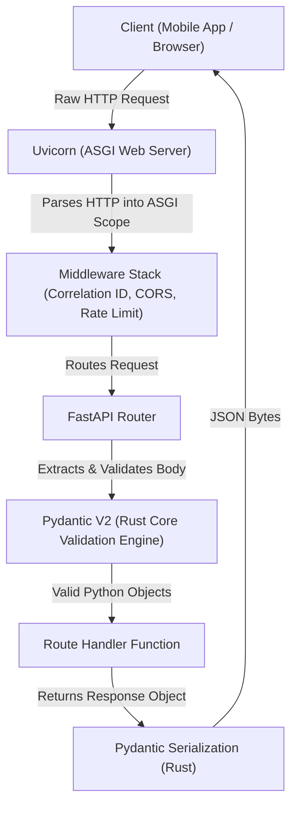
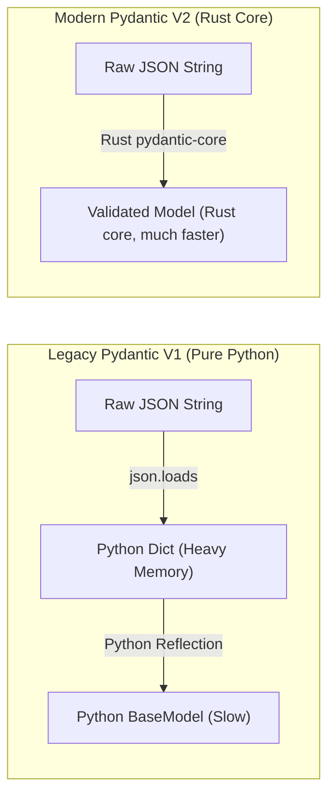
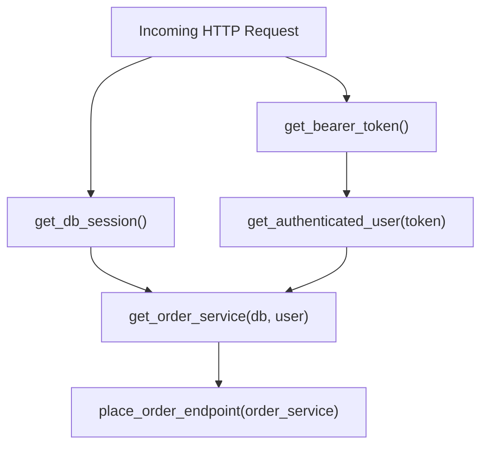
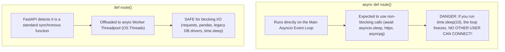
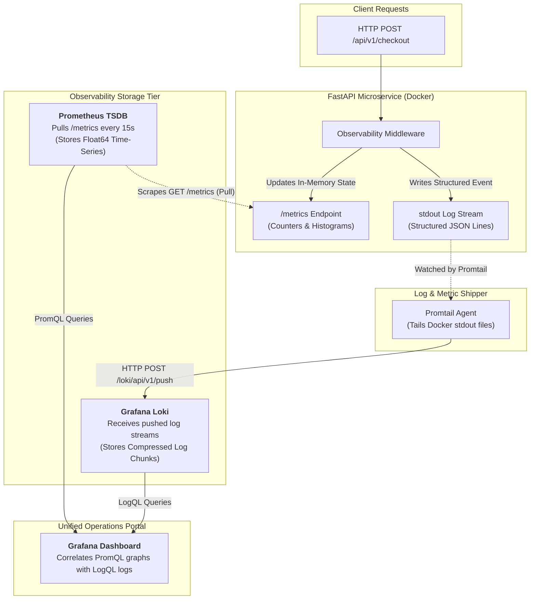

# Chapter 13: High-Performance Web Architecture (ASGI, FastAPI & Pydantic V2)

> **What you will be able to do:** Architect production ASGI web services using FastAPI and Uvicorn, implement ultra-fast data validation and serialization pipelines with Rust-backed Pydantic V2, manage lifespan events, and configure production worker concurrency.
> **What you must already know:** Chapter 06 asyncio coroutines, Chapter 07 type annotations, and HTTP request/response fundamentals.

---

> **Zero-Prerequisite Intuition: The "Michelin-Star Kitchen Assembly Line"**
> What actually happens when you open an app on your phone and tap "Order Food"?
> 
> Your phone sends a small digital letter across the internet to a server in the cloud. That letter is an **HTTP Request**. The server must read it, check if your credit card and address are valid, save the order to a database, and send back a receipt.
> 
> If you have 50,000 people ordering lunch at 12:00 PM simultaneously, how does a Python server survive without crashing or freezing?
> 
> * **Uvicorn (The Front Door & Host):** Stands at the restaurant entrance. When hundreds of guests arrive every second, the host greets them immediately, takes their order slip, and seats them without making anyone wait outside in the rain (the non-blocking **ASGI event loop**).
> * **FastAPI (The Head Chef & Dispatcher):** Reads the ticket and instantly routes it to the exact cooking station prepared for it. It also automatically generates a visual menu manual (**OpenAPI / Swagger docs**) so everyone knows what dishes are possible.
> * **Pydantic V2 (The High-Speed Robotic Health Inspector):** Before any ingredient touches a pan, an ultra-fast automated scanner inspects every item in microseconds. If a diner requested a pizza but wrote their phone number in the "credit card" box, this inspector catches the mistake in $0.00001$ seconds and hands back a helpful error message before the kitchen wastes any time cooking it (powered by **Rust** under the hood).
> * **The Cooks (`async def` vs `def`):** 
>   - The quick cooks stay on the main line sautéing dishes that take 2 milliseconds (`async def` coroutines running directly on the event loop).
>   - The slow cooks who must do heavy 20-minute manual potato peeling are sent to a separate back room so they never block the main kitchen counter (`def` synchronous functions offloaded to background worker threads).

---

## 1. What is an API and What is ASGI? (Spoon-Fed Foundations)

Before diving into complex architectures, let's establish fundamental clarity:

### The Jargon Demystified
1. **API (Application Programming Interface):** A set of defined rules that allows two computer programs to talk to each other. For example, your React mobile app asking your Python server: *"Please give me user #42's profile."*
2. **JSON (JavaScript Object Notation):** A universal text format for sending data across the web. It looks like a standard Python dictionary: `{"name": "Alice", "age": 30}`.
3. **Serialization:** Converting an in-memory Python object into a string of bytes or JSON text so it can travel across a network cable.
4. **Deserialization (Parsing):** Taking raw JSON text from a network cable and reconstructing it into a validated Python object in memory.
5. **WSGI vs ASGI:**
   - **WSGI (Web Server Gateway Interface - Old standard, e.g., Flask/Django):** Handles one request per OS thread. If a request waits 3 seconds for a slow third-party payment gateway, that entire thread sits idle doing nothing, blocking other users.
   - **ASGI (Asynchronous Server Gateway Interface - Modern standard, e.g., FastAPI/Starlette):** Handles thousands of concurrent connections on a single thread by pausing idle requests (`await`) and switching instantly to serve someone else.



### The Raw ASGI Protocol Specification (Zero-Framework Foundations)

You do not need FastAPI to write an asynchronous web application! Underneath all frameworks, the entire ASGI protocol is just a **single asynchronous Python function accepting three arguments**:

1. **`scope`:** A dictionary containing connection metadata (HTTP method, headers, URL path, query parameters).
2. **`receive`:** An async callable to read incoming request body bytes.
3. **`send`:** An async callable to stream response headers and body bytes back to Uvicorn.

```python
# raw_asgi_app.py
import json

async def barebones_asgi_app(scope, receive, send):
    """
    This is what Uvicorn executes under the hood!
    """
    assert scope["type"] in ("http", "websocket")

    if scope["type"] == "http":
        method = scope["method"]
        path = scope["path"]

        # Basic Path Routing
        if path == "/api/v1/health" and method == "GET":
            payload = json.dumps({"status": "HEALTHY", "engine": "Raw ASGI"}).encode("utf-8")
            
            # Step 1: Send HTTP Response Headers
            await send({
                "type": "http.response.start",
                "status": 200,
                "headers": [
                    [b"content-type", b"application/json"],
                    [b"content-length", str(len(payload)).encode("utf-8")]
                ]
            })

            # Step 2: Stream Response Body Bytes
            await send({
                "type": "http.response.body",
                "body": payload,
                "more_body": False
            })
        else:
            # 404 Route Not Found
            await send({
                "type": "http.response.start",
                "status": 404,
                "headers": [[b"content-type", b"text/plain"]]
            })
            await send({
                "type": "http.response.body",
                "body": b"404 Route Not Found",
                "more_body": False
            })

# You can launch this raw server directly in terminal:
# uvicorn raw_asgi_app:barebones_asgi_app --port 8000
```

### The Onion Middleware Chain
When you add middleware, it wraps around the inner ASGI application like layers of an onion:

```python
class TimingMiddleware:
    """Wraps any ASGI application to measure exact processing latency."""
    def __init__(self, inner_app):
        self.inner_app = inner_app

    async def __call__(self, scope, receive, send):
        if scope["type"] != "http":
            await self.inner_app(scope, receive, send)
            return

        import time
        start_time = time.perf_counter()

        async def send_wrapper(message):
            if message["type"] == "http.response.start":
                duration_ms = (time.perf_counter() - start_time) * 1000
                headers = list(message.get("headers", []))
                headers.append([b"x-latency-ms", f"{duration_ms:.2f}".encode("utf-8")])
                message["headers"] = headers
            await send(message)

        await self.inner_app(scope, receive, send_wrapper)
```

Now that you understand raw ASGI, you can see why **FastAPI** exists: writing raw dictionary parsers and manual `send()` calls for 50 endpoints becomes unmaintainable. FastAPI provides declarative routing, dependency injection, and automatic OpenAPI generation on top of this exact ASGI foundation.

---

## 2. Pydantic V2 Internals: The Rust Revolution

In Python web servers, data validation used to be a major performance bottleneck. In Pydantic V1 (pure Python), validating complex nested objects took up to **60% of the entire request time**.

In **Pydantic V2**, the entire core engine was rewritten in **Rust** (`pydantic-core`). 

### Why Rust Makes Validation Faster
Python is dynamic: every time it accesses an attribute, it performs hash table lookups, reference count increments, and type checks. 
Rust compiles directly to native CPU machine instructions. When raw JSON arrives, `pydantic-core` scans the bytes directly in C/Rust memory without creating millions of intermediate temporary Python string and dictionary objects on the heap.



### Building Your First Bulletproof Schema

Let's see how an entry-level developer writes a schema, and how a staff engineer elevates it to production standards:

```python
# schema_mastery.py
from datetime import datetime
from typing import Annotated
from uuid import UUID, uuid4
from pydantic import (
    BaseModel, 
    Field, 
    EmailStr, 
    field_validator, 
    model_validator, 
    ConfigDict
)

# -------------------------------------------------------------
# STEP 1: The Production Base Model
# -------------------------------------------------------------
class ProductionSchema(BaseModel):
    """Base schema enforcing enterprise safety rules across all child models."""
    model_config = ConfigDict(
        # 1. frozen=True makes instances immutable. Once created, nobody can
        # accidentally overwrite fields later in the code. Thread-safe!
        frozen=True,
        
        # 2. Automatically trims accidental leading/trailing whitespace ("  alice@mail.com " -> "alice@mail.com")
        str_strip_whitespace=True,
        
        # 3. extra='forbid' rejects unexpected fields. If a malicious client sends
        # {"is_admin": True} when registering, Pydantic immediately rejects it!
        extra="forbid",
        
        # 4. Allows reading data directly from database ORM models (SQLAlchemy)
        from_attributes=True
    )

# -------------------------------------------------------------
# STEP 2: The Domain Model with Rich Constraints
# -------------------------------------------------------------
class UserCreateRequest(ProductionSchema):
    # UUID automatically generated if omitted
    correlation_id: UUID = Field(default_factory=uuid4)
    
    # EmailStr automatically verifies email formatting (RFC 5322 standard)
    email: EmailStr
    
    # Annotated with Field allows declaring constraints right alongside types
    username: Annotated[str, Field(
        min_length=3, 
        max_length=24, 
        pattern=r"^[a-zA-Z0-9_-]+$",
        description="Alphanumeric username with underscores or dashes"
    )]
    
    age: int = Field(ge=18, le=120, description="Users must be at least 18 years old")
    subscription_plan: str = Field(default="FREE")

    # -------------------------------------------------------------
    # STEP 3: Field-Level Custom Validation
    # -------------------------------------------------------------
    @field_validator("username")
    @classmethod
    def prevent_system_impersonation(cls, value: str) -> str:
        """Runs immediately after basic type checking. Rejects reserved names."""
        forbidden_names = {"admin", "root", "system", "moderator", "support"}
        if value.lower() in forbidden_names:
            raise ValueError(f"The username '{value}' is reserved for internal system use.")
        return value.lower()

    # -------------------------------------------------------------
    # STEP 4: Model-Level Cross-Field Validation
    # -------------------------------------------------------------
    @model_validator(mode="after")
    def validate_enterprise_domains(self) -> "UserCreateRequest":
        """Runs after all individual fields are verified to check cross-field rules."""
        if self.subscription_plan == "ENTERPRISE" and not self.email.endswith((".com", ".org", ".io")):
            raise ValueError("Enterprise accounts must register with a corporate top-level domain.")
        return self
```

### High-Throughput Batch Validation with `TypeAdapter`
What if you need to validate a list of 50,000 user IDs coming from an external microservice? Instantiating a `BaseModel` for each ID would waste CPU cycles. Pydantic V2 provides **`TypeAdapter`**:

```python
from pydantic import TypeAdapter
from uuid import UUID

# Direct compilation of a list validator straight into Rust memory
batch_uuid_validator = TypeAdapter(list[UUID])

raw_json = '["550e8400-e29b-41d4-a716-446655440000", "c9bf9e57-1685-4c89-bafb-ff5af830be8a"]'

# Validates in a fraction of a millisecond!
validated_ids: list[UUID] = batch_uuid_validator.validate_json(raw_json)
print(f"Validated {len(validated_ids)} UUIDs directly from raw JSON bytes.")
```

---

## 3. Dependency Injection: The Cleanest Architecture Pattern

### What is Dependency Injection (DI)? (Spoon-Fed)
Imagine you are a chef making a cake. 
* **Without Dependency Injection:** In the middle of baking, you stop, walk outside, buy a cow, milk the cow, refine sugar, and build an oven from bricks. Your cake recipe is tightly coupled to everything in the world!
* **With Dependency Injection:** You simply say: *"Whoever asks for a cake must hand me 2 eggs, 1 cup of milk, and a preheated oven."*

In FastAPI, **`Depends()`** is how your route functions ask for what they need (a database connection, the authenticated user, or a configuration object). FastAPI automatically finds those dependencies, prepares them, hands them to your function, and cleans them up when your function finishes!



### Context-Managed Yield Dependencies (Zero Resource Leaks)
How do we guarantee that a database connection is **always closed**, even if our code crashes halfway through processing? We use a Python generator with `yield`:

```python
# dependencies_deep_dive.py
from typing import AsyncGenerator, Annotated
from fastapi import FastAPI, Depends, HTTPException, status

app = FastAPI()

class DatabaseConnection:
    """Simulated production database connection."""
    def __init__(self):
        self.is_open = True
    
    async def query(self, sql: str) -> str:
        return f"Executed: {sql}"
    
    async def close(self):
        self.is_open = False
        print("[DATABASE] Connection cleanly returned to pool.")

# -------------------------------------------------------------
# Yield Dependency: Guarantees Setup & Automatic Teardown
# -------------------------------------------------------------
async def get_db_connection() -> AsyncGenerator[DatabaseConnection, None]:
    # 1. SETUP: Runs before the route handler starts
    conn = DatabaseConnection()
    print("[DATABASE] Connection acquired from pool.")
    try:
        # Hand the connection to the route function
        yield conn
    finally:
        # 2. TEARDOWN: This 'finally' block ALWAYS runs!
        # Even if the route raises an unhandled exception or crashes!
        await conn.close()

# -------------------------------------------------------------
# Secondary Dependency: Authenticating Current User
# -------------------------------------------------------------
async def get_current_user(token: str = "mock_secret_token") -> dict:
    if token != "mock_secret_token":
        raise HTTPException(
            status_code=status.HTTP_401_UNAUTHORIZED,
            detail="Invalid security credentials"
        )
    return {"user_id": 42, "role": "admin"}

# -------------------------------------------------------------
# The Route: Notice how clean and readable it is!
# -------------------------------------------------------------
@app.get("/profile")
async def view_profile(
    user: Annotated[dict, Depends(get_current_user)],
    db: Annotated[DatabaseConnection, Depends(get_db_connection)]
):
    data = await db.query(f"SELECT * FROM profiles WHERE user_id = {user['user_id']}")
    return {"user": user, "data": data}
```

---

## 4. The Concurrency Death Trap: `async def` vs `def`

This is the **#1 question asked in Staff Python Web Architecture interviews**, and the #1 source of catastrophic production outages.

> **The Question:** *"FastAPI supports both `def` and `async def` route functions. What happens under the hood when you use each one?"*



### The Plain-English Explanation:
1. **The Event Loop is a Single Waiter:**
   In an `async def` function, the waiter (event loop) takes your order. When you say `await cook_pizza()`, the waiter doesn't stand staring at the oven; he turns around and takes orders from 100 other customers. When the oven dings, he returns to you.
2. **The Disaster:**
   If you write `async def` and inside it you run `time.sleep(10)` or `requests.get("https://slow-api.com")`, you just grabbed the waiter by his shirt collar and forced him to stand still for 10 seconds. **Every single customer in the entire restaurant must now wait in total silence.** Your server appears completely dead!
3. **The Threadpool Solution:**
   When you write a normal synchronous `def route()`, FastAPI knows this function might block. It automatically takes that function and hands it to a separate background OS worker thread (`anyio.to_thread.run_sync`). The event loop stays free!

### Code Demonstration: Spotting the Bug Before It Takes Down Production

```python
import time
import asyncio
from fastapi import FastAPI
import requests # Synchronous blocking library!
import httpx    # Asynchronous non-blocking library!

app = FastAPI()

# ❌ FATAL DISASTER: Blocks all other concurrent users on the server!
@app.get("/bad-blocking-async")
async def catastrophic_endpoint():
    # Calling blocking synchronous I/O inside 'async def'
    time.sleep(5) # FREEZES the entire server!
    return {"message": "You just froze the event loop for everyone"}

# ✅ CORRECT: Let FastAPI push synchronous blocking work to a threadpool
@app.get("/safe-sync-endpoint")
def safe_sync_endpoint():
    # Because this is 'def', FastAPI runs it in an OS threadpool
    time.sleep(5) # Safe! Other async users are unaffected.
    return {"message": "Processed safely in background thread"}

# ✅ GOLD STANDARD: Pure asynchronous non-blocking I/O
@app.get("/safe-async-endpoint")
async def ultra_fast_async_endpoint():
    # Cooperative multitasking: yields control back to event loop
    await asyncio.sleep(5)
    return {"message": "Ultra-scalable non-blocking operation"}
```

---

## 5. Modern Lifespan Protocol: Post-Fork Safe State

In legacy applications, developers used `@app.on_event("startup")` to initialize databases. This is deprecated. Modern enterprise Python uses the **ASGI Lifespan Protocol** (PEP 553 / ASGI 3.0).

### Why Lifespan Matters: The Fork Safety Trap
When you run a web server in production with 4 workers:
```bash
uvicorn main:app --workers 4
```
The master Python process starts, and then creates child processes using `os.fork()`.
* If you opened database connections or Redis sockets at the module level (outside lifespan), **all 4 worker processes inherit the exact same socket file descriptor!**
* They will start reading and writing over each other's TCP packets. Customer A will see Customer B's bank account, or queries will crash with mysterious `SSL SYSCALL error: EOF detected`.

The Lifespan context manager runs **inside each individual child process after the fork**, ensuring 100% isolated, safe connection pools:

```python
# lifespan_manager.py
from contextlib import asynccontextmanager
from typing import AsyncGenerator
from fastapi import FastAPI, Request

class ProductionState:
    """Holds long-lived connections for the worker process."""
    def __init__(self):
        self.db_pool = None
        self.redis_client = None

# -------------------------------------------------------------
# The ASGI Lifespan Context Manager
# -------------------------------------------------------------
@asynccontextmanager
async def lifespan_handler(app: FastAPI) -> AsyncGenerator[dict, None]:
    # ==================== STARTUP PHASE ====================
    print("[LIFESPAN] Worker process starting up...")
    print("[LIFESPAN] Initializing isolated DB connection pool...")
    db_pool = {"connection_limit": 50, "status": "READY"}
    
    # We yield a dictionary of state objects.
    # FastAPI attaches this dictionary directly to request.state!
    yield {"db_pool": db_pool}
    
    # ==================== SHUTDOWN PHASE ====================
    # Runs when Uvicorn receives a termination signal (SIGTERM/SIGINT)
    print("[LIFESPAN] SIGTERM received. Draining active requests...")
    print("[LIFESPAN] Closing all open database connections...")
    db_pool["status"] = "CLOSED"
    print("[LIFESPAN] Clean shutdown complete.")

app = FastAPI(lifespan=lifespan_handler)

@app.get("/health")
async def health_check(request: Request):
    # Access state safely without global variables!
    pool = request.state.db_pool
    return {"server_status": "UP", "database": pool["status"]}
```

---

## 6. End-to-End Industrial Microservice Blueprint

Here is a complete, production-grade microservice incorporating:
1. Global distributed tracing (`X-Correlation-ID`)
2. Response timing headers (`X-Response-Time`)
3. Immutability and strict validation with Pydantic V2
4. Scoped dependency injection
5. Centralized unhandled error capture

```python
# microservice_app.py
import time
import uuid
import logging
from typing import Annotated
from fastapi import FastAPI, Request, Response, Depends, status
from fastapi.responses import JSONResponse
from pydantic import BaseModel, Field, ConfigDict, EmailStr

# Configure structured logging
logging.basicConfig(level=logging.INFO, format="%(asctime)s [%(levelname)s] %(message)s")
logger = logging.getLogger("service.orders")

app = FastAPI(
    title="High-Throughput Order Engine",
    version="1.0.0",
    docs_url="/docs"
)

# -------------------------------------------------------------
# 1. Tracing & Latency Middleware
# -------------------------------------------------------------
@app.middleware("http")
async def trace_and_timing_middleware(request: Request, call_next):
    # Extract existing correlation ID or generate a fresh UUID4
    correlation_id = request.headers.get("X-Correlation-ID", str(uuid.uuid4()))
    request.state.correlation_id = correlation_id
    
    start_time = time.perf_counter()
    try:
        response: Response = await call_next(request)
    except Exception as exc:
        latency_ms = (time.perf_counter() - start_time) * 1000
        logger.error(
            f"CRASH: CID={correlation_id} | path={request.url.path} | "
            f"latency={latency_ms:.2f}ms | error={str(exc)}", 
            exc_info=True
        )
        return JSONResponse(
            status_code=status.HTTP_500_INTERNAL_SERVER_ERROR,
            content={
                "error": "InternalServerError", 
                "message": "A critical system error occurred. Reference the correlation ID.",
                "correlation_id": correlation_id
            }
        )
    
    latency_ms = (time.perf_counter() - start_time) * 1000
    response.headers["X-Correlation-ID"] = correlation_id
    response.headers["X-Response-Time"] = f"{latency_ms:.2f}ms"
    return response

# -------------------------------------------------------------
# 2. Pydantic V2 Schemas
# -------------------------------------------------------------
class OrderItem(BaseModel):
    model_config = ConfigDict(frozen=True, extra="forbid")
    sku: str = Field(min_length=3, max_length=16, pattern=r"^[A-Z0-9-]+$")
    quantity: int = Field(gt=0, le=50)
    unit_price_cents: int = Field(gt=0, description="Price in smallest currency unit")

class CreateOrderRequest(BaseModel):
    model_config = ConfigDict(frozen=True, extra="forbid")
    customer_email: EmailStr
    items: list[OrderItem] = Field(min_length=1, max_length=100)

class CreateOrderResponse(BaseModel):
    model_config = ConfigDict(frozen=True)
    order_id: str
    total_amount_cents: int
    item_count: int
    status: str

# -------------------------------------------------------------
# 3. Domain Service & Dependency Injection
# -------------------------------------------------------------
class OrderRepository:
    """Decoupled database repository layer."""
    async def save_order(self, customer_email: str, total_cents: int) -> str:
        # Simulate async database write
        generated_id = f"ord_{uuid.uuid4().hex[:12]}"
        logger.info(f"Order {generated_id} saved for {customer_email}")
        return generated_id

def get_order_repository() -> OrderRepository:
    """Dependency provider."""
    return OrderRepository()

# -------------------------------------------------------------
# 4. Route Handler: Pure Business Logic
# -------------------------------------------------------------
@app.post(
    "/v1/orders",
    response_model=CreateOrderResponse,
    status_code=status.HTTP_201_CREATED,
    summary="Create a validated customer order"
)
async def create_order_endpoint(
    payload: CreateOrderRequest,
    repo: Annotated[OrderRepository, Depends(get_order_repository)]
):
    total_cents = sum(item.quantity * item.unit_price_cents for item in payload.items)
    total_items = sum(item.quantity for item in payload.items)
    
    order_id = await repo.save_order(
        customer_email=payload.customer_email, 
        total_cents=total_cents
    )
    
    return CreateOrderResponse(
        order_id=order_id,
        total_amount_cents=total_cents,
        item_count=total_items,
        status="CONFIRMED"
    )
```

---

## 7. Staff Interview Traps & Production Edge Cases

### Trap 1: Memory Bloat When Streaming Large Datasets
* **The Incident:** An analyst adds an export route:
  ```python
  @app.get("/export-users")
  async def export():
      data = await db.fetch_all_users() # 5 million rows loaded into Python RAM!
      return data # Serializes 5 million dicts into one massive 4 GB JSON string!
  ```
* **The Post-Mortem:** When 3 users click "Download", the server allocates 12 GB of RAM instantly. The Linux kernel's Out-Of-Memory Killer (`oom_killer`) immediately terminates the process (`SIGKILL 9`).
* **The Staff Solution:** Use **`StreamingResponse`** with an async chunk generator. Memory usage remains bounded to a tiny 64 KB buffer regardless of whether the dataset is 10 MB or 100 GB:
  ```python
  from fastapi.responses import StreamingResponse

  async def user_record_stream():
      yield b'{"users": ['
      first = True
      async for user in db.stream_cursor_rows():
          if not first:
              yield b','
          first = False
          yield user.to_json_bytes()
      yield b']}'

  @app.get("/export-users")
  async def export_stream():
      return StreamingResponse(user_record_stream(), media_type="application/json")
  ```

### Trap 2: The Hidden Blocking Call Inside an Async Route
* **The Incident:** A developer writes:
  ```python
  @app.get("/user/{id}")
  async def get_user(id: int):
      # BOGUS: This library doesn't support async, but was placed in async def!
      cached = redis_sync_client.get(f"user:{id}") 
      return {"user": cached}
  ```
* **The Post-Mortem:** Under normal traffic (10 req/sec), nobody notices. During Black Friday, Redis experiences slight network latency (200 ms). Because `async def` was used, each 200 ms stall freezes the single-threaded event loop. Latency spirals exponentially from 200 ms to 45 seconds, crashing the cluster.
* **The Staff Rule:** Audit all calls inside `async def`. If a library does not have an `await` before it, verify that it does zero disk I/O and zero network I/O. If it blocks, either rewrite it using an async client (`redis.asyncio`) or declare the endpoint as synchronous `def` so FastAPI handles it on worker threads.

---

## 7. Production Observability: Endpoint Monitoring with the PLG Stack (Prometheus, Loki, Grafana)

In an enterprise environment, deploying a high-performance FastAPI service without observability is flying blind. When an incident occurs at 2:00 AM, you cannot SSH into production containers or manually run `grep` on massive log files.

Production observability unifies two complementary channels:
1. **Metrics (Prometheus):** Lightweight numbers aggregated over time (request rates, latency histograms, error counts).
2. **Logs (Grafana Loki):** Discrete contextual text events (full error stack traces, JSON metadata, user IDs, failure reasons).
3. **Dashboards & Alerts (Grafana):** The central visualization engine connecting metrics and logs on a single screen.



---

### Clearing Up the Two Biggest Architecture Misconceptions

Before diving into configuration, let's address two common misunderstandings about Loki:

#### Misconception 1: "Does Loki write logs to a file?"
**No, absolutely not.** 
* **Your application** writes logs (either to `stdout` in a container, or to a disk file like `/var/log/app.log`).
* **The Log Shipper (Promtail, Grafana Alloy, or Docker Log Driver)** reads those lines and forwards them over HTTP (`POST /loki/api/v1/push`) to Loki.
* **Loki** receives those log streams over the network, buffers them in an in-memory ring, compresses them into chunks (using Snappy or Gzip), and flushes the compressed chunks directly to cheap object storage (Amazon S3, Google Cloud Storage, or local disk directory). Loki never maintains text `.log` files.

#### Misconception 2: "Does Loki send logs to Grafana?"
**No.** Loki is a storage engine, not a push notifier.
* Loki sits passively waiting for queries.
* **Grafana pulls data from Loki on demand.** When an engineer opens a dashboard or adjusts the time-picker to *"Last 15 minutes"*, Grafana issues an HTTP request (`GET /loki/api/v1/query_range`) to Loki. Loki scans the relevant chunks, filters the matching lines, and sends the JSON result back to Grafana for rendering.

---

### Step 1: Building Dual-Channel Observability in FastAPI

Below is a production-grade FastAPI service that simultaneously feeds **Prometheus** (for high-speed numeric alerts) and **Loki** (for deep root-cause error traces) using a single non-blocking middleware:

```python
import time
import json
import logging
import io
from fastapi import FastAPI, Request, Response
from fastapi.testclient import TestClient
from prometheus_client import Counter, Histogram, generate_latest, CollectorRegistry

# 1. Isolated Prometheus Collector Registry
registry = CollectorRegistry()

REQUEST_COUNT = Counter(
    "http_requests_total",
    "Total HTTP Requests",
    ["method", "endpoint", "status_code"],
    registry=registry
)

REQUEST_LATENCY = Histogram(
    "http_request_duration_seconds",
    "HTTP Request Latency in Seconds",
    ["endpoint"],
    buckets=[0.01, 0.05, 0.1, 0.25, 0.5, 1.0],
    registry=registry
)

# 2. Structured JSON Logger (Formats output for Promtail/Loki ingestion)
log_buffer = io.StringIO()
logger = logging.getLogger("api_observability")
logger.setLevel(logging.INFO)
stream_handler = logging.StreamHandler(log_buffer)

class JSONFormatter(logging.Formatter):
    def format(self, record):
        log_obj = {
            "timestamp": time.strftime("%Y-%m-%dT%H:%M:%SZ", time.gmtime(record.created)),
            "level": record.levelname,
            "message": record.getMessage()
        }
        return json.dumps(log_obj)

stream_handler.setFormatter(JSONFormatter())
logger.addHandler(stream_handler)

app = FastAPI()

# 3. Observability Middleware: Instruments every single incoming request
@app.middleware("http")
async def monitor_endpoints(request: Request, call_next):
    start = time.perf_counter()
    response = await call_next(request)
    duration = time.perf_counter() - start
    duration_ms = round(duration * 1000, 2)

    # A. Feed Prometheus: Update numeric time-series
    REQUEST_COUNT.labels(
        method=request.method,
        endpoint=request.url.path,
        status_code=response.status_code
    ).inc()
    REQUEST_LATENCY.labels(endpoint=request.url.path).observe(duration)

    # B. Feed Loki: Emit structured JSON log event to stdout
    log_payload = {
        "event": "http_request",
        "method": request.method,
        "endpoint": request.url.path,
        "status_code": response.status_code,
        "duration_ms": duration_ms
    }
    
    if response.status_code >= 500:
        logger.error(json.dumps(log_payload))
    else:
        logger.info(json.dumps(log_payload))

    return response

# 4. Production Business Endpoints
@app.post("/api/v1/checkout")
def checkout():
    return {"status": "SUCCESS", "order_id": 9841}

@app.get("/metrics")
def metrics():
    """Prometheus Scrape Target: Exposes raw time-series counters."""
    return Response(content=generate_latest(registry), media_type="text/plain; version=0.0.4")

# Verification Test: Simulating production traffic
client = TestClient(app)
res = client.post("/api/v1/checkout")
assert res.status_code == 200

# Verify Prometheus metrics recorded
metrics_output = generate_latest(registry).decode("utf-8")
assert 'http_requests_total{endpoint="/api/v1/checkout"' in metrics_output

# Verify Loki structured JSON output generated
log_output = log_buffer.getvalue()
assert '"endpoint": "/api/v1/checkout"' in log_output
assert '"status_code": 200' in log_output
```

---

### Step 2: How Loki Monitors an Endpoint (LogQL Queries)

Once your container logs are shipped by Promtail to Loki with the label `{app="order-service"}`, you can query them inside Grafana using **LogQL** (Loki Query Language).

LogQL supports two types of queries: **Log Queries** (streaming text) and **Metric Queries** (turning text logs into numeric curves).

#### 1. Live Error Inspection for a Specific Endpoint
To see only the failed requests on your checkout endpoint in real time:
```logql
{app="order-service"} | json | endpoint = "/api/v1/checkout" | status_code >= 500
```
*What happens under the hood:* Loki uses its label index to find only the chunks for `app="order-service"`, streams them in parallel, extracts the JSON fields `endpoint` and `status_code`, and filters matching lines in milliseconds.

#### 2. Graphing Endpoint Request Rate (RPS) from Logs
To calculate how many times `/api/v1/checkout` is called per second:
```logql
sum(rate({app="order-service"} | json | endpoint = "/api/v1/checkout" [1m]))
```
*Result:* Grafana renders a smooth line chart of real-time throughput hitting that specific route.

#### 3. Graphing Endpoint Error Rate Percentage
To track the percentage of checkout requests failing with 5xx errors:
```logql
sum(rate({app="order-service"} | json | endpoint = "/api/v1/checkout" | status_code >= 500 [1m]))
/
sum(rate({app="order-service"} | json | endpoint = "/api/v1/checkout" [1m])) * 100
```

#### 4. Calculating 95th-Percentile Latency ($p_{95}$) Directly from Logs
Because our middleware logs `"duration_ms": 48.5`, Loki can extract that number (`unwrap duration_ms`) and calculate statistical percentiles:
```logql
quantile_over_time(0.95, 
  {app="order-service"} | json | endpoint = "/api/v1/checkout" | unwrap duration_ms [5m]
)
```
*Result:* A graph showing the $p_{95}$ latency of the checkout endpoint without needing a separate metrics collector!

#### 5. Defining an Automated Alert Rule in Grafana
In Grafana's **Alerting** tab, configure a rule:
```logql
count_over_time({app="order-service"} | json | endpoint = "/api/v1/checkout" | status_code >= 500 [2m]) > 10
```
*Trigger:* If more than 10 errors occur on `/api/v1/checkout` within any 2-minute rolling window, Grafana fires a high-priority alert directly to Slack or PagerDuty with a direct link to the dashboard.

---

### Step 3: Prometheus vs Loki — When to Use Which for Endpoint Monitoring?

| Monitoring Goal | Use Prometheus (PromQL) | Use Loki (LogQL) | Why? |
| :--- | :---: | :---: | :--- |
| **High-frequency traffic rate (RPS)** | **Yes (Preferred)** | Possible | Prometheus counters require zero string parsing and consume minimal CPU. |
| **High-cardinality endpoint params** (e.g. `/users/{uuid}`) | No | **Yes (Preferred)** | Storing UUIDs in Prometheus labels causes **cardinality explosion**; Loki handles high-cardinality values with zero memory penalty. |
| **Detailed stack traces & failure reasons** | No | **Yes (Preferred)** | Prometheus only stores numbers; Loki stores the exact exception message and traceback. |
| **System health & CPU/RAM saturation** | **Yes (Preferred)** | No | Prometheus scrapes Linux node and container vitals directly. |

---

### Step 4: The Split-View Correlation Workflow (The 30-Second Triage)

In production, the real superpower of having Prometheus, Loki, and Grafana working together is the **Split-View Correlation**:

```mermaid
sequenceDiagram
    autonumber
    participant Prom as Prometheus (Metrics TSDB)
    participant Grafana as Grafana Dashboard
    participant Loki as Grafana Loki (Log Engine)
    participant SRE as On-Call Engineer

    Prom->>Grafana: PromQL alert trips: "Checkout latency p95 > 1000ms"
    Grafana->>SRE: Dispatches alert notification with dashboard URL
    SRE->>Grafana: Opens Grafana dashboard; sees red latency spike at 14:02 UTC
    Note over Grafana,SRE: SRE clicks "Explore in Split View" on the latency spike
    Grafana->>Loki: Auto-queries Loki using matching labels {app="order-service"} & timestamp
    Loki-->>Grafana: Returns matching log lines: "Deadlock detected on account_id=402"
    Note over SRE: Root cause isolated in under 30 seconds!
```

---

### Complete Free Local `docker-compose.yml`

To test this complete stack locally, create a `docker-compose.yml` file:

```yaml
version: "3.8"

services:
  # 1. The FastAPI Microservice
  app:
    build: .
    container_name: order_service_app
    ports:
      - "8000:8000"

  # 2. Prometheus (Metrics TSDB)
  prometheus:
    image: prom/prometheus:latest
    container_name: prometheus
    ports:
      - "9090:9090"
    volumes:
      - ./prometheus.yml:/etc/prometheus/prometheus.yml
    command:
      - "--config.file=/etc/prometheus/prometheus.yml"
    depends_on:
      - app

  # 3. Grafana Loki (Compressed Log Storage)
  loki:
    image: grafana/loki:latest
    container_name: loki
    ports:
      - "3100:3100"
    command: -config.file=/etc/loki/local-config.yaml

  # 4. Promtail (Tails container logs and pushes to Loki)
  promtail:
    image: grafana/promtail:latest
    container_name: promtail
    volumes:
      - /var/lib/docker/containers:/var/lib/docker/containers:ro
      - ./promtail-config.yml:/etc/promtail/config.yml
    command: -config.file=/etc/promtail/config.yml
    depends_on:
      - loki

  # 5. Grafana (Unified Dashboard Portal)
  grafana:
    image: grafana/grafana:latest
    container_name: grafana
    ports:
      - "3000:3000"
    environment:
      - GF_SECURITY_ADMIN_PASSWORD=admin
    depends_on:
      - prometheus
      - loki
```

#### Accompanying Turnkey Configuration Files

To run the containers above locally, save the following two configuration files in the same directory as `docker-compose.yml`:

##### 1. `prometheus.yml` (Scrape Configuration)
```yaml
global:
  scrape_interval: 15s     # Scrape metrics every 15 seconds
  evaluation_interval: 15s # Evaluate alert rules every 15 seconds

scrape_configs:
  - job_name: "fastapi_order_service"
    scrape_interval: 5s    # Faster scrape interval for local testing
    metrics_path: "/metrics"
    static_configs:
      - targets: ["app:8000"]
        labels:
          app: "order-service"
          environment: "production"
```

##### 2. `promtail-config.yml` (Log Shipper Pipeline)
```yaml
server:
  http_listen_port: 9080
  grpc_listen_port: 0

positions:
  filename: /tmp/positions.yaml  # Tracks byte offsets to prevent duplicate log pushes

clients:
  - url: http://loki:3100/loki/api/v1/push

scrape_configs:
  - job_name: container_logs
    static_configs:
      - targets:
          - localhost
        labels:
          job: containerlogs
          app: order-service
          __path__: /var/lib/docker/containers/*/*-json.log

    pipeline_stages:
      # Step A: Parse Docker daemon JSON wrapper
      - json:
          expressions:
            raw_log: log
            stream: stream
            docker_time: time
      # Step B: Parse our application's nested JSON log line
      - json:
          expressions:
            level: level
            endpoint: endpoint
            status_code: status_code
            duration_ms: duration_ms
          source: raw_log
      # Step C: Promote status code and level to indexed stream labels
      - labels:
          level:
          status_code:
```

---

### Step 5: Under the Hood — How Each Component is Implemented Internally

To speak authoritatively as a Staff engineer, you need to understand the internal data structures, storage engines, and network protocols powering each component:

#### 1. Prometheus: Inverted Index & Gorilla Compressed TSDB
* **The Pull Scrape Loop:** Every 15 seconds, a Prometheus goroutine issues an HTTP `GET /metrics` against registered targets. It parses the Prometheus text exposition format into `(Timestamp, Value)` tuples.
* **The Head Block & Write-Ahead Log (WAL):** Incoming samples land in an in-memory Head chunk. Simultaneously, they append to an on-disk WAL (`wal/00000001` on NVMe SSD) via sequential writes. If the server loses power, Prometheus re-plays the WAL on reboot with zero data loss.
* **Gorilla Floating-Point Compression:**
  Standard 64-bit timestamps and 64-bit float values require 16 bytes per sample. Prometheus compresses this down to **~1.37 bytes per sample** (83%–90% reduction) using the Facebook Gorilla TSDB algorithm:
  * *Delta-of-Delta for Timestamps:* Timestamps arrive in predictable 15-second intervals. Prometheus computes:
    $$D = (T_{\text{curr}} - T_{\text{prev}}) - (T_{\text{prev}} - T_{\text{prev2}})$$
    When intervals are uniform ($D=0$), it writes a **single `0` bit** instead of 64 bits.
  * *XOR Value Compression:* Floats from adjacent scrapes change very little (e.g. CPU 42.1% $\to$ 42.2%). Prometheus computes the bitwise XOR between the current and previous IEEE-754 float ($V_{\text{curr}} \oplus V_{\text{prev}}$). Identical bits cancel out to leading and trailing zeros. Prometheus discards the zeros and packs only the variable middle bits.
* **Inverted Index (Posting Lists):** Every unique label pair (e.g. `endpoint="/api/v1/checkout"`) maps to a Roaring Bitmap of 32-bit Series IDs. A PromQL label filter performs an $O(\log N)$ bitwise intersection across posting lists, finding candidate time series in sub-millisecond time.
* **2-Hour Block Compactor:** Every 2 hours, the active Head block is frozen into an immutable directory containing chunk files, index, and `meta.json`. Background workers periodically compact three 2-hour blocks into an 8-hour block, and three 8-hour blocks into a 24-hour block.

#### 2. Grafana Loki: The Zero-Full-Text-Index Philosophy vs Elasticsearch
* **The Elasticsearch Paradigm:** Elasticsearch parses every incoming log message into individual words/tokens and inserts them into massive inverted indexes (Lucene). While this makes arbitrary keyword search fast, the index consumes **100%–150% as much disk space as the raw data**, causes massive JVM garbage-collection pauses, and demands heavy CPU during write spikes.
* **The Loki Paradigm ("Like Prometheus, But for Logs"):**
  Loki completely rejects indexing log content. Instead, it **only indexes stream labels** (e.g. `{app="order-service", env="production"}`).
  * The actual log messages are simply concatenated, compressed into chunks (using Snappy or Gzip), and flushed directly to cheap object storage (AWS S3, Google Cloud Storage, or MinIO).
  * Storage overhead is reduced by **up to 90%** compared to Elasticsearch.
  * Ingestion requires almost zero CPU, eliminating write-path bottlenecks during incident traffic spikes.
* **Loki Internal Microservices:**
  * **Distributor:** Stateless frontend receiving `POST /loki/api/v1/push`. Hashes stream labels to determine the responsible Ingesters using a consistent hashing ring.
  * **Ingester:** Stateful buffer holding active chunks in RAM. Appends incoming log entries to open chunks until they reach 1.5 MB or reach the idle cutoff (e.g. 2 hours), then compresses and flushes them to object storage.
  * **Querier:** Stateless query worker. When Grafana issues a LogQL query like `{app="order-service"} |= "Deadlock"`, the Querier:
    1. Looks up the TSDB index to find which compressed chunk IDs match the `{app="order-service"}` label stream within the requested time range.
    2. Downloads those chunks in parallel from S3 / disk cache.
    3. Decompresses the chunks in memory and spawns worker threads across CPU cores to execute vectorized `grep` / regex filtering on the fly ("grep as a service").

#### 3. Promtail: The Asynchronous Log Shipper
* **Why Decouple Logging from the API Thread?**
  Never make synchronous HTTP calls to Loki from inside your FastAPI request handler! If Loki is restarting or experiencing network jitter, your API worker threads will stall, queue requests, and crash the service.
  Instead, use **asynchronous decoupled logging**:
  1. FastAPI writes a JSON string to `stdout` (a non-blocking kernel buffer write taking $<0.02\text{ms}$).
  2. Docker engine routes stdout to a local disk log file.
  3. Promtail runs as an independent OS process or daemonset, reading the log file asynchronously.
* **The Positions File (`/tmp/positions.yaml`):**
  Promtail tracks the exact file byte offset it has read and acknowledged. If Promtail crashes or the node reboots, it reads `positions.yaml` and picks up precisely where it left off, guaranteeing zero lost logs and avoiding costly duplicates.

#### 4. Grafana: Unified Visualization, Alerting, and Correlation
* **Backend Query Proxy:** Grafana is an open-source TypeScript / Go web server. It does not store metrics or logs; it translates UI dashboard panels into native PromQL requests sent to Prometheus (`/api/v1/query_range`) and LogQL requests sent to Loki (`/loki/api/v1/query_range`).
* **Unified Alerting Engine:** Periodically evaluates configured threshold expressions (e.g., `rate(...) > 10`). When an alert triggers, Grafana formats rich notification cards with dashboard snapshot links and dispatches them to Slack, PagerDuty, or webhooks.
* **Split-View Correlation:** In Grafana Explore mode, the engineer places a Prometheus latency graph on the left and a Loki log panel on the right. Synchronized time-scrubbing ensures that zooming into a 30-second Prometheus anomaly instantly highlights the exact corresponding log lines in Loki.

---

### Step 6: End-to-End Incident Walkthrough: The 60-Second Root Cause Discovery

Here is what happens during a real production incident when an upstream database connection pool is exhausted:

```mermaid
sequenceDiagram
    autonumber
    actor User as Client
    participant API as FastAPI App
    participant Prom as Prometheus
    participant Shipper as Promtail
    participant Loki as Grafana Loki
    participant SRE as On-Call Engineer (Grafana)

    User->>API: POST /api/v1/checkout
    API->>API: DB Connection Pool Exhausted (Timeout 5000ms)
    API->>API: Middleware catches 500 status code
    API-->>User: HTTP 500 Internal Server Error
    API->>API: Increments Prometheus Counter: status_code=500
    API->>API: Writes structured JSON error to stdout

    Prom->>API: Periodic scrape (GET /metrics)
    API-->>Prom: Returns http_requests_total{status_code="500"} = 142
    Prom->>Prom: Alert rule evaluates: error_rate > 5% for 1m => FIRES ALERT!

    Shipper->>API: Tails Docker stdout log file
    Shipper->>Loki: POST /loki/api/v1/push (Snappy-compressed JSON log event)
    Loki->>Loki: Appends line to in-memory chunk ring

    Prom-->>SRE: PagerDuty alert: "Checkout 5xx spike detected"
    SRE->>SRE: Opens Grafana Incident Dashboard; sees 500 error spike at 14:02:15 UTC
    SRE->>SRE: Clicks "Split View -> Query Loki Logs" for timestamp 14:02:15
    Loki-->>SRE: Returns logs: {"error": "PoolTimeout: QueuePool limit of 20 overflow 10 reached"}
    Note over SRE: Root cause identified in under 60 seconds without SSHing into any server!
```

---

## 8. Master Checklist for Chapter 13

| Concept | Entry-Level Mental Model | Senior / Staff Production Rule |
| :--- | :--- | :--- |
| **ASGI Engine** | Host at a restaurant greeting guests | Non-blocking event loop; never run blocking synchronous code inside `async def` |
| **Pydantic V2** | Robotic health inspector checking ingredients | Rust-backed `pydantic-core`; use `ConfigDict(frozen=True, extra='forbid')` |
| **TypeAdapter** | Quick scanner for lists without creating full classes | Validates raw bulk JSON arrays directly without `BaseModel` overhead |
| **Dependency Injection** | Handing ingredients to the chef when needed | Declared via `Depends()`; use `yield` for bulletproof connection pool cleanup |
| **Lifespan Manager** | Turning lights on/off when kitchen opens/closes | Prevents cross-process file-descriptor corruption caused by `os.fork()` |
| **Streaming Responses** | Sipping water through a straw instead of swallowing a lake | Keeps RAM footprint flat at $O(1)$ constant size for multi-gigabyte exports |
| **Endpoint Observability** | Hospital ICU heart monitor & medical chart | Use Prometheus for numbers & counters; use Loki for structured JSON logs & traces |


## Version Notes

- Pydantic v2 renamed v1 APIs: `parse_obj` to `model_validate`, `.dict()` to `model_dump()`, `@validator` to `@field_validator`, inner `class Config` to `model_config = ConfigDict(...)`. v1 snippets from older tutorials will emit deprecation warnings or fail.
- FastAPI replaced `@app.on_event("startup")` hooks with the `lifespan` context manager; the old hooks are deprecated. Check the installed FastAPI and Pydantic versions with `pip show` before copying code from an old article.


## Exercises

Three graded exercises for this chapter (two coding, one debugging) with hidden tests:

```bash
python exercises/run.py --init   # once: creates exercises/ch13.py stubs
python exercises/run.py 13       # run the hidden tests against your solution
```

Attempt first; the reference solutions are in `exercises/_answers/ch13.py`.


## Further Reading

- [FastAPI documentation](https://fastapi.tiangolo.com/)
- [Pydantic documentation](https://docs.pydantic.dev/latest/)
- [ASGI specification](https://asgi.readthedocs.io/en/latest/)


---

## Check Yourself

Answer in your head or on paper first, then open each answer.

<details>
<summary><strong>1.</strong> What does FastAPI use Pydantic for?</summary>

To parse and validate request bodies, query and path parameters from type hints and to generate OpenAPI schemas.

</details>

<details>
<summary><strong>2.</strong> Why should a blocking function be declared `def` not `async def` in FastAPI?</summary>

FastAPI runs plain `def` endpoints in a threadpool; an `async def` containing blocking calls blocks the event loop.

</details>

<details>
<summary><strong>3.</strong> What is dependency injection in FastAPI?</summary>

Declaring `Depends(fn)` parameters; the framework calls `fn`, caches per request and injects the result (DB sessions, auth).

</details>

<details>
<summary><strong>4.</strong> How do Pydantic v2 validators differ from simple type coercion?</summary>

`field_validator`/`model_validator` run custom checks (cross-field rules, normalisation) after or before type validation.

</details>
