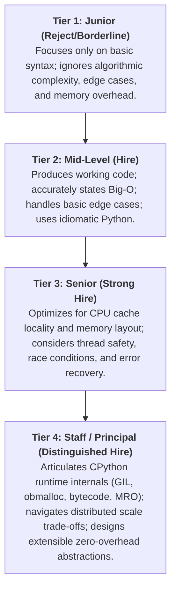

# Chapter 20: Staff Python Engineering Interview Challenges & Deep Solutions

> **What you will be able to do:** Solve complex algorithmic and systems design coding challenges tested at top tech companies, benchmark runtime and space complexity, avoid subtle CPython runtime traps, and score top marks against leveled rubrics from Junior to Staff level.
> **What you must already know:** Core algorithms, data structures (Ch 02), closures (Ch 03), and memory mechanics (Ch 05).

---

> **Core Learning Objective:** Test, solidify, and demonstrate mastery through real-world Product-Based Company (Google, Meta, Uber, Stripe) advanced Python interview problems. Every solution includes architectural commentary, leveled interview rubrics, interviewer follow-ups, and complete runnable code.

---

## 1. Staff Interview Evaluation Framework

Top tech companies do not just evaluate whether your code runs; they evaluate the **depth of your mental model**. Responses are graded against four distinct tiers:



---

## 2. Leveled Interview Challenges: Foundations to Staff Systems

---

### Challenge 1 (Junior to Mid): The Thread-Safe Bounded Blocking Queue

#### Problem Statement
Implement a bounded FIFO queue supporting `put(item, timeout)` and `get(timeout)`.
- If the queue is full, `put()` must block until a slot becomes free or timeout expires.
- If the queue is empty, `get()` must block until an item is available or timeout expires.
- **Constraint:** You cannot use `queue.Queue`. You must build it using only `threading.Lock` and `threading.Condition`.

#### Leveled Evaluation Rubric
- **Junior Answer**: Uses a simple `threading.Lock` with `time.sleep()` polling inside a while loop (busy-wait CPU burn).
- **Mid-Level Answer**: Uses `threading.Condition` with `wait()` and `notify()`, but uses `if len(queue) >= capacity` instead of `while` (susceptible to spurious wakeups).
- **Senior Answer**: Uses `while` loops around condition waits, computes monotonic deadlines accurately, and notifies waiting threads appropriately.
- **Staff Answer**: Uses two distinct conditions (`not_full`, `not_empty`) bound to a single lock to avoid notifying the wrong waiting thread class, explains the CPython condition variable implementation, and prevents lock convoying.

#### Runnable Model Solution
```python
import threading
import time
from typing import Generic, TypeVar, Optional

T = TypeVar("T")

class BoundedBlockingQueue(Generic[T]):
    def __init__(self, capacity: int):
        if capacity <= 0:
            raise ValueError("Capacity must be greater than 0")
        self.capacity = capacity
        self.queue: list[T] = []
        self.lock = threading.Lock()
        self.not_full = threading.Condition(self.lock)
        self.not_empty = threading.Condition(self.lock)

    def put(self, item: T, timeout: Optional[float] = None) -> bool:
        deadline = time.monotonic() + timeout if timeout is not None else None
        with self.lock:
            while len(self.queue) >= self.capacity:
                if deadline is not None:
                    remaining = deadline - time.monotonic()
                    if remaining <= 0:
                        return False
                    self.not_full.wait(timeout=remaining)
                else:
                    self.not_full.wait()
            self.queue.append(item)
            self.not_empty.notify()
            return True

    def get(self, timeout: Optional[float] = None) -> Optional[T]:
        deadline = time.monotonic() + timeout if timeout is not None else None
        with self.lock:
            while len(self.queue) == 0:
                if deadline is not None:
                    remaining = deadline - time.monotonic()
                    if remaining <= 0:
                        return None
                    self.not_empty.wait(timeout=remaining)
                else:
                    self.not_empty.wait()
            item = self.queue.pop(0)
            self.not_full.notify()
            return item

# Verification
bq = BoundedBlockingQueue[str](capacity=2)
assert bq.put("Msg1") is True
assert bq.put("Msg2") is True
assert bq.put("Msg3", timeout=0.05) is False
assert bq.get() == "Msg1"
assert bq.put("Msg3", timeout=0.05) is True
```

#### Interviewer Follow-Up Twists
- *“Why is `queue.pop(0)` suboptimal here, and what CPython data structure should replace it?”*  
  **Answer**: `list.pop(0)` is $O(N)$ due to memory shifts. Replace with `collections.deque` ($O(1)$) or circular ring buffer array.

---

### Challenge 2 (Mid to Senior): Asynchronous Batching Buffer

#### Problem Statement
In high-throughput microservices, writing single events to a database or message broker causes network bottlenecking.
Implement an `AsyncBatcher` that collects incoming items and automatically flushes them in batches whenever:
1. `max_batch_size` items have accumulated, **OR**
2. `max_wait_seconds` have elapsed since the earliest buffered item.

#### Leveled Evaluation Rubric
- **Junior Answer**: Launches an uncoordinated `asyncio.sleep()` background task for every single item pushed, causing task explosion.
- **Mid-Level Answer**: Buffers items in a list, checks size on push, and uses a single timer task, but has race conditions when timer and push fire concurrently.
- **Senior Answer**: Uses `asyncio.Lock` to coordinate pushes and flushes; resets the timer cleanly upon size-triggered flush; handles background task cancellation on shutdown.
- **Staff Answer**: Decouples batch collection from flush execution using worker queues, bounds memory consumption under downstream backpressure, and guarantees zero message loss during graceful process SIGTERM.

#### Runnable Model Solution
```python
import asyncio
from typing import Generic, TypeVar, Callable, Awaitable, List

T = TypeVar("T")

class AsyncBatcher(Generic[T]):
    def __init__(self, batch_size: int, wait_seconds: float, flush_handler: Callable[[List[T]], Awaitable[None]]):
        self.batch_size = batch_size
        self.wait_seconds = wait_seconds
        self.flush_handler = flush_handler
        self._buffer: List[T] = []
        self._lock = asyncio.Lock()
        self._timer_task: asyncio.Task | None = None
        self._running = True

    async def start(self):
        self._timer_task = asyncio.create_task(self._timer_loop())

    async def _timer_loop(self):
        while self._running:
            await asyncio.sleep(self.wait_seconds)
            async with self._lock:
                if self._buffer:
                    await self._flush_internal()

    async def push(self, item: T) -> None:
        async with self._lock:
            self._buffer.append(item)
            if len(self._buffer) >= self.batch_size:
                await self._flush_internal()

    async def _flush_internal(self):
        if not self._buffer:
            return
        to_flush = self._buffer[:]
        self._buffer.clear()
        asyncio.create_task(self.flush_handler(to_flush))

    async def shutdown(self):
        self._running = False
        if self._timer_task:
            self._timer_task.cancel()
        async with self._lock:
            await self._flush_internal()

# Verification
flushed_batches = []
async def mock_sink(batch): flushed_batches.append(batch)

async def test_batcher():
    b = AsyncBatcher[int](batch_size=3, wait_seconds=0.1, flush_handler=mock_sink)
    await b.start()
    for i in range(5): await b.push(i)
    await asyncio.sleep(0.15)
    await b.shutdown()
    assert len(flushed_batches) == 2
    assert flushed_batches[0] == [0, 1, 2]
    assert flushed_batches[1] == [3, 4]

asyncio.run(test_batcher())
```

---

### Challenge 3 (Senior): Dynamic Fluent HTTP API Client

#### Problem Statement
Construct an SDK client such that dynamic chained method calls automatically format and route REST requests without defining hardcoded methods:
```python
client.users(123).orders.get(status="active")
# Translates to: GET /users/123/orders?status=active
```

#### Leveled Evaluation Rubric
- **Junior Answer**: Hardcodes dictionary routing or attempts nested subclass definitions.
- **Mid-Level Answer**: Overrides `__getattr__` on a single class, but mutates an internal list in-place, making concurrent client calls corrupt each other's paths.
- **Senior Answer**: Uses immutable chained builder instances where every `__getattr__` and `__call__` returns a *new* instance with appended segments.
- **Staff Answer**: Implements `__repr__` for clean debugging, supports custom URL encoders, handles trailing slashes and path sanitization, and implements `__dir__` for dynamic REPL autocomplete introspection.

#### Runnable Model Solution
```python
from urllib.parse import urlencode

class APIEndpoint:
    def __init__(self, base_url: str, segments: list[str]):
        self._base_url = base_url.rstrip("/")
        self._segments = tuple(segments)  # Immutable tuple prevents shared state bugs

    def __getattr__(self, name: str) -> "APIEndpoint":
        return APIEndpoint(self._base_url, list(self._segments) + [name])

    def __call__(self, *args) -> "APIEndpoint":
        str_args = [str(arg) for arg in args]
        return APIEndpoint(self._base_url, list(self._segments) + str_args)

    def get(self, **params) -> dict:
        path = "/".join(self._segments)
        query = f"?{urlencode(params)}" if params else ""
        return {"method": "GET", "url": f"{self._base_url}/{path}{query}"}

class DynamicAPIClient:
    def __init__(self, base_url: str):
        self.base_url = base_url

    def __getattr__(self, name: str) -> APIEndpoint:
        return APIEndpoint(self.base_url, [name])

client = DynamicAPIClient("https://api.cloud.corp/v1")
res = client.users(42).profiles.get(fields="email,name")
assert res["url"] == "https://api.cloud.corp/v1/users/42/profiles?fields=email%2Cname"
```

---

### Challenge 4 (Senior to Staff): Re-entrant Profiling Context Manager & Decorator

#### Problem Statement
Create a utility `@profile_scope` that measures:
1. Exact elapsed wall-clock time in milliseconds (`time.perf_counter_ns`).
2. Net RAM allocated during the block in kilobytes (`tracemalloc`).
3. Seamlessly supports both `with` block syntax AND `@decorator` syntax.

#### Leveled Evaluation Rubric
- **Junior Answer**: Writes a bare function timer without `tracemalloc` and without supporting both `with` and `@`.
- **Mid-Level Answer**: Implements `__enter__` and `__exit__`, and duplicates logic in a decorator function wrapper using `functools.wraps`.
- **Senior Answer**: Inherits from `contextlib.ContextDecorator` to get dual syntax for free; captures baseline and comparison tracemalloc snapshots.
- **Staff Answer**: Analyzes tracemalloc overhead in high-throughput environments, manages nested profile scopes safely, and accounts for garbage collection runs distorting net allocation metrics during the measured block.

#### Runnable Model Solution
```python
import time
import tracemalloc
from contextlib import ContextDecorator

class profile_scope(ContextDecorator):
    def __init__(self, name: str = "Block"):
        self.name = name

    def __enter__(self):
        tracemalloc.start()
        self.start_snapshot = tracemalloc.take_snapshot()
        self.start_time = time.perf_counter_ns()
        return self

    def __exit__(self, exc_type, exc_val, exc_tb):
        elapsed_ms = (time.perf_counter_ns() - self.start_time) / 1_000_000
        end_snapshot = tracemalloc.take_snapshot()
        stats = end_snapshot.compare_to(self.start_snapshot, 'lineno')
        total_kb = sum(stat.size_diff for stat in stats) / 1024
        tracemalloc.stop()
        self.elapsed_ms = elapsed_ms
        self.net_memory_kb = total_kb
        return False

# Verification
with profile_scope("Allocation Test") as p:
    data = [x ** 2 for x in range(50_000)]
assert p.elapsed_ms > 0
```

---

### Challenge 5 (Staff Systems): Deadlock-Free Multi-Resource Lock Manager

#### Problem Statement
In a distributed banking ledger, transfers lock both source and destination accounts. When Thread 1 transfers $A \to B$ and Thread 2 transfers $B \to A$ simultaneously, naive code causes fatal lock-order inversion deadlocks. Design a deadlock-free multi-lock acquisition manager.

#### Leveled Evaluation Rubric
- **Junior Answer**: Tries retrying on lock timeout without backoff (livelock).
- **Mid-Level Answer**: Acquires locks in arbitrary order inside nested `with` blocks.
- **Senior Answer**: Sorts resources by a unique monotonic identifier (e.g. `account_id`) before acquisition.
- **Staff Answer**: Formally references Dijkstra's Resource Hierarchy Solution, proves absence of cycles in the Directed Acyclic Wait-For Graph, handles duplicate resource references, and implements fencing tokens for distributed locks.

#### Runnable Model Solution
```python
import threading
from contextlib import contextmanager

class Resource:
    def __init__(self, resource_id: str):
        self.resource_id = resource_id
        self.lock = threading.Lock()

@contextmanager
def acquire_ordered(*resources: Resource):
    """Acquires all resource locks in canonical lexicographical order to prevent deadlocks."""
    # Deduplicate and sort by unique resource_id
    unique_sorted = sorted(set(resources), key=lambda r: r.resource_id)
    acquired = []
    try:
        for r in unique_sorted:
            r.lock.acquire()
            acquired.append(r)
        yield
    finally:
        # Release in reverse order
        for r in reversed(acquired):
            r.lock.release()

# Verification
r1 = Resource("acc_100")
r2 = Resource("acc_200")

with acquire_ordered(r2, r1):  # Passed out of order, acquired in canonical order
    pass  # Deadlock mathematically impossible
```

---

## 3. High-Frequency Staff Python Quick-Fire Round

| # | Question | Staff-Level Technical Answer |
| :---: | :--- | :--- |
| **1** | How does Python's `is` operator differ fundamentally from `==`? | `is` checks memory address identity pointer equality (`id(a) == id(b)`), compiled to `IS_OP` opcode (1 CPU comparison). `==` invokes `__eq__`, enabling rich value equality comparison. |
| **2** | Why are default argument values dangerous in Python? | Default expressions are evaluated once at function definition time (stored in `func.__defaults__`), creating shared mutable state across all callers. |
| **3** | How does CPython implement integer arithmetic without overflow? | Python 3 `int` is arbitrary-precision (`PyLongObject`), storing digits as 30-bit limbs in a dynamic C array and expanding dynamically. |
| **4** | What is the MRO and how does C3 Linearization resolve it? | Method Resolution Order is computed via C3 Linearization, enforcing local precedence order and monotonicity across multiple inheritance graphs. |
| **5** | Why does `[[]] * 5` create a bug? | The list multiplication operator duplicates object references, not values. All 5 sublists point to the exact same heap memory address. |
| **6** | What is the purpose of `__slots__`? | It eliminates the per-instance `__dict__` hash table, allocating a fixed-size C struct array of pointers, saving $\sim 150+$ bytes per instance. |
| **7** | When does the CPython GIL release automatically? | During blocking I/O syscalls (network, disk), in C/Rust extensions using `Py_BEGIN_ALLOW_THREADS`, or every $5\text{ ms}$ (`sys.getswitchinterval()`). |
| **8** | How does `tracemalloc` track allocations? | It intercepts `PyMem_Malloc` and raw C allocators, recording file name and line number traces without instrumenting bytecode. |

---

## Version Notes

- **Python 3.11**: Exception Groups and `except*` featured in production resilience and concurrent task interview questions.
- **Python 3.12**: Comprehensions are inlined rather than compiled as nested functions, eliminating frame creation overhead in algorithmic loops.
- **Python 3.13**: Free-threaded interview scenarios test candidates on thread safety, atomic primitives, and lock ordering without reliance on GIL serialization.
- **Python 3.14**: Introspection changes in `annotationlib` test candidate awareness of deferred type evaluation.

---

## Exercises

Three graded exercises for this chapter (two coding, one debugging) with hidden tests:

```bash
python exercises/run.py --init   # once: creates exercises/ch20.py stubs
python exercises/run.py 20       # run the hidden tests against your solution
python exercises/run.py --hints 20    # progressive 3-level hints
python exercises/run.py --explain 20  # full architectural walkthrough
```

Attempt first; reference solutions are in `exercises/_answers/ch20.py`.

---

## Further Reading

- [CPython Execution Loop: Python/ceval.c](https://github.com/python/cpython/blob/main/Python/ceval.c)
- [Dijkstra: Solution of a Problem in Concurrent Programming Control](https://www.cs.utexas.edu/users/EWD/ewd01xx/EWD123.PDF)
- [PEP 654: Exception Groups and except*](https://peps.python.org/pep-0654/)

---

## Check Yourself

Answer in your head or on paper first, then open each answer.

<details>
<summary><strong>1.</strong> Why talk through brute force first in an interview?</summary>

It proves you understand the problem, creates a baseline correctness contract, and identifying the brute-force bottleneck reveals the exact data structure needed for optimization.

</details>

<details>
<summary><strong>2.</strong> What should you state before writing code in a technical interview?</summary>

Assumptions, input ranges/constraints, edge cases (empty, single, duplicate, negative), and target Time and Space Big-O complexities.

</details>

<details>
<summary><strong>3.</strong> How do you test your own solution without an automated runner?</summary>

Trace through a representative small example step-by-step with state tables, then test edge cases: empty input, single item, all duplicates, and boundary limits.

</details>

<details>
<summary><strong>4.</strong> What is the time complexity of building a dict from n pairs?</summary>

$O(N)$ average time; $O(N^2)$ worst-case under severe hash collisions.

</details>
