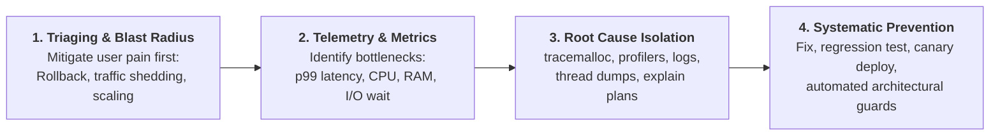

# Chapter 21: Production Crisis Scenarios & Staff-Level Architectural Grills

> **What you will be able to do:** Deconstruct high-stakes production incident scenarios, diagnose obscure bugs (deadlocks, memory leaks, event loop stalls, Celery worker crashes), and articulate nuanced architectural trade-offs using Senior/Staff communication frameworks.
> **What you must already know:** Production operations across asyncio (Ch 06), databases (Ch 12), distributed queues (Ch 15), and profiling (Ch 10).

---

> **Core Learning Objective:** Master the tough, scenario-driven interview questions asked by FAANG and top Product-Based Companies. Learn how to diagnose real-world production outages, explain CPython runtime edge cases, and articulate senior engineering trade-offs under pressure.

---

## 1. The Incident Postmortem Framework for Staff Interviews

When interviewers present an open-ended production crisis ("The database is on fire", "Workers are running out of RAM"), they are not testing whether you guess the bug on the first try. They are testing your **Incident Command Framework**:



---

## 2. Fifteen Production Crisis Scenarios & Staff Solutions

---

### Scenario 1: The Memory Leak in a Celery Background Worker
**The Interviewer Asks:**  
> *"We have a long-running Python worker processing millions of messages daily. Over 48 hours, its RAM usage steadily balloons from 200 MB to 16 GB until the OS kernel OOM-killer terminates the process. But our code explicitly calls `del` on every processed message! How do you diagnose and eliminate this leak?"*

**Staff-Level Response & Remediation:**
1. **Root Cause Analysis:**  
   `del` only decrements `ob_refcnt` by 1; it does **not** free memory if a circular reference exists or if global registries hold pointers. Furthermore, CPython's PyMalloc allocator does not always return freed memory pages back to the OS—it keeps them in arenas for future allocations (heap fragmentation).
2. **Diagnostic Procedure:**
   - Enable `tracemalloc` to take differential snapshots (`snapshot2.compare_to(snapshot1, 'lineno')`) to isolate which line allocates surviving objects.
   - Use `gc.get_objects()` and inspect referrers using `gc.get_referrers(obj)`.
3. **Architectural Fixes:**
   - **Worker Recycling:** Set `worker_max_tasks_per_child = 1000` in Celery configuration. This forces worker worker processes to terminate and recreate fresh processes periodically, returning fragmented virtual memory pages cleanly to the OS.
   - **Weak References:** Refactor internal event registries to use `weakref.WeakKeyDictionary` or `weakref.WeakValueDictionary`.
   - **OS Page Compaction:** On Linux, invoke `ctypes.CDLL('libc.so.6').malloc_trim(0)` periodically to force `glibc` to release freed memory back to the Linux kernel.

---

### Scenario 2: Event Loop Starvation in an Asyncio Microservice
**The Interviewer Asks:**  
> *"Our FastAPI microservice is built with `async def` endpoints, designed to handle 5,000 concurrent requests. However, during load testing, when one endpoint performs password hashing or queries a legacy database, all other endpoints freeze and latency spikes to 10 seconds. What is happening?"*

**Staff-Level Response & Remediation:**
1. **Root Cause:**  
   `asyncio` operates on a **single OS thread**. An `await` only yields control if the awaited function is a non-blocking asynchronous coroutine. If an engineer executes a CPU-heavy task (`bcrypt.hashpw`) or a synchronous blocking I/O call (`requests.get()` or synchronous `time.sleep()`), the thread blocks. The event loop cannot tick, starving all 4,999 other concurrent coroutines.
2. **Diagnostic Procedure:**
   - Run Python with asyncio debug mode enabled: `asyncio.run(main(), debug=True)` or `PYTHONASYNCIODEBUG=1`. The event loop will log warnings: `Executing <Handle ...> took 1.250 seconds`.
3. **Production Fix:**
   - Offload CPU-heavy or synchronous blocking I/O calls to a separate worker thread pool using `asyncio.to_thread()`:
     ```python
     import asyncio
     import bcrypt

     # PRODUCTION PATTERN: Offloads to worker thread pool; event loop stays unblocked
     async def good_login(password: str, hashed: bytes) -> bool:
         return await asyncio.to_thread(bcrypt.checkpw, password.encode(), hashed)
     ```

---

### Scenario 3: High Concurrency Multithreading CPU Throttling
**The Interviewer Asks:**  
> *"We converted an image thumbnail generator from 1 thread to 8 OS threads on an 8-core CPU, expecting an 8x speedup. Instead, the total execution time was 20% SLOWER than the single-threaded version! Why?"*

**Staff-Level Response & Remediation:**
1. **Root Cause:**  
   Image compression/processing in pure Python is a **CPU-bound workload**. Due to CPython's **Global Interpreter Lock (GIL)**, only one OS thread can execute Python bytecode at any given millisecond. When 8 threads run on 8 physical cores, they aggressively contend for the single GIL mutex. The CPU wastes cycles on OS thread context-switching and lock contention (the "convoy effect"), running slower than a single thread.
2. **Production Fix:**  
   Switch from `threading.Thread` to `multiprocessing.Pool` or `concurrent.futures.ProcessPoolExecutor`. Each process runs an independent CPython interpreter on its own core with its own GIL. Alternatively, utilize compiled C/Rust extensions (like OpenCV or Pillow with native C routines) that release the GIL via `Py_BEGIN_ALLOW_THREADS`.

---

### Scenario 4: Database Connection Pool Exhaustion under Traffic Spikes
**The Interviewer Asks:**  
> *"During a traffic surge, our FastAPI service starts throwing `TimeoutError: QueuePool limit of size 20 overflow 10 reached, connection timed out`. Scaling the web pods causes the database to crash. How do you resolve this?"*

**Staff-Level Response & Remediation:**
1. **Root Cause:**  
   Web pods create database connections per-pod. If 50 pods each run a pool of 30 connections, that requires $50 \times 30 = 1,500$ open PostgreSQL connections. PostgreSQL allocates $\sim 5-10\text{ MB}$ of RAM per connection and spawns a dedicated backend process, leading to CPU thrashing and connection limits.
2. **Production Architecture:**
   - **Deploy PgBouncer:** Place an intermediate connection pooler (PgBouncer in transaction-pooling mode) between FastAPI pods and PostgreSQL. PgBouncer maintains hundreds of thousands of client connections while multiplexing them into only 50-100 real database connections.
   - **Strict Session Scoping:** Ensure FastAPI dependencies release database sessions immediately using `async with async_session() as session:`, and move slow third-party HTTP calls outside the database session context.

---

### Scenario 5: Postgres Deadlocks on Concurrent Read-Modify-Write
**The Interviewer Asks:**  
> *"Two concurrent user transactions execute `UPDATE accounts SET balance = balance - 100 WHERE id = 1` and `UPDATE accounts SET balance = balance + 100 WHERE id = 2`, and vice versa. PostgreSQL aborts one with `deadlock detected`. How do you eliminate this permanently?"*

**Staff-Level Response & Remediation:**
1. **Root Cause:**  
   Classic lock-order inversion across concurrent database transactions. Transaction A locks row 1 and requests row 2; Transaction B locks row 2 and requests row 1.
2. **Production Fix:**
   - Enforce canonical lock acquisition order in application code: always lock rows in ascending order of primary key (`WHERE id IN (1, 2) ORDER BY id FOR UPDATE`).
   - Use atomic database operations (`UPDATE accounts SET balance = balance - 100 WHERE id = 1 AND balance >= 100`) rather than reading the balance into Python and writing it back.

---

### Scenario 6: Kafka Consumer Group Rebalance Storms
**The Interviewer Asks:**  
> *"Our Kafka Python consumer processes batches of complex machine learning inference jobs. Every 10 minutes, the consumer group triggers a rebalance storm, dropping partitions and reprocessing duplicate messages repeatedly. What is wrong?"*

**Staff-Level Response & Remediation:**
1. **Root Cause:**  
   Kafka consumers must send heartbeats and call `.poll()` within `max.poll.interval.ms` (default 5 minutes). If a single Python processing loop takes 7 minutes, the Kafka broker assumes the consumer has crashed, kicks it out of the group, and triggers a full cluster rebalance.
2. **Production Fix:**
   - Decouple Kafka message fetching from processing: the consumer loop immediately pushes messages into an in-memory queue (`asyncio.Queue`), where worker threads process them, keeping the Kafka poll loop responsive.
   - Tune `max.poll.interval.ms` to accommodate expected worst-case task latency, or decrease `max.poll.records` so each polled batch completes well within the timeout.
   - Enable Kafka Cooperative Sticky Assignor (`CooperativeStickyAssignor`) to avoid stop-the-world rebalances.

---

### Scenario 7: Silent Data Loss via Unhandled Asyncio Task Exceptions
**The Interviewer Asks:**  
> *"A critical background audit logging task is launched with `asyncio.create_task(log_event(event))`. In production, when database credentials change, the task fails, but no errors appear in Sentry or server logs, and audit logs are silently lost! Why?"*

**Staff-Level Response & Remediation:**
1. **Root Cause:**  
   When a coroutine launched via `asyncio.create_task()` raises an unhandled exception, the exception is stored inside the `Task` object. If the task is never awaited and its reference is dropped, the exception is only printed when the task is garbage collected (`Task exception was never retrieved`), which may happen hours later or never.
2. **Production Fix:**
   - Attach an error-handling callback: `task.add_done_callback(handle_task_exception)`.
   - Use Python 3.11+ structured concurrency with `asyncio.TaskGroup`, which automatically propagates exceptions from child tasks.
   - Maintain a global `set` of active background tasks (`background_tasks.add(task); task.add_done_callback(background_tasks.discard)`) to prevent premature garbage collection.

---

### Scenario 8: Memory Bloat from Unbounded Closures
**The Interviewer Asks:**  
> *"A developer wrote a logging decorator that captures local request state. Over time, memory consumption grows linearly with request volume. How can a closure leak memory?"*

**Staff-Level Response & Remediation:**
1. **Root Cause:**  
   Inner functions that reference outer variables create `PyCellObject` instances stored in `func.__closure__`. If the outer scope contains large variables (e.g. `request_payload = large_bytes`), the inner function keeps that entire large variable alive on the heap, even if the closure only needed `request_id = request_payload.id`.
2. **Production Fix:**
   - Scope local variables tightly: extract only the scalar identifier before defining the closure.
   - Inspect `func.__closure__` and `func.__code__.co_freevars` to audit which variables are captured.

---

### Scenario 9: Redis OOM & Latency Spikes from `KEYS *`
**The Interviewer Asks:**  
> *"Our service runs smoothly until a cron job executes a cache eviction script, causing our p99 latency to spike to 15 seconds across all customer requests. What happened?"*

**Staff-Level Response & Remediation:**
1. **Root Cause:**  
   Redis is **single-threaded** for command execution. The `KEYS *` command is an $O(N)$ blocking scan across the entire keyspace. If Redis holds 50 million keys, `KEYS *` blocks all other read/write commands for several seconds.
2. **Production Fix:**
   - Never run `KEYS *` in production. Use `SCAN` (or `SSCAN`, `HSCAN`) which iterates the keyspace non-blockingly across incremental batches using a cursor.
   - Assign appropriate Redis key TTLs and use Redis `volatile-lru` or `allkeys-lru` eviction policies.

---

### Scenario 10: Zero-Downtime Database Migration Deadlock with Alembic
**The Interviewer Asks:**  
> *"We deployed a migration adding a column with a default value: `op.add_column('orders', sa.Column('status', sa.String(), server_default='pending'))`. The migration hung, locked the table, and caused a complete site outage. Why?"*

**Staff-Level Response & Remediation:**
1. **Root Cause:**  
   In older PostgreSQL versions or when adding columns with non-constant defaults, `ALTER TABLE` acquires an `ACCESS EXCLUSIVE` lock on the table. While waiting for long-running read queries to finish, the migration blocks all incoming queries behind it in the lock queue, exhausting connection pools.
2. **Production Fix:**
   - Always set `lock_timeout`: `ALTER TABLE orders SET (lock_timeout = '2s')`. If the lock cannot be acquired within 2 seconds, fail immediately rather than queueing behind active queries.
   - Add column as nullable without default first, backfill asynchronously in batches, then set `NOT NULL` and default constraint.

---

### Scenario 11: FFI Memory Leak across Native PyO3 / C Boundaries
**The Interviewer Asks:**  
> *"Our Rust native extension via PyO3 processes images at 100x speed, but process RAM increases continuously without `tracemalloc` reporting any memory growth. How can memory leak outside tracemalloc?"*

**Staff-Level Response & Remediation:**
1. **Root Cause:**  
   `tracemalloc` only instruments CPython allocators (`PyMem_Malloc`). Memory allocated in Rust or C via the system allocator (`malloc`, jemalloc) is completely invisible to `tracemalloc`. If Rust code fails to free buffers or creates reference leaks via `Python::acquire_gil()`, native heap leaks occur.
2. **Production Fix:**
   - Profile native process memory using Valgrind, Heaptrack, or eBPF memory profilers.
   - Ensure Rust structs properly implement the `Drop` trait and use Rust RAII guards to clean up allocated native memory.

---

### Scenario 12: Thundering Herd Cache Stampede
**The Interviewer Asks:**  
> *"Our homepage cache key expires every hour. At the exact second it expires, our database CPU spikes to 100% and crashes the cluster. What is this phenomenon and how do you prevent it?"*

**Staff-Level Response & Remediation:**
1. **Root Cause:**  
   **Thundering Herd (Cache Stampede)**. When a high-traffic cache key expires, thousands of concurrent requests observe a cache miss at the exact same millisecond and all fire expensive queries against the database simultaneously.
2. **Production Fix:**
   - **Distributed Mutex (Locking):** Only allow one worker to acquire a lock to compute and populate the cache; other workers wait or receive stale data.
   - **Probabilistic Early Expiration (XFetch Algorithm):** Recompute cache asynchronously before actual expiration with probability $P = -\beta \cdot \delta \cdot \ln(rand()) > TTL_{remaining}$.
   - **Stale While Revalidate:** Serve stale cache immediately while background coroutine refreshes data.

---

### Scenario 13: Forking Process with Initialized Database Connection Pools
**The Interviewer Asks:**  
> *"A Gunicorn worker starts with 4 processes. Intermittently, database queries return corrupted data belonging to different users or raise `SSL SYSCALL error: EOF detected`. Why?"*

**Staff-Level Response & Remediation:**
1. **Root Cause:**  
   Initializing database connection pools in the master process before calling `fork()` copies the file descriptors (socket connections) into all child worker processes. Multiple child workers now write to and read from the exact same TCP socket concurrently, interleaving packets.
2. **Production Fix:**
   - Always initialize database connection pools **inside child worker lifespan hooks** (`post_fork` in Gunicorn, or FastAPI `lifespan` event), ensuring each worker creates independent socket connections.

---

### Scenario 14: Pydantic V2 Validation Latency Bottleneck
**The Interviewer Asks:**  
> *"Our microservice receives large JSON payloads (10 MB). CPU profiling reveals that 80% of request latency is spent validating schemas in Pydantic. How do you optimize this?"*

**Staff-Level Response & Remediation:**
1. **Root Cause:**  
   Pydantic recursively validates and coerces every single field, building deeply nested object trees on the heap.
2. **Production Fix:**
   - Validate only required fields using lazy models or `TypeAdapter`.
   - Use `model_validate_json(raw_bytes)` directly instead of `json.loads()` + `model_validate(dict)`, allowing Pydantic-core's compiled Rust parser to deserialize directly from UTF-8 bytes into memory.

---

### Scenario 15: Out-of-Core Memory Spike in Columnar Polars / DuckDB
**The Interviewer Asks:**  
> *"We process a 100 GB Parquet dataset on a machine with 32 GB RAM. Polars crashes with Out-Of-Memory. How do you process datasets larger than physical RAM in Python?"*

**Staff-Level Response & Remediation:**
1. **Root Cause:**  
   Calling `.collect()` without streaming forces Polars to materialize all intermediate query arrays into RAM simultaneously.
2. **Production Fix:**
   - Use Polars LazyFrames with streaming engine enabled: `df.lazy().filter(...).collect(streaming=True)`.
   - In DuckDB, query Parquet files directly using `duckdb.query("SELECT ... FROM 'data/*.parquet'")`, allowing DuckDB's vectorized pipelined engine to process chunks out-of-core with fixed memory buffer pools.

---

## 3. High-Frequency Staff Architectural Quick-Fire

| # | Question | Staff-Level Technical Answer |
| :---: | :--- | :--- |
| **1** | When should you use `isinstance` vs `type()`? | Always prefer `isinstance()`; it respects class inheritance and polymorphism. `type(a) == type(b)` fails on subclasses. |
| **2** | How do you prevent circular import errors in Python? | Move imports inside functions (lazy imports), use `from __future__ import annotations` (PEP 563) with `if TYPE_CHECKING:` guards, or refactor shared interfaces into a dedicated module. |
| **3** | Why doesn't Python garbage-collect all memory when functions exit? | CPython's obmalloc allocator holds memory pools in 256KB Arenas for future allocations rather than repeatedly calling OS `free()`. |
| **4** | What is the difference between shallow and deep copy? | Shallow copy (`copy.copy`) duplicates the outer container but copies pointers to nested objects; deep copy (`copy.deepcopy`) recursively duplicates the entire object graph. |
| **5** | How does Python handle integer division? | Python integer division `//` implements **floor division** (rounds toward negative infinity: `-3 // 2 == -2`), preserving the invariant `(a // b) * b + (a % b) == a`. |

---

## Version Notes

- **Python 3.11**: Fine-grained error locations in tracebacks accelerate production outage diagnosis.
- **Python 3.12**: Subinterpreter worker pools evaluated as alternatives to traditional prefork worker architectures in production incident scenarios.
- **Python 3.13**: Incident postmortems feature multi-threaded race conditions and memory safety bugs occurring when migrating to free-threaded `--disable-gil` Python.
- **Python 3.14**: Deferred annotation evaluation (PEP 649 / PEP 749) guarantees that refactoring type hints no longer causes runtime circular import crashes.

---

## Exercises

Three graded exercises for this chapter (two coding, one debugging) with hidden tests:

```bash
python exercises/run.py --init   # once: creates exercises/ch21.py stubs
python exercises/run.py 21       # run the hidden tests against your solution
python exercises/run.py --hints 21    # progressive 3-level hints
python exercises/run.py --explain 21  # full architectural walkthrough
```

Attempt first; reference solutions are in `exercises/_answers/ch21.py`.

---

## Further Reading

- [Google SRE Book: Postmortem Culture & Incident Response](https://sre.google/sre-book/postmortem-culture/)
- [Python tracemalloc Documentation](https://docs.python.org/3/library/tracemalloc.html)
- [Celery Best Practices & Memory Management](https://docs.celeryq.dev/en/stable/userguide/optimizing.html)

---

## Check Yourself

Answer in your head or on paper first, then open each answer.

<details>
<summary><strong>1.</strong> A scenario question asks 'how would you debug a memory leak in production?' Outline an answer.</summary>

Confirm growth with APM metrics, capture `tracemalloc` snapshots over time, diff to isolate growing allocation sites, inspect referrers with `gc.get_referrers()`, fix root cause, configure worker recycling (`max_tasks_per_child`), and add regression alerting.

</details>

<details>
<summary><strong>2.</strong> How do you structure an answer to a design-trade-off question?</summary>

State the architectural options, evaluate each against operational requirements and constraints (throughput, latency, memory, cost), choose with concrete justification, and identify boundary conditions that would change your decision.

</details>

<details>
<summary><strong>3.</strong> What do interviewers look for in 'tell me about a production incident'?</summary>

Clear timeline, blast radius triage actions, systematic diagnostic steps, exact technical root cause, short-term and long-term remediation, and preventative architectural guardrails.

</details>

<details>
<summary><strong>4.</strong> What turns a good answer into a staff-level answer?</summary>

Quantified business/latency impact, awareness of failure modes and edge cases, understanding CPython runtime and kernel internals, and designing permanent automated architectural guardrails.

</details>
