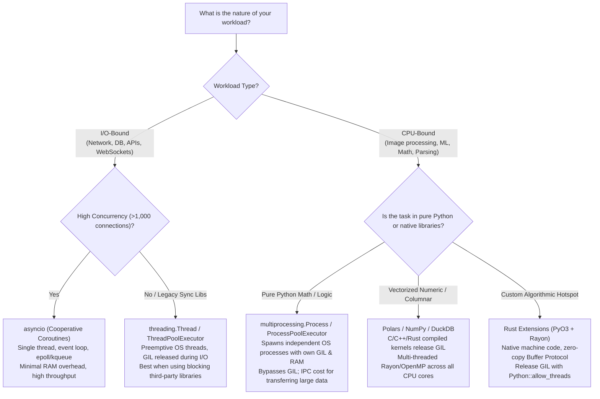

# Chapter 22: Track 1 Recap — The Python Engineering Mastery Playbook

> **What you will be able to do:** Rapidly reference and synthesize the entire spectrum of modern Python engineering—from CPython memory internals to distributed systems and native Rust extensions—and excel in Staff-level technical architecture reviews.
> **What you must already know:** Completion of Track 1 Chapters 00 through 21.

---

> **Core Learning Objective:** Consolidate everything you have mastered across Track 1 into a permanent, interconnected mental model. This chapter provides a high-yield, quick-reference synthesis of CPython internals, memory mechanics (Stack vs Heap, PyObject, GC), concurrency choices (Threads vs Asyncio vs Multiprocessing), production backend architectures (FastAPI, PostgreSQL, Celery, Kafka), and high-performance computing (Polars, HPC, Rust PyO3).

---

## 1. The Grand Architectural Mental Map

Throughout Track 1, you traveled from the lowest silicon-level CPU instructions all the way to high-concurrency event-driven distributed systems. Here is how every chapter connects into a unified engineering machine:

```mermaid
flowchart TD
    subgraph S1 ["1. The Execution Engine (Silicon to Bytecode)"]
        Ch1["01: Lexer & AST<br/>ceval.c & Stack Machine"] --> Ch2["02: Data Structures<br/>Compact Dicts & Lists"]
        Ch2 --> Ch3["03: Scopes & Closures<br/>LEGB & PyCellObject"]
        Ch3 --> Ch4["04: OOP & Dunders<br/>MRO, C3 & Descriptors"]
    end

    subgraph S2 ["2. Memory & Hardware Limits"]
        Ch4 --> Ch5["05: Memory & GC<br/>PyMalloc, RefCount & GIL"]
        Ch5 --> Ch6["06: Concurrency Models<br/>OS Threads vs Coroutines"]
        Ch6 --> Ch7["07: Type System<br/>Protocols & Mypy"]
    end

    subgraph S3 ["3. Enterprise Engineering & Quality"]
        Ch7 --> Ch8["08: Packaging & uv<br/>sys.path & ABI Wheels"]
        Ch8 --> Ch9["09: Testing & Mocking<br/>Pytest Fixtures & AsyncMock"]
        Ch9 --> Ch10["10: Profiling & Leaks<br/>tracemalloc & cProfile"]
        Ch10 --> Ch11["11: Brownfield Refactoring<br/>Pinning Tests & Clean Architecture"]
    end

    subgraph S4 ["4. Production Backend & Distributed Data"]
        Ch11 --> Ch12["12: SQL & PostgreSQL MVCC<br/>Indexes, CTEs & Locks"]
        Ch12 --> Ch13["13: FastAPI & ASGI<br/>Pydantic V2 & Lifespans"]
        Ch13 --> Ch14["14: Security & Cryptography<br/>Argon2id, JWT & RBAC"]
        Ch14 --> Ch15["15: Distributed Tasks<br/>Celery, Redis & Idempotency"]
        Ch15 --> Ch16["16: Event-Driven Streaming<br/>Kafka, gRPC & BSD Sockets"]
    end

    subgraph S5 ["5. Extreme Performance & Native Systems"]
        Ch16 --> Ch17["17: Columnar Data<br/>Polars, Arrow & DuckDB"]
        Ch17 --> Ch18["18: High-Performance Computing<br/>SIMD, Numba, Cython & No-GIL"]
        Ch18 --> Ch19["19: Rust PyO3 Extensions<br/>CPython C-API & Buffer Protocol"]
    end

    S1 --> S2 --> S3 --> S4 --> S5
```



---

## 2. Plain-English Jargon Demystifier (Track 1 Edition)

Whenever you encounter technical terminology in senior interviews or production post-mortems, refer to this translation table:

| Term | The Formal Definition | Plain-English Real-World Metaphor | Why It Matters in Production |
| :--- | :--- | :--- | :--- |
| **CPython** | The reference implementation of Python written in C. | **The Master Chef** who reads your recipe (Python) and cooks it on physical CPU hardware. | Explains why Python has specific memory behaviors, GIL constraints, and C-API bindings. |
| **The Stack** | LIFO memory structure for execution frames and local pointers. | **Your Desk**: small, lightning-fast (<1 ns), cleaned off the instant a function finishes. | Function arguments and local pointers live here. Stack overflow happens when recursion is too deep. |
| **The Heap** | Dynamic memory pool managed by an allocator (`PyMalloc`). | **The Cavernous Warehouse Floor**: vast, flexible storage for any size object, requiring pointers to find. | All Python objects (`int`, `str`, `list`, `dict`) live here. Excessive allocations cause memory bloat. |
| **`PyObject`** | The 16-to-24 byte C struct header at the start of every Python object. | **The Identification Collar** around every pet in the shelter: records who it is (type) and how many owners love it (refcount). | An integer `1` is not 8 bytes; it is 28 bytes in Python due to this overhead. |
| **Descriptor** | An object attribute with binding behavior defined by `__get__`, `__set__`, or `__delete__`. | **A Security Guard at a Room Door**: intercepting anyone trying to read or modify a variable. | Powers `@property`, `@classmethod`, `@staticmethod`, and ORMs like SQLAlchemy and Django models. |
| **MRO (Method Resolution Order)** | The linearized order in which Python searches base classes for methods (C3 algorithm). | **The Family Tree Chain-of-Command**: deciding whether mom's rule or dad's rule takes precedence without infinite loops. | Prevents ambiguity in multiple inheritance (the Diamond Problem). |
| **GIL (Global Interpreter Lock)** | A mutual exclusion lock preventing multiple OS threads from executing CPython bytecode simultaneously. | **A Single Microphone in a Debate Room**: only one speaker can talk at any given instant. | Multi-threading will **never** speed up CPU-bound math in standard CPython; it only speeds up I/O-bound wait times. |
| **`PyCellObject`** | A heap-allocated wrapper holding a reference to a variable captured by a closure. | **A Glass Display Box** on the warehouse floor: preserving a variable so an inner function can read it long after the outer function died. | Powers decorators and functional factories. |
| **ASGI** | Asynchronous Server Gateway Interface: non-blocking interface between async web servers and applications. | **A Fast-Food Order Ticket Machine**: accepting orders continuously without waiting for burgers to flip. | Powers FastAPI and Starlette, allowing 50,000 concurrent WebSocket/HTTP connections on a single worker. |
| **SIMD** | Single Instruction, Multiple Data: CPU instruction set processing vectors of numbers simultaneously. | **A Cookie Cutter**: stamping out 8 cookies in one press instead of cutting one cookie at a time. | Powers NumPy, Polars, and DuckDB to achieve 100x analytical query speedups. |

---

## 3. The Concurrency & Parallelism Decision Matrix

One of the most frequent Staff Engineer interview questions is: *"Which concurrency tool should I choose for this problem?"* Use this definitive decision rubric:



| Concurrency Model | Best For | GIL Impact | Memory Overhead | Communication Mechanism |
| :--- | :--- | :--- | :--- | :--- |
| **`asyncio`** | Web APIs, scrapers, chat servers, microservice orchestrators | Runs under 1 GIL on 1 core | **Ultra-Low** (~1 KB per task) | Shared memory within single thread |
| **`threading`** | I/O with blocking sync SDKs (boto3, older DB drivers) | Releases GIL during socket/disk I/O | **Medium** (~8 MB OS thread stack) | Shared heap memory (requires Locks) |
| **`multiprocessing`**| Heavy CPU calculations in pure Python | Bypasses GIL (separate interpreters) | **High** (full copy of Python process) | `Queue`, `Pipe`, Shared Memory |
| **`Polars / DuckDB`**| Massive tabular data transforms & filtering | Bypasses GIL in native Rust/C++ | **Optimal** (Arrow columnar vectors) | In-process zero-copy memory buffers |
| **`PyO3 (Rust)`** | Algorithmic bottlenecks, custom parsers, crypto | Can manually release GIL | **Lowest native** | Python Buffer Protocol (`&[u8]`) |

---

## 4. The Junior vs. Senior Antipattern Graveyard

Avoid these 7 classic traps that immediately flag an inexperienced engineer during technical interviews and production code reviews:

| # | The Junior Antipattern | What Goes Wrong in Production | The Senior / Staff Solution |
| :---: | :--- | :--- | :--- |
| **1** | `def add_item(item, basket=[]):` | The list is allocated **once at module load time**. All subsequent calls share the exact same list, causing cross-request data leaks! | Use `basket: list | None = None` and initialize `if basket is None: basket = []` inside the function body. |
| **2** | Calling `time.sleep()` or sync `requests.get()` inside an `async def` function. | **Event loop starvation**: the single OS thread freezes. Thousands of pending client coroutines stop dead in their tracks. | Use `asyncio.sleep()`, `httpx.AsyncClient`, or delegate blocking sync calls to `asyncio.to_thread()`. |
| **3** | Spawning 100 `threading.Thread` instances to crunch numbers faster. | Because of the **GIL**, the threads serialize on a single core. Thread-context-switching overhead actually makes the job **slower** than single-threaded code! | Use `ProcessPoolExecutor`, `Polars`, `Numba`, or compiled Rust extensions. |
| **4** | Creating millions of small class instances with standard `__dict__`. | Each dictionary consumes 100+ bytes of heap overhead, causing out-of-memory (OOM) crashes on large datasets. | Define `__slots__ = ('x', 'y')` or use `@dataclass(slots=True)` to reduce memory footprint by $>68\%$. |
| **5** | Building strings with `s += chunk` inside a large loop. | Strings are **immutable**. Each `+=` allocates a new string and copies all previous characters, degrading to $O(N^2)$ time. | Collect chunks in a list `chunks.append(...)` and join once via `"".join(chunks)` in $O(N)$ time. |
| **6** | `except Exception: pass` without logging or re-raising. | Silently swallows `KeyboardInterrupt`, memory errors, and syntax bugs, turning system outages into untraceable ghosts. | Catch specific exceptions (`except (ValueError, KeyError):`), log stack traces with `logger.exception()`, or use Python 3.11 `ExceptionGroup`. |
| **7** | Executing SQL queries inside a loop (`for user in users: db.query(...)`). | **The N+1 Query Trap**: 1,000 users cause 1,001 round-trips to the database, ballooning response latency from 5ms to 8 seconds. | Use SQL `JOIN`, `IN (...)`, or SQLAlchemy `joinedload` / `selectinload` to fetch all relational data in a single batch query. |

---

## 5. High-Yield 10-Minute Pre-Interview Memory Anchors

Commit these high-frequency technical facts to memory before any Senior/Staff Python interview:

1. **Variables are Sticky Nametags, Not Lockers:** `a = [1, 2]` creates a heap object and sticks label `a` on it. `b = a` slaps label `b` onto the exact same heap object. Mutating `b` mutates `a`.
2. **CPython Integer Singleton Cache:** Integers from `-5` through `256` are pre-allocated at startup. `a = 100; b = 100; a is b` is `True`. Outside that range, `is` can evaluate to `False`. Always use `==` for value comparison.
3. **Reference Counting + Generational GC:** Every object has `ob_refcnt`. When it hits 0, memory is freed immediately. Generational GC (Gen 0, Gen 1, Gen 2) only exists to hunt and destroy circular reference loops (`obj_a.ref = obj_b; obj_b.ref = obj_a`).
4. **Protocols (Structural Subtyping):** Python 3.8+ Protocols allow static type checking with runtime duck typing. If an object has a `.read()` method, it matches `Readable` protocol without needing explicit inheritance!
5. **FastAPI `async def` vs `def` Traps:** In FastAPI, declaring an endpoint as `def endpoint():` runs it inside a background threadpool (safe for blocking code). Declaring it as `async def endpoint():` runs it directly on the main event loop (blocking calls freeze the entire server).
6. **Polars vs Pandas:** Pandas stores data as row-oriented Python pointers requiring GIL locking. Polars uses columnar Apache Arrow memory format, enabling SIMD vectorization and lock-free multi-core query execution across all CPU cores.
7. **Python 3.13 Free-Threaded Build:** Python 3.13 introduced `python3.13t` (experimental build with the GIL completely disabled), utilizing mimalloc thread-local heaps and biased reference counting to achieve true multi-core parallel scaling in pure Python.

---

## 6. Staff Architectural Scenarios & System Design Grills

These 10 advanced architectural grills test your ability to synthesize language mechanics with large-scale distributed systems:

### Grill 1: Designing an In-Process Memory Cache for 10M Concurrent Keys
- **The Question**: How do you architect an in-process cache storing 10 million string keys in Python without blowing up RAM or pausing on GC cycles?
- **Staff Answer**: A standard `dict` of 10M entries consumes $> 1.5\text{ GB}$ of RAM due to `PyObject` wrappers and table over-allocation, and GC generation 2 collections will pause for hundreds of milliseconds traversing 10M objects. Use a compact representation:
  1. Store keys and values in shared memory (`multiprocessing.shared_memory`) or a contiguous memory-mapped byte buffer.
  2. Use a C/Rust native hash map (e.g. PyO3 or `marisa-trie` / `radix-tree`).
  3. Disable cyclical GC tracking on the container using `gc.freeze()` or `gc.disable()`, because primitive strings cannot form reference cycles.

### Grill 2: Zero-Copy IPC Between Python Processes
- **The Question**: When scaling CPU-bound workloads across 32 worker processes, transferring 500 MB NumPy arrays via `multiprocessing.Queue` consumes massive CPU and RAM. How do you eliminate serialization overhead?
- **Staff Answer**: `multiprocessing.Queue` serializes arrays using `pickle`, involving two memory copies and CPU serialization. Use POSIX shared memory (`multiprocessing.shared_memory.SharedMemory`). Allocate the buffer once in the master process, create NumPy `ndarray` views with `buffer=shm.buf` in child workers without copying a single byte ($O(1)$ zero-copy transfer), and coordinate access via `multiprocessing.Lock` or atomic counters.

### Grill 3: Designing a Resilient Distributed Lock with Python and Redis
- **The Question**: What are the failure modes of naive Redis locks (`SET key val NX PX 10000`), and how do you achieve safety against clock drift and GC pauses?
- **Staff Answer**: If a process experiences a GC pause or I/O delay longer than 10 seconds, its lock expires automatically. A second worker acquires the lock, and the first worker wakes up and writes corrupted data. Remediation:
  1. **Fencing Tokens**: Every lock grant returns a strictly monotonically increasing token from Redis (`INCR lock_counter`). The database or storage engine rejects writes with older tokens.
  2. **Lock Heartbeat Renewal**: Run a background coroutine/thread that extends the TTL periodically as long as the worker is actively executing.
  3. **Safe Release via Lua**: Release locks using an atomic Lua script verifying that the stored UUID value matches the worker's unique ID.

### Grill 4: Mitigating GIL Bottlenecks in Production AI Serving
- **The Question**: In an LLM serving backend, Python coordinates batching while PyTorch/vLLM executes tensor operations on GPUs. How do you prevent Python from becoming the serving bottleneck?
- **Staff Answer**: Keep the Python orchestration layer strictly non-blocking. Offload tensor execution to C++ CUDA kernels that release the GIL (`py::call_guard<py::gil_scoped_release>()`). Use FastAPI with Uvicorn worker threads to receive requests, queue requests in an in-memory `asyncio.Queue`, and run a continuous batching loop that submits batches to the GPU engine without holding the Python GIL.

### Grill 5: Safe Hot-Reloading in Long-Running Python Daemons
- **The Question**: How can a Python daemon reload updated business logic modules without restarting the process or dropping active TCP connections?
- **Staff Answer**: Use `importlib.reload(module)`. However, reload does not update existing class instances, inherited subclasses, or previously imported module symbols (`from mod import func`). Staff approach:
  1. Wrap plugins in dynamic proxy factories that resolve attributes dynamically against the latest loaded module instance.
  2. Drain active requests on old worker instances before reloading.
  3. For zero-downtime, utilize OS socket passing (`SO_REUSEPORT` or systemd socket activation) where a new process binds the port and the old process terminates gracefully after draining.

### Grill 6: Evaluating Python 3.13 Free-Threaded Migration
- **The Question**: Your company is evaluating migrating a multi-process backend to Python 3.13 free-threaded (`--disable-gil`). What risks and verification steps do you present to the executive architecture review?
- **Staff Answer**:
  1. **C Extension Compatibility**: Any third-party extension (NumPy, Cython, C-FFI) not explicitly compiled for the free-threaded ABI (`Py_mod_gil`) will force CPython to re-enable the GIL at runtime.
  2. **Thread Safety Traps**: Code that previously relied on the GIL for implicit serialization (e.g. `list.append()`, `dict[k] = v`, dictionary reads during writes) now requires explicit locking or thread-safe primitives.
  3. **Verification Plan**: Compile extensions with `--disable-gil`, execute test suites under ThreadSanitizer (TSan), benchmark throughput under high thread counts, and establish memory overhead baselines (biased reference counts and thread-local heaps add $\sim 10-15\%$ memory overhead).

### Grill 7: Debugging a Production Async Deadlock
- **The Question**: An asyncio backend stops processing incoming requests entirely. CPU usage drops to 0%, but healthcheck endpoints timeout. How do you diagnose it?
- **Staff Answer**:
  1. Capture a stack trace of all running asyncio tasks:
     ```python
     import asyncio
     for task in asyncio.all_tasks():
         task.print_stack()
     ```
  2. Typical root cause: An unhandled exception or missed signal caused a lock, event, or queue (`await event.wait()` or `await queue.get()`) to never be notified, causing all tasks to suspend waiting for a condition that will never occur.

### Grill 8: Architectural Trade-offs of Microservices vs Monolith in Python
- **The Question**: When does a Python monolith hit its breaking point, and what architectural boundaries justify splitting into microservices?
- **Staff Answer**: Monolith breaking points in Python are typically organizational (merge contention, deployment queues) and operational (heterogeneous resource scaling—e.g. one endpoint requires 16 GPUs while others require 50 MB RAM). Split along domain boundaries (Domain-Driven Design bounded contexts) where failure isolation, distinct scaling profiles, and team ownership outweigh the operational costs of network latency, distributed transactions, and protobuf schema management.

### Grill 9: Defensive Design for Third-Party API Integrations
- **The Question**: How do you architect a Python client communicating with an external payment gateway that experiences periodic 30-second latency spikes and 500 errors?
- **Staff Answer**:
  1. **Timeouts**: Enforce strict connect (2s) and read (5s) timeouts.
  2. **Circuit Breaker**: Trip the circuit after 5 consecutive failures, failing fast locally for 30 seconds to protect downstream queues.
  3. **Retry with Exponential Backoff and Full Jitter**: Retry idempotency-keyed requests with randomized exponential delay.
  4. **Dead Letter Queue (DLQ)**: Persist failed payloads to a durable queue for manual operator replay.

### Grill 10: Ensuring Idempotency Across At-Least-Once Streaming Pipelines
- **The Question**: In an event-driven architecture using Kafka, network partition recovery can cause message duplication. How do you guarantee exactly-once processing semantics at the Python consumer layer?
- **Staff Answer**: Kafka provides at-least-once delivery by default. Exactly-once is an end-to-end property achieved via **Idempotent Consumers**:
  1. Every message includes a globally unique `idempotency_key` (UUID + timestamp).
  2. On receipt, the consumer executes a database transaction combining the business state mutation with an insertion into an `idempotency_records` table (`INSERT INTO idempotency_keys VALUES (...) ON CONFLICT DO NOTHING`).
  3. If the insert fails or key exists, the message is skipped as a duplicate, and the Kafka offset is committed.

---

## 7. Track 1 Graduation Milestone Check

Before you proceed to **Track 2: Low-Level Design (LLD)**, verify that you can comfortably answer these 4 mastery questions:
- [x] *Can you trace the exact journey of code from source characters to AST, bytecode, and `ceval.c` evaluation stack?*
- [x] *Can you diagnose a memory leak in a production service using `tracemalloc` and spot cyclical reference traps?*
- [x] *Can you defend your choice between `asyncio`, `threading`, and `multiprocessing` for any arbitrary production workload?*
- [x] *Can you architect a high-throughput, secure backend using FastAPI, Pydantic V2, PostgreSQL MVCC, and Celery/Kafka?*

> [!TIP]
> **Next Stop: Track 2 (Low-Level Design)!**
> Now that you possess world-class mastery over the Python language engine, memory, and concurrency, it is time to build modular, maintainable, and battle-tested object-oriented architectures. Proceed to [Track 2: Low-Level Design](../02-Low-Level-Design/00-The-Intuitive-LLD-Mental-Model-And-Interview-Blueprint.md)!

---

## Exercises

Three graded exercises for this chapter (two coding, one debugging) with hidden tests:

```bash
python exercises/run.py --init   # once: creates exercises/ch22.py stubs
python exercises/run.py 22       # run the hidden tests against your solution
python exercises/run.py --hints 22    # progressive 3-level hints
python exercises/run.py --explain 22  # full architectural walkthrough
```

Attempt first; reference solutions are in `exercises/_answers/ch22.py`.

---


## Version Notes

- **Python 3.11**: Specialized adaptive bytecode (PEP 659), Exception Groups (`except*`), and zero-cost exceptions.
- **Python 3.12**: Per-interpreter GIL (PEP 684), PEP 695 type parameter syntax, and low-overhead `sys.monitoring` (PEP 669).
- **Python 3.13**: Free-threaded CPython (PEP 703) and experimental Tier-2 copy-and-patch JIT compiler (PEP 744).
- **Python 3.14**: Deferred annotation evaluation (PEP 649 / PEP 749) and template strings (`t-strings`, PEP 750).


## Further Reading

- [Python performance tips (docs)](https://wiki.python.org/moin/PythonSpeed/PerformanceTips)
- [cProfile](https://docs.python.org/3/library/profile.html)
- [Real Python: concurrency overview](https://realpython.com/python-concurrency/)


---

## Check Yourself

Answer in your head or on paper first, then open each answer.

<details>
<summary><strong>1.</strong> Name the three levels of the Python performance ladder.</summary>

Algorithmic/data-structure choice, vectorisation and libraries, then native code (Numba/Cython/Rust).

</details>

<details>
<summary><strong>2.</strong> Which two concurrency models fit I/O-bound work?</summary>

Threads and asyncio; processes are for CPU-bound work.

</details>

<details>
<summary><strong>3.</strong> How do you keep dependencies reproducible?</summary>

Lock files plus a virtual environment (or container), built from `pyproject.toml`.

</details>

<details>
<summary><strong>4.</strong> What is the first step before any optimisation?</summary>

Measure with a profiler or benchmark to find the real bottleneck.

</details>
