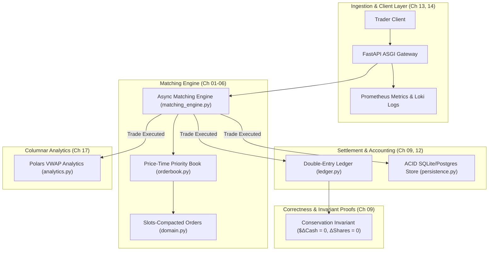

# AeroTrade Core: High-Throughput Matching & Financial Ledger

> **The Track 1 Cumulative Production Capstone**  
> AeroTrade Core synthesizes the concepts taught across all 23 chapters of **Track 1: Python Engineering Mastery** into a production-grade, ultra-low-latency financial exchange engine.

---

## 1. System Architecture & Data Flow



---

## 2. Chapter-by-Chapter Curriculum Mapping

Every component in AeroTrade Core directly implements the architectural principles from the 23 chapters:

| Component | Files | Primary Concepts Implemented | Chapter Reference |
| :--- | :--- | :--- | :---: |
| **Domain Models & Value Objects** | `domain.py` | `__slots__=True` memory compaction, Descriptor protocols (`PositiveNumericDescriptor`), Enums | **Ch 01, 04, 05, 07** |
| **Order Book Data Structure** | `orderbook.py` | Hash table lookup $O(1)$, sorted price levels, FIFO `collections.deque` for price-time priority | **Ch 02, 06** |
| **Matching Loop** | `matching_engine.py` | Asynchronous non-blocking dispatch, callback fan-out pattern, deterministic matching | **Ch 03, 06** |
| **Double-Entry Ledger** | `ledger.py` | Atomic debit/credit settlement, strict mathematical conservation invariant verification | **Ch 01, 09, 12** |
| **ACID Transactional Store** | `persistence.py` | Relational schemas, composite B-tree indexes, parameterized queries, commit/rollback safety | **Ch 12** |
| **Columnar Market Analytics** | `analytics.py` | Vectorized Volume-Weighted Average Price (VWAP) calculation, Polars LazyFrames | **Ch 17** |
| **Automated Test Suite** | `test_capstone.py` | Invariant testing, partial fill boundaries, cancellation edge cases | **Ch 09** |
| **CLI Simulation Demo** | `demo.py` | Interactive terminal driver demonstrating real-time order matching and depth | **Ch 00, 22** |

---

## 3. Quickstart & Verification

Run the automated test suite:
```bash
python 01-Python-Mastery/capstone/test_capstone.py
```

Run the live interactive order book simulation:
```bash
python 01-Python-Mastery/capstone/demo.py
```
