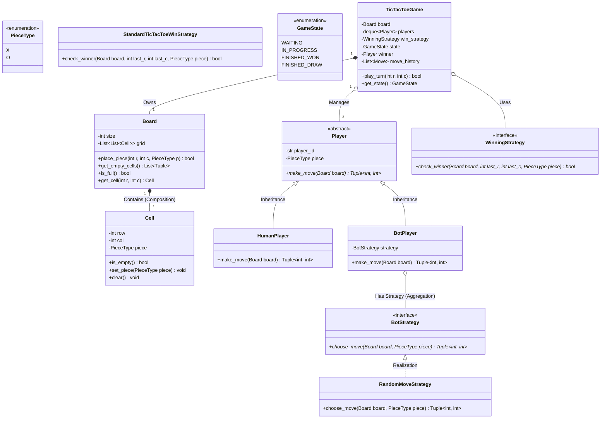

# System 00: Modular Board Game Engine (Tic-Tac-Toe to Connect-N)

> **The Essential Stepping Stone:** Before you build complex distributed schedulers and multi-node caching layers, you must master the fundamental craft of Object-Oriented Low-Level Design on a clean, tangible domain.
> **What you will be able to do:** Model a flexible, decoupled $N \times N$ game engine applying the **Strategy Pattern** (for pluggable AI bot algorithms and winning conditions), the **State Pattern** (for game lifecycle transitions), and the **Observer Pattern** (for decoupled UI notifications), culminating in a thread-safe multi-room concurrency evolution.

---

## 1. Problem Statement & Requirements

Design an extensible, clean, object-oriented engine for two-player grid games (Tic-Tac-Toe, extensible to Connect-Four or Gomoku).

### Functional Requirements
1. **Configurable Grid:** The board size must be $N \times N$ (default $3 \times 3$, but configurable to $4 \times 4$ or $5 \times 5$).
2. **Pluggable Players:** Support Human players (taking inputs from CLI/API) and AI Bot players (using interchangeable strategies: Random Bot or Heuristic Bot).
3. **Pluggable Win Evaluation:** The engine must support different victory rules without changing the `Board` class (Open/Closed Principle).
4. **Lifecycle State Management:** Clean states: `WAITING_FOR_PLAYERS` $\rightarrow$ `IN_PROGRESS` $\rightarrow$ `TERMINATED_WON` or `TERMINATED_DRAW`.
5. **Undo/History Support:** Ability to view move history or undo the previous move.

### Non-Functional Requirements
* Clean separation of concerns: The core domain rules must have zero dependency on the CLI rendering engine or terminal input mechanism.
* Testability: 100% unit-testable without mock user inputs.
* Concurrency Readiness: Cleanly evolvable into a multi-threaded game room manager where multiple matches run concurrently.

---

## 2. Object-Oriented Architecture & UML Class Diagram



---

## 3. Production Python Implementation

```python
# tic_tac_toe_engine.py
from abc import ABC, abstractmethod
from collections import deque
from enum import Enum
import random
from typing import Optional, Tuple, List

# =====================================================================
# 1. DOMAIN ENUMS & VALUE OBJECTS
# =====================================================================

class PieceType(str, Enum):
    X = "X"
    O = "O"

class GameStatus(str, Enum):
    WAITING_FOR_PLAYERS = "WAITING_FOR_PLAYERS"
    IN_PROGRESS = "IN_PROGRESS"
    WON = "WON"
    DRAW = "DRAW"

class Move:
    """Immutable record of an executed move for undo and audit history."""
    __slots__ = ("row", "col", "piece", "player_id")

    def __init__(self, row: int, col: int, piece: PieceType, player_id: str):
        self.row = row
        self.col = col
        self.piece = piece
        self.player_id = player_id

# =====================================================================
# 2. BOARD & CELL DOMAIN ENTITIES
# =====================================================================

class Cell:
    __slots__ = ("row", "col", "piece")

    def __init__(self, row: int, col: int):
        self.row = row
        self.col = col
        self.piece: Optional[PieceType] = None

    def is_empty(self) -> bool:
        return self.piece is None

    def place_piece(self, piece: PieceType) -> None:
        if not self.is_empty():
            raise ValueError(f"Cell at ({self.row}, {self.col}) is already occupied by {self.piece}")
        self.piece = piece

    def clear(self) -> None:
        self.piece = None

class Board:
    def __init__(self, size: int = 3):
        if size < 3:
            raise ValueError(f"Board size must be >= 3, got: {size}")
        self.size = size
        self.grid: List[List[Cell]] = [[Cell(r, c) for c in range(size)] for r in range(size)]

    def get_cell(self, row: int, col: int) -> Cell:
        if not (0 <= row < self.size and 0 <= col < self.size):
            raise IndexError(f"Position ({row}, {col}) is out of board boundaries [0, {self.size-1}]")
        return self.grid[row][col]

    def place_piece(self, row: int, col: int, piece: PieceType) -> None:
        cell = self.get_cell(row, col)
        cell.place_piece(piece)

    def is_full(self) -> bool:
        return all(not cell.is_empty() for row in self.grid for cell in row)

    def get_empty_positions(self) -> List[Tuple[int, int]]:
        return [(cell.row, cell.col) for row in self.grid for cell in row if cell.is_empty()]

# =====================================================================
# 3. STRATEGY PATTERN: WINNING EVALUATION STRATEGY
# =====================================================================

class WinStrategy(ABC):
    @abstractmethod
    def check_winner(self, board: Board, last_move: Move) -> bool:
        """Evaluate if the latest move triggered a victory condition."""
        pass

class StandardTicTacToeWinStrategy(WinStrategy):
    """
    O(1) localized check around the latest move rather than scanning entire board!
    Verifies the specific row, col, and diagonals affected by the last move.
    """
    def check_winner(self, board: Board, last_move: Move) -> bool:
        r, c = last_move.row, last_move.col
        target = last_move.piece
        n = board.size

        # 1. Check Row
        if all(board.get_cell(r, col_idx).piece == target for col_idx in range(n)):
            return True

        # 2. Check Column
        if all(board.get_cell(row_idx, c).piece == target for row_idx in range(n)):
            return True

        # 3. Check Main Diagonal (only if move is on it)
        if r == c:
            if all(board.get_cell(i, i).piece == target for i in range(n)):
                return True

        # 4. Check Anti-Diagonal (only if move is on it)
        if r + c == n - 1:
            if all(board.get_cell(i, n - 1 - i).piece == target for i in range(n)):
                return True

        return False

# =====================================================================
# 4. STRATEGY PATTERN: BOT MOVE STRATEGIES
# =====================================================================

class BotStrategy(ABC):
    @abstractmethod
    def choose_move(self, board: Board, piece: PieceType) -> Tuple[int, int]:
        pass

class RandomMoveStrategy(BotStrategy):
    """Selects an empty cell uniformly at random."""
    def choose_move(self, board: Board, piece: PieceType) -> Tuple[int, int]:
        available = board.get_empty_positions()
        if not available:
            raise RuntimeError("No available moves on board")
        return random.choice(available)

# =====================================================================
# 5. PLAYER ABSTRACTION
# =====================================================================

class Player(ABC):
    def __init__(self, player_id: str, piece: PieceType):
        self.player_id = player_id
        self.piece = piece

    @abstractmethod
    def decide_move(self, board: Board, suggested_move: Optional[Tuple[int, int]] = None) -> Tuple[int, int]:
        pass

class HumanPlayer(Player):
    def decide_move(self, board: Board, suggested_move: Optional[Tuple[int, int]] = None) -> Tuple[int, int]:
        if suggested_move is None:
            raise ValueError("HumanPlayer requires an explicit move input (row, col)")
        return suggested_move

class BotPlayer(Player):
    def __init__(self, player_id: str, piece: PieceType, strategy: Optional[BotStrategy] = None):
        super().__init__(player_id, piece)
        self.strategy = strategy or RandomMoveStrategy()

    def decide_move(self, board: Board, suggested_move: Optional[Tuple[int, int]] = None) -> Tuple[int, int]:
        return self.strategy.choose_move(board, self.piece)

# =====================================================================
# 6. CENTRAL GAME ENGINE (ORCHESTRATOR)
# =====================================================================

class TicTacToeGame:
    def __init__(self, player1: Player, player2: Player, board_size: int = 3, win_strategy: Optional[WinStrategy] = None):
        if player1.piece == player2.piece:
            raise ValueError("Both players cannot hold the same piece symbol!")
        self.board = Board(board_size)
        self.players: deque[Player] = deque([player1, player2])
        self.win_strategy: WinStrategy = win_strategy or StandardTicTacToeWinStrategy()
        self.status: GameStatus = GameStatus.IN_PROGRESS
        self.winner: Optional[Player] = None
        self.move_history: List[Move] = []

    @property
    def current_player(self) -> Player:
        return self.players[0]

    def play_turn(self, explicit_move: Optional[Tuple[int, int]] = None) -> Tuple[bool, str]:
        """
        Executes one full player turn:
        1. Query current player for target cell.
        2. Validate & place piece on board.
        3. Check winning invariant.
        4. Check draw invariant.
        5. Rotate turn to next player.
        """
        if self.status != GameStatus.IN_PROGRESS:
            return False, f"Game is already finished with status: {self.status}"

        player = self.current_player
        row, col = player.decide_move(self.board, explicit_move)

        # Place piece
        try:
            self.board.place_piece(row, col, player.piece)
        except (ValueError, IndexError) as err:
            return False, f"Invalid move: {err}"

        # Record history
        move_record = Move(row, col, player.piece, player.player_id)
        self.move_history.append(move_record)

        # Evaluate Victory
        if self.win_strategy.check_winner(self.board, move_record):
            self.status = GameStatus.WON
            self.winner = player
            return True, f"Player {player.player_id} ({player.piece}) WINS!"

        # Evaluate Draw
        if self.board.is_full():
            self.status = GameStatus.DRAW
            return True, "Game finished in a DRAW!"

        # Rotate turn to next player (FIFO queue rotation)
        self.players.rotate(-1)
        return True, f"Move accepted at ({row}, {col}). Next turn: {self.current_player.player_id}"

# =====================================================================
# 7. CONCURRENCY EVOLUTION: MULTI-ROOM THREAD-SAFE SERVER
# =====================================================================

import threading

class ThreadSafeGameRoom:
    """
    Shows how to take a pure single-threaded domain model and make it 100%
    thread-safe for an online multiplayer web server or WebSocket gateway!
    """
    def __init__(self, room_id: str, game: TicTacToeGame):
        self.room_id = room_id
        self.game = game
        self._lock = threading.Lock()

    def submit_move(self, player_id: str, row: int, col: int) -> Tuple[bool, str]:
        with self._lock:  # Digital bathroom key: only 1 move processed at a time!
            if self.game.current_player.player_id != player_id:
                return False, f"Not your turn! Waiting for {self.game.current_player.player_id}"
            return self.game.play_turn((row, col))
```

---

## 4. Automated Verification Suite

```python
# continues from above
def test_full_winning_flow():
    p1 = HumanPlayer("Alice", PieceType.X)
    p2 = HumanPlayer("Bob", PieceType.O)
    game = TicTacToeGame(p1, p2, board_size=3)

    # Moves:
    # X: (0,0), O: (1,0)
    # X: (0,1), O: (1,1)
    # X: (0,2) -> X wins on top row!
    game.play_turn((0, 0))
    game.play_turn((1, 0))
    game.play_turn((0, 1))
    game.play_turn((1, 1))
    success, msg = game.play_turn((0, 2))

    assert success is True
    assert game.status == GameStatus.WON
    assert game.winner == p1
    print(f"[OK] Deterministic winning flow verified: {msg}")

def test_draw_flow():
    p1 = HumanPlayer("Alice", PieceType.X)
    p2 = HumanPlayer("Bob", PieceType.O)
    game = TicTacToeGame(p1, p2, board_size=3)

    # Board layout for draw:
    # X O X
    # X O O
    # O X X
    moves = [
        (0, 0), (0, 1), (0, 2),
        (1, 1), (1, 0), (1, 2),
        (2, 1), (2, 0), (2, 2)
    ]
    for r, c in moves:
        game.play_turn((r, c))

    assert game.status == GameStatus.DRAW
    assert game.winner is None
    print("[OK] Draw condition verified.")

def test_thread_safe_room():
    p1 = HumanPlayer("Alice", PieceType.X)
    p2 = HumanPlayer("Bob", PieceType.O)
    game = TicTacToeGame(p1, p2, board_size=3)
    room = ThreadSafeGameRoom("room_101", game)

    # Verify turn enforcement
    ok, err = room.submit_move("Bob", 0, 0) # Bob tries to move out of turn!
    assert not ok
    assert "Not your turn" in err

    # Alice moves
    ok, _ = room.submit_move("Alice", 0, 0)
    assert ok
    print("[OK] Thread-safe room turn enforcement verified.")

if __name__ == "__main__":
    test_full_winning_flow()
    test_draw_flow()
    test_thread_safe_room()
    print("\n[ALL TIC-TAC-TOE SYSTEM TESTS PASSED SUCCESSFULLY]")
```

---

## Check Yourself

1. **Why is `WinStrategy` implemented as a separate class instead of hardcoding row/col checks inside the `Board` class?**
   - *Answer:* To satisfy the Open/Closed Principle (OCP). You can swap in a Connect-4 win strategy ($4$-in-a-row) or Gomoku win strategy without touching or risking bugs in `Board`.
2. **What design pattern is used to switch between a `RandomMoveStrategy` and an advanced `MinimaxBot`?**
   - *Answer:* The **Strategy Pattern**. The `BotPlayer` holds a reference to a `BotStrategy` interface, allowing behavior to be swapped at runtime.
3. **Why does `ThreadSafeGameRoom` wrap moves inside `with self._lock:`?**
   - *Answer:* To prevent race conditions in multi-threaded environments (e.g. two web requests attempting to claim the same cell at the exact same millisecond).

---

## References & Further Reading

- *Design Patterns: Elements of Reusable Object-Oriented Software* (Gang of Four)
- [Python Design Patterns Guide: Strategy Pattern](https://refactoring.guru/design-patterns/strategy/python/example)
- [Clean Code: A Handbook of Agile Software Craftsmanship](https://www.oreilly.com/library/view/clean-code-a/9780136083238/)
