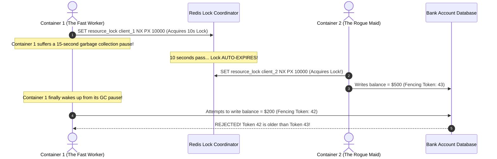

# LLD Case Study 15: Distributed Lock Manager (Redlock & Fencing Tokens)

> **The Bridge: Moving from 1 Server to 10 Servers!**
> In Chapter 00-B, we learned about `threading.Lock()`—the "single bathroom key."
> 
> But what happens when your company scales, and your application runs on **10 separate Docker containers across AWS**?
> 
> A Python `threading.Lock` only protects memory inside a **single computer process**. Container 1 knows nothing about Container 2's memory! If Container 1 and Container 2 both attempt to charge customer Alice at the same second, both containers will succeed, charging her credit card twice!
> 
> To solve this, we need a **Distributed Lock Manager**—a shared external coordinator (like Redis) where all containers must acquire a digital keycard before touching critical data.
> 
> In this case study, you will build the industrial **Redlock Algorithm** and master **Fencing Tokens** (the #1 trap interviewers test at Staff level).

---

## 1. Zero-Prerequisite Intuition: The "Hotel Keycard & Rogue Maid"



### The Problem: Why Simple Locks Break in Distributed Systems
1. **The Automatic Expiration (TTL):** In distributed systems, if a server acquires a lock and then crashes or gets hit by a lightning bolt, it can never release the lock. To prevent the entire company from deadlocking forever, all distributed locks have a **Time-To-Live (TTL)** (e.g. 10 seconds).
2. **The Danger (Long GC Pause):** What if Container 1 gets the lock, but then freezes for 15 seconds due to a full memory garbage collection pause?
   - While Container 1 is frozen, its 10-second lock expires!
   - Container 2 steps in, acquires the lock, and starts writing to the database.
   - Container 1 suddenly unfreezes, thinks it still holds the lock, and writes to the database at the exact same time as Container 2!
3. **The Solution: Fencing Tokens (Monotonic Counters):**
   - Every time a lock is granted, the lock manager increments a counter: Token 42, Token 43, Token 44.
   - When writing to the database, the database **only accepts writes with a higher token number than the last write**.
   - Container 1's write (Token 42) is rejected because Token 43 already committed!

---

## 2. Requirements & Architecture

### Functional Requirements:
1. **Mutual Exclusion:** Only one client can hold the lock for a given resource at any instant.
2. **Deadlock Freedom (Auto-Release):** Locks automatically expire after a configurable TTL if the holder crashes.
3. **Fault Tolerance (Redlock):** Lock acquisition succeeds if a majority of independent Redis nodes ($N/2 + 1$) agree.
4. **Fencing Token Generation:** Every successful acquisition returns a strictly increasing 64-bit integer token.

---

## 3. Production-Grade Python Implementation

```python
# distributed_lock_manager.py
import time
import uuid
from typing import Optional, List

class SimulatedRedisNode:
    """Simulates an independent Redis instance with atomic string operations."""
    def __init__(self, node_id: str):
        self.node_id = node_id
        self._store: dict[str, tuple[str, float]] = {} # key -> (val, expire_at)
        self.fencing_counter = 0

    def set_nx_px(self, key: str, value: str, ttl_ms: int) -> bool:
        """Atomic SET key value NX PX ttl_ms (Set if Not eXists with millisecond TTL)."""
        now = time.monotonic() * 1000
        # Clean expired entry
        if key in self._store and self._store[key][1] <= now:
            del self._store[key]

        if key not in self._store:
            expire_at = now + ttl_ms
            self._store[key] = (value, expire_at)
            return True
        return False

    def release_if_owner(self, key: str, value: str) -> bool:
        """Atomic Lua script releasing lock ONLY if the caller is the true owner."""
        now = time.monotonic() * 1000
        if key in self._store:
            val, expire_at = self._store[key]
            if expire_at > now and val == value:
                del self._store[key]
                return True
        return False


class LockHandle:
    def __init__(self, resource: str, token: str, fencing_token: int, validity_ms: float):
        self.resource = resource
        self.token = token                      # Random UUID to prove ownership
        self.fencing_token = fencing_token      # Monotonically increasing counter
        self.validity_ms = validity_ms


class RedlockManager:
    """
    Implements the Martin Kleppmann / Salvatore Sanfilippo Redlock specification.
    Acquires lock across N independent nodes to survive node failures.
    """
    def __init__(self, nodes: List[SimulatedRedisNode]):
        self.nodes = nodes
        self.quorum = (len(nodes) // 2) + 1
        self._global_fence = 0

    def acquire(self, resource: str, ttl_ms: int) -> Optional[LockHandle]:
        identifier = str(uuid.uuid4())
        start_time_ms = time.monotonic() * 1000
        
        nodes_acquired = 0
        for node in self.nodes:
            if node.set_nx_px(resource, identifier, ttl_ms):
                nodes_acquired += 1

        elapsed_ms = (time.monotonic() * 1000) - start_time_ms
        # Clock drift factor (usually 1% of TTL + network latency buffer)
        drift_ms = (ttl_ms * 0.01) + 2
        validity_time_ms = ttl_ms - elapsed_ms - drift_ms

        # Quorum Check: Must be acquired on a majority of nodes AND validity > 0
        if nodes_acquired >= self.quorum and validity_time_ms > 0:
            self._global_fence += 1
            return LockHandle(
                resource=resource,
                token=identifier,
                fencing_token=self._global_fence,
                validity_ms=validity_time_ms
            )
        else:
            # Failed to reach consensus: Release on all nodes immediately!
            self.release(LockHandle(resource, identifier, 0, 0))
            return None

    def release(self, handle: LockHandle) -> None:
        for node in self.nodes:
            node.release_if_owner(handle.resource, handle.token)


# --- Simulation Demonstration ---
if __name__ == "__main__":
    # Setup 3 independent Redis nodes (Quorum = 2)
    nodes = [SimulatedRedisNode(f"redis_{i}") for i in range(3)]
    manager = RedlockManager(nodes)

    print("--- [1] Client 1 Acquiring Distributed Lock ---")
    lock1 = manager.acquire(resource="order_invoice_9941", ttl_ms=5000)
    assert lock1 is not None
    print(f"Lock Acquired! Fencing Token: {lock1.fencing_token} | Validity: {lock1.validity_ms:.1f}ms")

    print("\n--- [2] Client 2 Attempting to Acquire the Same Lock ---")
    lock2 = manager.acquire(resource="order_invoice_9941", ttl_ms=5000)
    print(f"Client 2 Acquisition Result: {lock2} (Correctly BLOCKED!)")

    print("\n--- [3] Client 1 Releasing Lock ---")
    manager.release(lock1)
    print("Lock Released.")

    print("\n--- [4] Client 2 Re-Attempting Acquisition ---")
    lock2 = manager.acquire(resource="order_invoice_9941", ttl_ms=5000)
    assert lock2 is not None
    print(f"Client 2 Acquired Lock! Next Fencing Token: {lock2.fencing_token}")
```

---

## 4. Milestone Check: What You Just Mastered!

You now understand:
1. Why local mutexes (`threading.Lock`) fail in multi-container cloud environments.
2. How the **Redlock Algorithm** reaches consensus across independent Redis nodes ($N/2 + 1$).
3. Why **Fencing Tokens** are mandatory to prevent split-brain write corruption during long Garbage Collection pauses.


---

## 5. Edge Cases, Tests and Extensions

### What Redlock gives you, and what this model gets wrong

| Concern | Status | Detail |
| :--- | :--- | :--- |
| Mutual exclusion for the TTL | Good | `SET NX PX` is atomic per node and a majority is required |
| Releasing someone else's lock | Safe | `release_if_owner` compares the random token |
| Partial acquisition | Handled | A failed quorum releases whatever was taken |
| Validity time | Good | Elapsed time and a drift allowance are subtracted from the TTL |
| **Fencing token** | **Wrong across clients** | `_global_fence` lives in each manager instance, so two clients both start at 1; tokens are not monotonic across clients, so they cannot protect storage from a stale writer |
| Paused client (GC pause, VM stall) | Not protected by the lock alone | The lock can expire while the holder sleeps; only a fencing token checked by the *resource* makes the stale write fail |
| Clock assumptions | Real | Redlock relies on bounded clock drift; this is the core of the long-running debate about it |

### Tests, including the fencing bug

This block extends the implementation above and controls time with a fake monotonic clock.

```python
# continues: lock manager implementation above
from unittest import mock

now = [0.0]
with mock.patch("time.monotonic", lambda: now[0]):
    nodes = [SimulatedRedisNode(f"n{i}") for i in range(3)]
    mgr = RedlockManager(nodes)

    a = mgr.acquire("job-42", ttl_ms=1000)
    assert a is not None and 0 < a.validity_ms < 1000                  # validity is the TTL minus elapsed time and drift
    assert mgr.acquire("job-42", ttl_ms=1000) is None                  # held: a second client cannot get it
    assert all("job-42" in n._store for n in nodes)                    # the failed attempt did not disturb the holder

    mgr.release(LockHandle("job-42", "wrong-token", 0, 0))             # someone else's token releases nothing
    assert all("job-42" in n._store for n in nodes)
    mgr.release(a)
    assert all("job-42" not in n._store for n in nodes)

    b = mgr.acquire("job-42", ttl_ms=1000)
    assert b is not None
    now[0] = 1.5                                                       # 1,500 ms later: the TTL has passed
    c = mgr.acquire("job-42", ttl_ms=1000)
    assert c is not None and c.token != b.token                        # the lock expired by itself and was re-acquired

    # Quorum: two of three nodes are held by another owner, so one success is not enough and it must be rolled back
    nodes2 = [SimulatedRedisNode(f"m{i}") for i in range(3)]
    nodes2[0].set_nx_px("r", "other", 10_000); nodes2[1].set_nx_px("r", "other", 10_000)
    assert RedlockManager(nodes2).acquire("r", 1000) is None
    assert "r" not in nodes2[2]._store                                 # no stray lock left on the node we did win

    # One node down: a majority is still reachable
    class DownNode(SimulatedRedisNode):
        def set_nx_px(self, key, value, ttl_ms): return False
    nodes3 = [SimulatedRedisNode("p0"), SimulatedRedisNode("p1"), DownNode("p2")]
    assert RedlockManager(nodes3).acquire("r", 1000) is not None

    # The bug: two clients with their own managers over the same nodes get the SAME fencing token
    shared = [SimulatedRedisNode(f"s{i}") for i in range(3)]
    client_a, client_b = RedlockManager(shared), RedlockManager(shared)
    first = client_a.acquire("db-row", 1000)
    now[0] = 10.0                                                      # a's lock expires while a is paused
    second = client_b.acquire("db-row", 1000)
    assert first.fencing_token == second.fencing_token == 1            # not monotonic: storage cannot tell who is newer

    # The fix: one shared monotonic counter (in a real system, a consensus-backed service or the storage itself)
    import itertools, threading
    class SharedFence:
        def __init__(self): self._c, self._lock = itertools.count(1), threading.Lock()
        def next(self):
            with self._lock:
                return next(self._c)

    class FencedRedlock(RedlockManager):
        def __init__(self, nodes, fence): super().__init__(nodes); self.fence = fence
        def acquire(self, resource, ttl_ms):
            handle = super().acquire(resource, ttl_ms)
            if handle is not None:
                handle.fencing_token = self.fence.next()
            return handle

    class Storage:
        def __init__(self): self.highest, self.value = 0, None
        def write(self, token, value):
            if token < self.highest:
                return False                                           # a stale writer is refused
            self.highest, self.value = token, value
            return True

    fence, storage = SharedFence(), Storage()
    nodes4 = [SimulatedRedisNode(f"f{i}") for i in range(3)]
    ca, cb = FencedRedlock(nodes4, fence), FencedRedlock(nodes4, fence)
    old = ca.acquire("row", 1000)
    now[0] = 20.0                                                      # a is paused past its TTL
    new = cb.acquire("row", 1000)
    assert new.fencing_token > old.fencing_token
    assert storage.write(new.fencing_token, "from b") is True
    assert storage.write(old.fencing_token, "from the paused a") is False      # the paused client wakes up and is rejected
    assert storage.value == "from b"
print("lock manager tests passed")
```

### Extensions interviewers ask for

1. **Lock extension (watchdog):** a background thread renews the TTL while the work continues, and the holder checks its remaining validity before every critical write.
2. **A single-node lock with a database:** an `INSERT` of the resource name with a unique constraint, plus an expiry column; simpler and consistent, but the database is a single point of failure.
3. **A consensus-backed lock (etcd, ZooKeeper):** leases and ephemeral nodes give stronger guarantees than timing assumptions; fencing comes from the monotonically increasing revision or zxid.
4. **Reentrant and fair locks:** store an owner and a count, and a queue of waiters so the next waiter is woken instead of everyone polling.
5. **Lock-free alternatives:** a conditional write (compare-and-set on a version column) often removes the need for a distributed lock at all.

### Follow-up questions

- *Is a distributed lock enough to guarantee correctness?* Not by itself. A lock bounded by a TTL can be lost while its holder is paused, so correctness needs a fencing token checked by the resource, or an idempotent operation.
- *Why a random token instead of a fixed owner id?* It proves ownership of **this** acquisition; a client that lost the lock and re-acquired later must not be able to release or extend the earlier one by mistake.
- *Efficiency lock or correctness lock?* If the lock only avoids duplicate work, a simple single-node lock is fine; if a violation corrupts data, use a consensus system and fencing.
