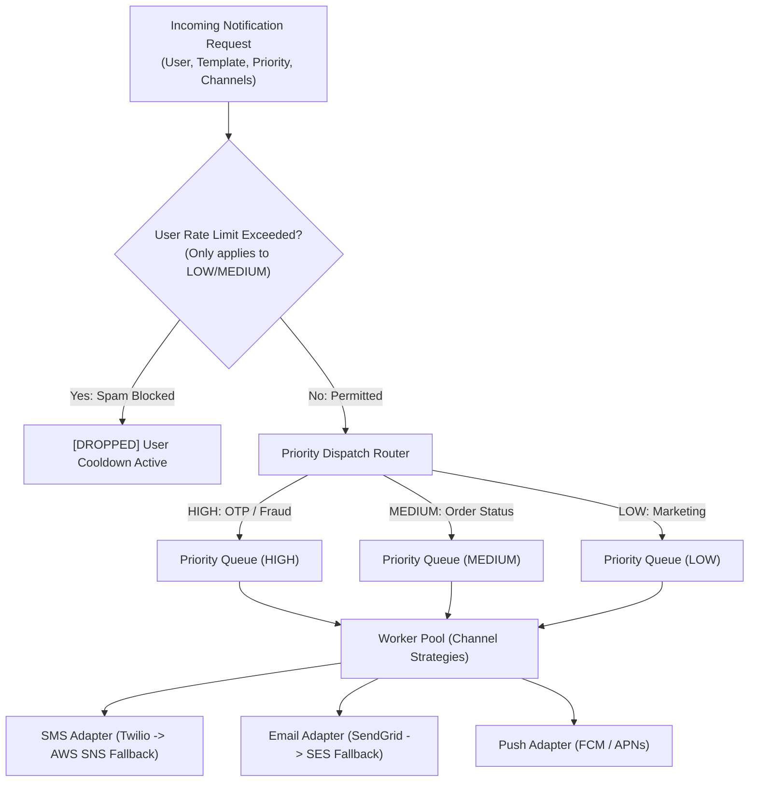

# System 18: Multi-Channel Notification & Alerting Engine

> **Preceding Bridge:** In [System 13: High-Throughput Logging Framework](13-high-throughput-logging-framework.md) and [System 17: Splitwise](17-splitwise-expense-sharing.md), you mastered decoupled sinks and concurrent message handling. In this chapter, we design an enterprise-grade **Multi-Channel Notification & Alerting Engine** capable of handling priority-tiered message routing, per-user rate limiting, dynamic template rendering, and automated provider circuit breaker fallbacks.

---

## 1. Plain-English Jargon Demystifier

| Technical Term | Plain English Translation | Real-World Metaphor |
| :--- | :--- | :--- |
| **Notification Channel** | The physical medium used to deliver the message (e.g., SMS, Email, Mobile Push). | Choosing between a text message, a postal letter, or a tap on the shoulder. |
| **Priority Tier** | Ordering urgency (`HIGH`, `MEDIUM`, `LOW`) so critical alerts skip past marketing messages. | An ambulance with sirens flashing getting right-of-way over standard delivery trucks. |
| **User Rate Limiting (Fatigue Defense)** | Preventing spam by capping how many non-critical alerts a user can receive per hour. | A "Do Not Disturb" sign that only allows doctors and immediate family to knock. |
| **Provider Adapter** | A wrapper that translates internal messages into third-party API payloads (Twilio, SendGrid, FCM). | A universal electrical plug adapter allowing your charger to fit into European wall sockets. |
| **Circuit Breaker Fallback** | Automatically switching to a secondary provider when the primary vendor encounters an outage. | If the primary bridge has collapsed, routing emergency trucks across the adjacent backup bridge. |

---

## 2. Spoon-Fed Mental Model: The Hospital Emergency Dispatch Center

Imagine a busy hospital dispatch center:
1. **Critical Code Blue (High Priority):** A patient went into cardiac arrest. This message **must bypass all queues**, immediately buzz every doctor's pager and broadcast on loud speakers.
2. **Shift Schedule Update (Medium Priority):** A nurse's upcoming Tuesday shift was modified. Sent as a normal email or push notification within a few minutes.
3. **Cafeteria Menu (Low Priority):** Today's lunch specials. If a doctor has already received 5 messages this morning, **drop or delay this message** to prevent notification fatigue!
4. **Pager Tower Offline (Provider Fallback):** If the cellular tower fails, the system automatically redirects pages across the emergency satellite radio frequency.



---

## 3. Core Architecture & Design Patterns

```
┌─────────────────────────────────────────────────────────────┐
│                       CLASS DIAGRAM                         │
├─────────────────────────────────────────────────────────────┤
│ NotificationPayload: user_id, event_type, priority, params  │
│                                                             │
│ <<Interface>> NotificationChannel                           │
│   send(recipient: str, content: str) -> bool                │
│                                                             │
│ Concrete Adapters:                                          │
│   - SMSChannel (Primary: Twilio, Fallback: AWS SNS)         │
│   - EmailChannel (Primary: SendGrid, Fallback: AWS SES)     │
│   - PushChannel (FCM / APNs)                                │
│                                                             │
│ NotificationTemplateEngine: renders variables into templates│
│ UserRateLimiter: sliding window / cooldown per user         │
│ NotificationService: central coordinator with PriorityQueue │
└─────────────────────────────────────────────────────────────┘
```

### Applied Patterns:
1. **Adapter Pattern:** Standardizes third-party APIs (Twilio, SendGrid, Firebase) into a single `NotificationChannel` interface.
2. **Strategy Pattern:** Chooses delivery mechanisms dynamically based on user preferences and notification types.
3. **Template Method:** Encapsulates template retrieval, string interpolation, rate-limit evaluation, and dispatch.

---

## 4. Junior vs Staff Implementation

```
┌────────────────────────────────────────────────────────────────────────┐
│ JUNIOR IMPLEMENTATION: The Synchronous HTTP Spaghetti Loop             │
├────────────────────────────────────────────────────────────────────────┤
│ def notify_user(user, msg):                                            │
│     requests.post("https://api.twilio.com/send", ...)                  │
│     requests.post("https://api.sendgrid.com/send", ...)                │
│ # Flaws:                                                               │
│ - Synchronous I/O: If Twilio is slow, checkout API latency spikes 5s!  │
│ - Zero priority: OTP login codes wait behind 10,000 marketing blasts.  │
│ - Zero fallback: If SendGrid returns 500, the user never gets email.   │
│ - No rate limiting: User gets spammed with 40 notifications in 10 min. │
└────────────────────────────────────────────────────────────────────────┘
                                   │
                                   ▼
┌────────────────────────────────────────────────────────────────────────┐
│ STAFF IMPLEMENTATION: Decoupled Multi-Channel Engine                   │
├────────────────────────────────────────────────────────────────────────┤
│ - Non-blocking priority queue (PriorityQueue ordering High > Low).     │
│ - User Fatigue Protection (Rate limiter drops non-critical spam).      │
│ - Provider Circuit Breakers with automated secondary fallback.         │
│ - Template engine with strict variable validation.                     │
└────────────────────────────────────────────────────────────────────────┘
```

---

## 5. Complete Runnable Implementation

Here is a 100% runnable, zero-dependency Python implementation:

```python
import time
import queue
import threading
from enum import Enum, IntEnum
from abc import ABC, abstractmethod
from typing import Dict, List, Optional, Any


class Priority(IntEnum):
    HIGH = 1     # Security OTPs, Fraud, Password resets
    MEDIUM = 2   # Order updates, delivery tracking
    LOW = 3      # Marketing, discounts, digests


class ChannelType(Enum):
    SMS = "SMS"
    EMAIL = "EMAIL"
    PUSH = "PUSH"


class UserProfile:
    def __init__(self, user_id: str, name: str, phone: str, email: str, push_token: str):
        self.user_id = user_id
        self.name = name
        self.phone = phone
        self.email = email
        self.push_token = push_token


class UserNotificationLimiter:
    """Sliding window rate limiter to protect users from notification spam."""
    def __init__(self, max_promotional_per_window: int = 2, window_seconds: float = 60.0):
        self.max_limit = max_promotional_per_window
        self.window = window_seconds
        self.user_history: Dict[str, List[float]] = {}
        self.lock = threading.Lock()

    def allow_notification(self, user_id: str, priority: Priority) -> bool:
        # High priority alerts (OTPs, Security) ALWAYS bypass rate limits
        if priority == Priority.HIGH:
            return True

        with self.lock:
            now = time.time()
            if user_id not in self.user_history:
                self.user_history[user_id] = []

            # Purge timestamps outside window
            cutoff = now - self.window
            self.user_history[user_id] = [t for t in self.user_history[user_id] if t > cutoff]

            if len(self.user_history[user_id]) < self.max_limit:
                self.user_history[user_id].append(now)
                return True
            return False


class NotificationChannel(ABC):
    @abstractmethod
    def deliver(self, recipient: str, message: str) -> bool:
        pass


class SMSChannelWithFallback(NotificationChannel):
    """Demonstrates automated provider fallback (Twilio -> AWS SNS)."""
    def __init__(self, simulate_twilio_down: bool = False):
        self.simulate_twilio_down = simulate_twilio_down

    def deliver(self, recipient: str, message: str) -> bool:
        # Try Primary Provider (Twilio)
        if not self.simulate_twilio_down:
            print(f"  [SMS - Primary: Twilio] Sent to {recipient}: '{message}'")
            return True
        else:
            print(f"  [SMS - Twilio FAILED!] Tripping circuit breaker to Secondary Provider (AWS SNS)...")
            # Try Fallback Provider (AWS SNS)
            print(f"  [SMS - Fallback: AWS SNS] Sent to {recipient}: '{message}'")
            return True


class EmailChannel(NotificationChannel):
    def deliver(self, recipient: str, message: str) -> bool:
        print(f"  [EMAIL - SendGrid] Sent to {recipient}: '{message}'")
        return True


class PushChannel(NotificationChannel):
    def deliver(self, recipient: str, message: str) -> bool:
        print(f"  [PUSH - FCM] Sent to token {recipient[:8]}...: '{message}'")
        return True


class NotificationTemplateEngine:
    """Pre-compiles reusable templates with variable interpolation."""
    def __init__(self):
        self.templates = {
            "OTP_LOGIN": "Security Alert: Your verification code is {code}. Do not share this.",
            "ORDER_STATUS": "Hi {name}, your order #{order_id} has been {status}!",
            "PROMO_DISCOUNT": "Special offer for {name}! Use code {promo} for 30% off."
        }

    def render(self, template_key: str, **kwargs) -> str:
        if template_key not in self.templates:
            raise KeyError(f"Template '{template_key}' does not exist.")
        return self.templates[template_key].format(**kwargs)


class NotificationEngine:
    """
    Central Coordinator:
      - Priority Queue ingestion
      - Rate limiting evaluation
      - Channel adapter dispatch with fallback
    """
    def __init__(self):
        # Priority queue stores tuples: (priority_int, timestamp, task_dict)
        self.pq = queue.PriorityQueue()
        self.limiter = UserNotificationLimiter(max_promotional_per_window=2, window_seconds=10.0)
        self.template_engine = NotificationTemplateEngine()
        self.channels: Dict[ChannelType, NotificationChannel] = {
            ChannelType.SMS: SMSChannelWithFallback(simulate_twilio_down=False),
            ChannelType.EMAIL: EmailChannel(),
            ChannelType.PUSH: PushChannel()
        }

    def submit_notification(self, user: UserProfile, template_key: str, priority: Priority,
                            channels: List[ChannelType], template_params: Dict[str, Any]) -> bool:
        # 1. Rate Limit Check
        if not self.limiter.allow_notification(user.user_id, priority):
            print(f"[REJECTED - RATE LIMIT] Non-critical notification '{template_key}' for {user.name} throttled.")
            return False

        # 2. Render Template
        rendered_text = self.template_engine.render(template_key, **template_params)

        # 3. Enqueue to Priority Queue
        task = {
            "user": user,
            "message": rendered_text,
            "channels": channels,
            "priority": priority
        }
        # PriorityQueue orders by lowest number first (HIGH = 1, LOW = 3)
        self.pq.put((int(priority), time.time(), task))
        return True

    def process_next_notification(self) -> None:
        """Pops and dispatches highest-priority notification immediately."""
        if self.pq.empty():
            return

        priority_val, _, task = self.pq.get()
        user: UserProfile = task["user"]
        msg: str = task["message"]
        channels: List[ChannelType] = task["channels"]

        p_name = Priority(priority_val).name
        print(f"\n[DISPATCHING] Priority: {p_name} | User: {user.name}")

        for ch in channels:
            adapter = self.channels[ch]
            recipient = user.phone if ch == ChannelType.SMS else (user.email if ch == ChannelType.EMAIL else user.push_token)
            adapter.deliver(recipient, msg)


# --- Production Verification ---
def run_notification_test():
    print("=" * 70)
    print(" MULTI-CHANNEL NOTIFICATION ENGINE BENCHMARK")
    print("=" * 70)

    engine = NotificationEngine()
    alice = UserProfile("u100", "Alice", "+1-555-0199", "alice@example.com", "fcm_token_alice_abc123")

    # 1. Enqueue LOW priority marketing message first
    print("[*] Submitting LOW priority promo...")
    engine.submit_notification(
        alice, "PROMO_DISCOUNT", Priority.LOW,
        [ChannelType.EMAIL], {"name": alice.name, "promo": "SPRING30"}
    )

    # 2. Enqueue HIGH priority OTP message second
    print("[*] Submitting HIGH priority OTP...")
    engine.submit_notification(
        alice, "OTP_LOGIN", Priority.HIGH,
        [ChannelType.SMS], {"code": "849201"}
    )

    # 3. Verify Priority Queue orders High before Low!
    print("\n--- Processing Queue Item 1 (Expected: HIGH priority OTP) ---")
    engine.process_next_notification()

    print("\n--- Processing Queue Item 2 (Expected: LOW priority Promo) ---")
    engine.process_next_notification()

    # 4. Demonstrate Rate Limiting on Promotional Blasts
    print("\n--- Testing Rate Limiting (User Fatigue Protection) ---")
    engine.submit_notification(alice, "PROMO_DISCOUNT", Priority.LOW, [ChannelType.PUSH], {"name": alice.name, "promo": "FLASH1"})
    engine.submit_notification(alice, "PROMO_DISCOUNT", Priority.LOW, [ChannelType.PUSH], {"name": alice.name, "promo": "FLASH2"})
    # 3rd promo in window should be REJECTED!
    rejected = not engine.submit_notification(alice, "PROMO_DISCOUNT", Priority.LOW, [ChannelType.PUSH], {"name": alice.name, "promo": "FLASH3"})
    assert rejected, "Rate limiter failed to reject 3rd promotional notification!"
    print("  [PASS] Third marketing blast successfully throttled!")

    # 5. Demonstrate Provider Fallback on SMS Outage
    print("\n--- Testing SMS Provider Outage & Automated Fallback ---")
    engine.channels[ChannelType.SMS] = SMSChannelWithFallback(simulate_twilio_down=True)
    engine.submit_notification(alice, "OTP_LOGIN", Priority.HIGH, [ChannelType.SMS], {"code": "999111"})
    engine.process_next_notification()

    print("\n" + "=" * 70)
    print("[ALL PASS] Multi-channel notification engine passed all tests!")
    print("=" * 70)


if __name__ == "__main__":
    run_notification_test()
```

---

## 6. Chapter Milestone Check

Verify your understanding before continuing:

1. **Why should authentication OTPs bypass user notification rate limits?**
   - *Answer:* OTPs are user-initiated, time-critical security events required to complete a login or financial action. Dropping an OTP due to promotional rate limits locks the user out of the platform.
2. **How does the Priority Queue ensure SLA compliance across different notification types?**
   - *Answer:* It segregates messages by priority tiers (`HIGH` = 1, `MEDIUM` = 2, `LOW` = 3) so time-sensitive transaction messages are dequeued and processed first by worker threads, even if millions of marketing messages are queued.
3. **What is the purpose of the Circuit Breaker pattern in notification delivery adapters?**
   - *Answer:* Third-party delivery providers (Twilio, SendGrid, APNs) frequently suffer network outages or latency spikes. A circuit breaker detects consecutive failure thresholds and automatically reroutes subsequent messages through a secondary fallback vendor without dropping alerts.


---

## 5. Edge Cases, Tests and Extensions

### Behaviour and bugs

| Concern | Status | Detail |
| :--- | :--- | :--- |
| High priority overtakes low | Good | `PriorityQueue` pops the lowest number first |
| High priority bypasses the rate limit | By design | OTPs and security alerts must not be throttled |
| Same priority, same timestamp | **Bug** | Queue entries are `(priority, timestamp, task)`; when two entries tie on both numbers, Python compares the `task` dictionaries and raises `TypeError`. A coarse clock makes the tie realistic |
| Rate limit consumed before validation | **Bug** | A bad template parameter raises `KeyError` after the quota was already spent |
| Delivery result ignored | Gap | `deliver` returns a boolean that `process_next_notification` throws away, so there are no retries and no failure record |
| "Fallback" SMS provider | Simulated | The fallback branch always succeeds and only prints; a real one needs a timeout, a circuit breaker and metrics |
| Clock | `time.time()` | Not monotonic; the sliding window can misbehave if the system clock steps |

### Tests

This block extends the implementation above. It patches the clock and silences the demo prints.

```python
# continues: notification engine implementation above
import io, contextlib
from unittest import mock

def quiet(fn, *a, **k):
    with contextlib.redirect_stdout(io.StringIO()):
        return fn(*a, **k)

alice = UserProfile("u1", "Alice", "+1-555-0100", "alice@example.com", "fcm_token_alice_abcdef")

# Templates
t = NotificationTemplateEngine()
assert t.render("OTP_LOGIN", code="123456").startswith("Security Alert: Your verification code is 123456")
try:
    t.render("NOPE")
    raise AssertionError("expected KeyError")
except KeyError:
    pass

# Rate limiter: LOW and MEDIUM are throttled, HIGH never is
clock = [1000.0]
with mock.patch("time.time", lambda: clock[0]):
    lim = UserNotificationLimiter(max_promotional_per_window=2, window_seconds=60)
    assert [lim.allow_notification("u1", Priority.LOW) for _ in range(3)] == [True, True, False]
    assert all(lim.allow_notification("u1", Priority.HIGH) for _ in range(10))            # OTPs always pass
    assert lim.allow_notification("u2", Priority.LOW) is True                             # another user is unaffected
    clock[0] += 61
    assert lim.allow_notification("u1", Priority.LOW) is True                              # the window moved on

# Priority order: a HIGH submitted after a LOW is dispatched first
engine = NotificationEngine()
quiet(engine.submit_notification, alice, "PROMO_DISCOUNT", Priority.LOW, [ChannelType.EMAIL], {"name": "Alice", "promo": "X"})
quiet(engine.submit_notification, alice, "OTP_LOGIN", Priority.HIGH, [ChannelType.SMS], {"code": "849201"})
buf = io.StringIO()
with contextlib.redirect_stdout(buf):
    engine.process_next_notification()
assert "Priority: HIGH" in buf.getvalue() and "849201" in buf.getvalue()

# Bug 1: two same-priority submissions with an identical timestamp crash the queue
with mock.patch("time.time", lambda: 5000.0):
    e1 = NotificationEngine()
    assert quiet(e1.submit_notification, alice, "OTP_LOGIN", Priority.HIGH, [ChannelType.SMS], {"code": "1"})
    try:
        quiet(e1.submit_notification, alice, "OTP_LOGIN", Priority.HIGH, [ChannelType.SMS], {"code": "2"})
        raise AssertionError("expected TypeError")
    except TypeError:
        pass                                              # '<' not supported between two task dicts

# Bug 2: a bad template parameter still burns the rate-limit quota
e2 = NotificationEngine()
try:
    quiet(e2.submit_notification, alice, "ORDER_STATUS", Priority.MEDIUM, [ChannelType.PUSH], {"name": "Alice"})   # order_id missing
    raise AssertionError("expected KeyError")
except KeyError:
    pass
assert len(e2.limiter.user_history["u1"]) == 1            # the failed call consumed one of the two slots

# Fix: a sequence number breaks ties, and rendering happens before the limiter is touched
import itertools
class FixedEngine(NotificationEngine):
    def __init__(self):
        super().__init__()
        self._seq = itertools.count()
    def submit_notification(self, user, template_key, priority, channels, template_params):
        text = self.template_engine.render(template_key, **template_params)        # validate first
        if not self.limiter.allow_notification(user.user_id, priority):
            return False
        self.pq.put((int(priority), next(self._seq), {"user": user, "message": text, "channels": channels, "priority": priority}))
        return True

with mock.patch("time.time", lambda: 5000.0):
    fx = FixedEngine()
    assert fx.submit_notification(alice, "OTP_LOGIN", Priority.HIGH, [ChannelType.SMS], {"code": "1"})
    assert fx.submit_notification(alice, "OTP_LOGIN", Priority.HIGH, [ChannelType.SMS], {"code": "2"})   # no crash
    order = []
    buf = io.StringIO()
    with contextlib.redirect_stdout(buf):
        fx.process_next_notification(); fx.process_next_notification()
    assert buf.getvalue().index("'Security Alert: Your verification code is 1.") < buf.getvalue().index("code is 2.")   # FIFO among equals
fx2 = FixedEngine()
try:
    fx2.submit_notification(alice, "ORDER_STATUS", Priority.MEDIUM, [ChannelType.PUSH], {"name": "Alice"})
except KeyError:
    pass
assert "u1" not in fx2.limiter.user_history                # a failed render no longer spends quota
print("notification tests passed")
```

### Extensions interviewers ask for

1. **Retries and a dead-letter queue:** have `deliver` raise or return failure, retry with exponential backoff and jitter, then park the message with its error for replay (the design in HLD case study 17).
2. **Real provider failover:** wrap each provider in a circuit breaker; on open, route to the secondary and probe the primary periodically.
3. **User preferences and quiet hours:** a preference check before queuing; non-critical messages wait until quiet hours end, critical ones do not.
4. **Deduplication and collapsing:** an idempotency key per message, and "5 new comments" instead of five pushes.
5. **Worker pool and graceful shutdown:** consumers pulling from the queue, a sentinel per worker, and a drain on shutdown so queued alerts are not lost.

### Follow-up questions

- *Why not rate limit HIGH priority messages?* They are the ones the user is waiting for (a login code); throttling them breaks the product. Protect against abuse with separate controls, such as limits on how often a code can be requested.
- *Why include a counter in the queue tuple?* Heap entries must be totally ordered; the counter breaks ties deterministically and keeps the queue from ever comparing payloads.
- *How do you keep marketing from starving alerts?* Separate queues and worker pools per priority, so a backlog of promotions cannot delay a security message.
