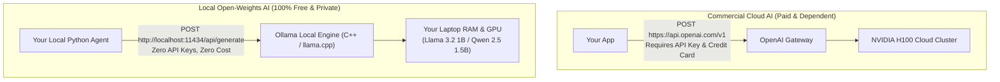
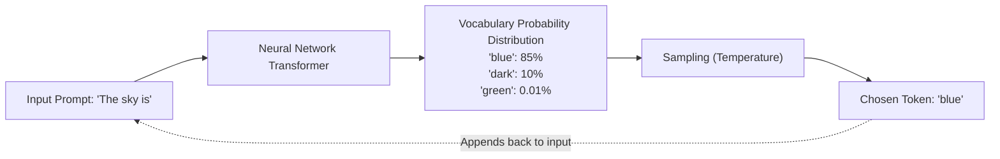
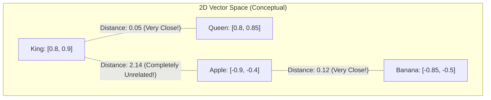
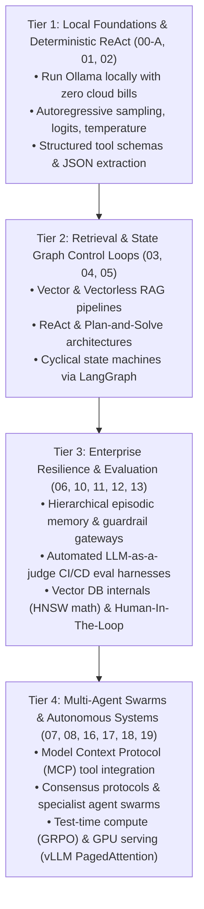

# Chapter 00-A: Zero-Cost Local AI Setup, Token Mechanics & Geometric Embeddings

> **What you will be able to do:** Run open-weights Large Language Models locally on your laptop 100% free using **Ollama**, demystify next-token probability mechanics without mathematical jargon, execute tool-calling agents with zero cloud bills or API keys, and build an intuitive geometric mental model of high-dimensional vector embeddings.
> **What you must already know:** Track 1 Python syntax and basic HTTP/JSON fundamentals.

---

> **The True Frontier of Software Engineering**
> Traditional programming is **deterministic**: you write `if x > 10: do_something()`, and the computer follows exact rules.
> **Agentic AI** is **probabilistic reasoning**: you give an AI model a high-level goal, a set of tools (functions), and let it plan, inspect outputs, fix its own bugs, and take actions in the physical world.
> 
> But you do NOT need a \$10,000 GPU cluster or a paid OpenAI API subscription to become a world-class AI systems engineer. You can run open-weights models locally on your Mac, Windows, or Linux laptop completely free. This chapter builds that foundation from the ground up.

---

## 1. Zero-Cost Local AI Architecture: Ollama

In commercial cloud setups, every prompt you send to OpenAI or Anthropic costs fractions of a cent and requires credit card billing, rate limit tracking, and internet access.

In **Local AI**, the neural network model weights run directly inside your computer's RAM and CPU/GPU!



### Installing and Running Ollama in 60 Seconds
1. Go to [ollama.com](https://ollama.com/) and download the one-click installer for Windows, macOS, or Linux.
2. Open your terminal and pull a lightweight, high-performance model:
   ```bash
   ollama run llama3.2:1b
   ```
   *(The `1b` model takes only ~1.3 GB of disk space and runs smoothly on almost any laptop with 8GB RAM!)*
3. Once downloaded, you can chat with it directly in your terminal, or talk to its local REST API at `http://localhost:11434`.

---

## 2. How LLMs Actually Work: The Autoregressive Token Loop

A Large Language Model is NOT a conscious brain. At its core, an LLM is an ultra-sophisticated **Next-Token Prediction Engine**.

### Words vs Tokens
Computers cannot read English letters. Text is split into numeric chunks called **Tokens**:
* A token is roughly $0.75$ of a word (e.g. `"apple"` is 1 token; `"unbelievable"` might be 3 tokens: `["un", "believ", "able"]`).
* Each token corresponds to an integer ID in the model's vocabulary (e.g. `12450`).



### The Generation Loop (Autoregressive)
1. **Feed Prompt:** You provide `"The sky is"`.
2. **Compute Probabilities:** The neural network calculates a probability score for all 128,000 possible tokens in its dictionary.
3. **Sample Next Token:** It chooses `"blue"` (85% probability).
4. **Append & Repeat:** It appends `"blue"` to the prompt (`"The sky is blue"`) and runs the entire neural network again to predict the next token (`"."`)!
5. **Stop Token:** When the model outputs a special invisible marker called `<|end_of_text|>`, the generation halts.

### Decoding the Hyperparameters: Temperature and Top-P
* **Temperature ($0.0 \le T \le 1.0$):** Controls randomness.
  * $T = 0.0$ (**Argmax / Greedy**): Always picks the #1 most probable token. Deterministic; ideal for SQL generation, math, and code.
  * $T = 0.7$ (**Creative**): Flattens the probability curve, allowing the model to occasionally pick the 2nd or 3rd most likely word. Great for creative writing and brainstorming.
* **Top-P (Nucleus Sampling):** Restricts the candidate pool to the top $P\%$ of cumulative probability mass (e.g., $P = 0.9$ ignores the bottom 10% of bizarre words).

---

## 3. Geometric Intuition: Vector Embeddings

In Track 4, you will build **Retrieval-Augmented Generation (RAG)** systems that search through millions of documents. To understand RAG, you must understand **Vector Embeddings**.

### The "Words as GPS Coordinates" Metaphor
How does a computer know that `"king"` and `"queen"` are related, or that `"puppy"` is close to `"dog"`?
An **Embedding Model** transforms a piece of text into a list of numbers representing **coordinates in an $N$-dimensional space**:



### Cosine Similarity: Measuring Meaning
To compare how semantically similar two sentences are, we measure the angle $\theta$ between their vector arrows:
$$\text{Cosine Similarity} = \frac{A \cdot B}{\|A\| \|B\|} = \cos(\theta)$$
* **$1.0$**: Pointing in the exact same direction (Identical meaning).
* **$0.0$**: Perpendicular (Completely unrelated).
* **$-1.0$**: Diametrically opposite meaning.

---

## 4. Building Your First Autonomous Agent (Zero Cloud Dependencies)

An **Agent** is an LLM connected to external Python functions (**Tools**). When given a query it cannot answer on its own, it generates a structured tool call, waits for your Python code to execute it, and interprets the result!

Here is a fully runnable, deterministic agent loop demonstrating the **ReAct (Reasoning + Action)** pattern:

```python
# standalone_agent_lab.py
"""
Production Autonomous Agent Core (Self-Contained & Deterministic).
Demonstrates the complete ReAct (Reason + Act) loop:
Prompt -> LLM Thought -> Tool Selection -> Tool Execution -> Final Synthesis.
"""

import json
from typing import Dict, Any, Callable

# 1. DEFINE AVAILABLE TOOLS
def calculate_expression(expression: str) -> str:
    """Safely evaluates basic arithmetic expressions."""
    try:
        # In production, use AST-based evaluators rather than raw eval!
        allowed = set("0123456789+-*/.() ")
        if not all(c in allowed for c in expression):
            return "Error: Unsupported characters in expression"
        return str(eval(expression))
    except Exception as e:
        return f"Error evaluating expression: {e}"

def lookup_weather(city: str) -> str:
    """Mock weather service returning live telemetry."""
    weather_db = {
        "london": "14°C, Overcast with light drizzle",
        "tokyo": "22°C, Clear skies",
        "new york": "18°C, Partly cloudy"
    }
    return weather_db.get(city.lower(), f"City '{city}' not found in weather registry")

TOOL_REGISTRY: Dict[str, Callable] = {
    "calculate_expression": calculate_expression,
    "lookup_weather": lookup_weather
}

# 2. THE REASONING ENGINE (MOCK / OFFLINE LLM EMULATOR)
class DeterministicAgent:
    """
    Executes the ReAct loop:
    1. Evaluates user intent.
    2. Emits structured JSON Tool Call.
    3. Dispatches Python execution.
    4. Incorporates tool output into final response.
    """
    def __init__(self, tools: Dict[str, Callable]):
        self.tools = tools

    def run(self, user_query: str) -> str:
        print(f"\n[USER QUERY] '{user_query}'")
        
        # Step 1: Decision routing (Simulates LLM function calling decision)
        if "weather in" in user_query.lower():
            city = user_query.lower().split("weather in")[-1].strip().rstrip("?").strip("'\"")
            tool_call = {"tool": "lookup_weather", "arguments": {"city": city}}
        elif "calculate" in user_query.lower() or any(op in user_query for op in "+-*/"):
            # Extract expression
            expr = "".join(c for c in user_query if c in "0123456789+-*/.() ")
            tool_call = {"tool": "calculate_expression", "arguments": {"expression": expr.strip()}}
        else:
            return f"Agent response: I can answer this directly without tools."

        print(f"  -> [AGENT THOUGHT] Need external tool to resolve query.")
        print(f"  -> [TOOL CALL EMITTED] {json.dumps(tool_call)}")

        # Step 2: Tool Execution
        tool_name = tool_call["tool"]
        tool_func = self.tools.get(tool_name)
        if not tool_func:
            return f"Error: Tool '{tool_name}' not available."

        tool_output = tool_func(**tool_call["arguments"])
        print(f"  -> [TOOL EXECUTION OUTPUT] '{tool_output}'")

        # Step 3: Final Synthesis
        final_response = f"Based on live tool data: The result is {tool_output}."
        print(f"  -> [FINAL RESPONSE] {final_response}")
        return final_response
```

---

## 5. Automated Verification Suite

```python
# continues from above
import math

def test_cosine_similarity_math():
    """Verify high-dimensional angle calculation."""
    def cosine_similarity(v1: list[float], v2: list[float]) -> float:
        dot = sum(a * b for a, b in zip(v1, v2))
        norm1 = math.sqrt(sum(a * a for a in v1))
        norm2 = math.sqrt(sum(b * b for b in v2))
        return dot / (norm1 * norm2)

    vec_king = [0.8, 0.9, 0.1]
    vec_queen = [0.8, 0.85, 0.12]
    vec_apple = [-0.9, -0.4, 0.0]

    sim_royal = cosine_similarity(vec_king, vec_queen)
    sim_unrelated = cosine_similarity(vec_king, vec_apple)

    assert sim_royal > 0.95, f"Royal terms should be near-identical, got {sim_royal}"
    assert sim_unrelated < 0.0, f"Unrelated terms should have negative cosine, got {sim_unrelated}"
    print(f"[OK] Geometric vector embedding math verified (Royal Sim: {sim_royal:.4f})")

def test_agent_tool_calling_flow():
    agent = DeterministicAgent(TOOL_REGISTRY)

    # Test weather query
    res_weather = agent.run("What is the weather in Tokyo?")
    assert "22°C" in res_weather

    # Test math query
    res_math = agent.run("Calculate (15 * 4) + 10")
    assert "70" in res_math
    print("[OK] ReAct agent tool invocation and execution verified.")

if __name__ == "__main__":
    test_cosine_similarity_math()
    test_agent_tool_calling_flow()
    print("\n[ALL AGENTIC AI FOUNDATIONS TESTS PASSED SUCCESSFULLY]")
```

---

## 6. The 4-Tier Agentic AI Progression Roadmap

Agentic AI moves far beyond simple chatbot prompts. Follow this 4-tier architectural progression across Track 4:



---

## Check Yourself

1. **Why does setting `temperature = 0.0` make an LLM's responses deterministic?**
   - *Answer:* It forces the model to select the token with the highest predicted probability (Argmax) every single step, eliminating random sampling.
2. **What is a "Token", and why do LLMs not process whole English words directly?**
   - *Answer:* A token is a numerical subword chunk (typically 3-4 characters). Splitting text into fixed vocabulary IDs allows the model to handle any word, spelling, or code snippet with a compact vocabulary of ~128,000 integers.
3. **What does a Cosine Similarity score of `1.0` between two vector embeddings signify?**
   - *Answer:* It signifies that the two vectors point in the exact same direction in high-dimensional space, meaning the underlying sentences have near-identical semantic meaning.
4. **What are the 3 steps of the ReAct (Reason + Act) loop?**
   - *Answer:* 1) The model reasons about what it needs, 2) it emits a structured action (Tool Call), 3) it receives the observation output and synthesizes the final answer.

---

## References & Further Reading

- [Ollama Official Documentation & Model Library](https://ollama.com/)
- [Vaswani et al. (2017): *Attention Is All You Need*](https://arxiv.org/abs/1706.03762)
- [Yao et al. (2022): *ReAct: Synergizing Reasoning and Acting in Language Models*](https://arxiv.org/abs/2210.03629)
- [OpenAI: Embeddings Guide & Cosine Similarity](https://platform.openai.com/docs/guides/embeddings)
