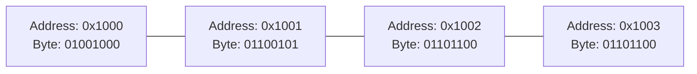
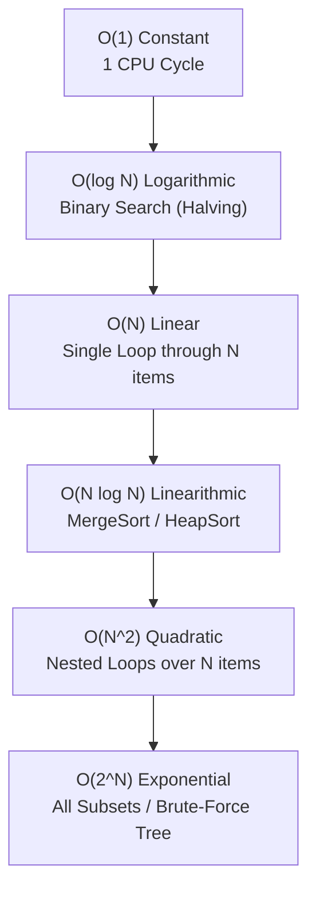
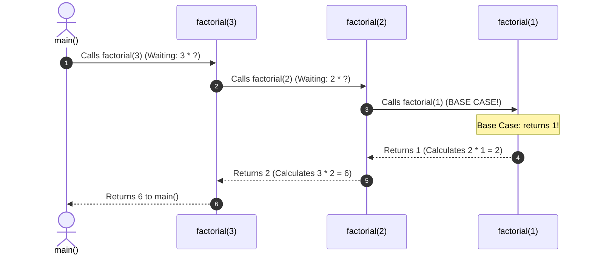

# Chapter 00-A: Zero-Prerequisite Computer Science Foundations & Data Structure Construction

> **What you will be able to do:** Understand computer RAM and pointers from the silicon up, prove why arrays have $O(1)$ random access, build the 5 foundational data structures (Dynamic Array, Linked List, Stack, Queue, Binary Search Tree) from scratch in bare Python, demystify recursion and call-stack frame mechanics, and calculate Big-O time and space complexity with zero guesswork.
> **What you must already know:** Track 1 Python syntax (classes, loops, conditionals).

---

> **The Bridge from Coding to Algorithmic Mastery**
> Anyone can memorize LeetCode solutions. But when a Google or Meta interviewer tweaks a constraint, engineers who memorized answers freeze.
> Engineers who understand **how physical hardware manipulates bytes in memory** never freeze.
> 
> Before you tackle the 16 Algorithmic Patterns and the Core 75, this chapter will build your foundational intuition by hand-crafting every primary data structure from raw memory pointers.

---

## 1. Physical RAM & Memory Addresses (The Silicon Reality)

### What is Computer Memory (RAM)?
Your computer's RAM is a massive, linear strip of numbered lockers. Each locker holds **1 Byte (8 bits)** of data. Each locker has a unique numerical address:



### Why Array Indexing is Strictly $O(1)$ Constant Time
Why does accessing `nums[500]` take the exact same time as `nums[0]`?
Because the CPU does not count through 500 items! It uses simple **Pointer Arithmetic**:
$$\text{Memory Address} = \text{Base Address} + (\text{Index} \times \text{Element Size})$$

If an array starts at memory address `1000` and each 64-bit integer takes `8 bytes`:
$$\text{Address of index } 500 = 1000 + (500 \times 8) = 5000$$
The CPU calculates `5000` in **1 single clock cycle** and jumps directly to that electrical wire. That is why array random access is mathematically $O(1)$!

---

## 2. Big-O Complexity Masterclass: Counting Steps Without Guessing

Big-O notation describes **how the execution time or memory of an algorithm scales as the input size $N$ grows toward infinity**.



### The 3 Golden Rules of Big-O Calculation:
1. **Drop Constant Factors:** An algorithm doing $3N + 50$ operations is simplified to $O(N)$. Constants don't matter when $N = 1,000,000$.
2. **Keep Only the Dominant Term:** If an algorithm takes $N^2 + 500N$ steps, the $N^2$ term dwarfs $500N$ at scale. The complexity is $O(N^2)$.
3. **Worst-Case by Default:** Unless specified otherwise, always analyze the worst possible input scenario.

---

## 3. Building the 5 Fundamental Data Structures from Scratch

Here is the complete production implementation of the 5 foundational data structures written in bare Python:

```python
# core_data_structures.py
from typing import Optional, List

# =====================================================================
# 1. THE DYNAMIC ARRAY (Python list from scratch with geometric doubling)
# =====================================================================
class DynamicArray:
    """
    Implements a resizable array with geometric capacity doubling.
    Proves why append() has amortized O(1) time complexity!
    """
    def __init__(self, initial_capacity: int = 2):
        self.capacity = initial_capacity
        self.size = 0
        self.buffer = [None] * self.capacity

    def get(self, index: int):
        if not (0 <= index < self.size):
            raise IndexError("Index out of bounds")
        return self.buffer[index]

    def append(self, val):
        # When full, double capacity to maintain amortized O(1) append!
        if self.size == self.capacity:
            self._resize(self.capacity * 2)
        self.buffer[self.size] = val
        self.size += 1

    def _resize(self, new_capacity: int):
        new_buffer = [None] * new_capacity
        for i in range(self.size):
            new_buffer[i] = self.buffer[i]
        self.buffer = new_buffer
        self.capacity = new_capacity

    def __len__(self) -> int:
        return self.size

# =====================================================================
# 2. THE SINGLY LINKED LIST (Node & Pointer Mechanics)
# =====================================================================
class ListNode:
    __slots__ = ("val", "next")
    def __init__(self, val=0, next=None):
        self.val = val
        self.next = next

class SinglyLinkedList:
    def __init__(self):
        # Sentinel dummy node simplifies head boundary operations
        self.dummy_head = ListNode(0)
        self.size = 0

    def append(self, val: int):
        curr = self.dummy_head
        while curr.next is not None:
            curr = curr.next
        curr.next = ListNode(val)
        self.size += 1

    def reverse(self):
        """In-place pointer reversal in O(N) time and O(1) space."""
        prev = None
        curr = self.dummy_head.next
        while curr is not None:
            next_node = curr.next # Remember future node
            curr.next = prev       # Reverse pointer
            prev = curr            # Advance prev
            curr = next_node       # Advance curr
        self.dummy_head.next = prev

# =====================================================================
# 3. THE STACK (LIFO: Last-In, First-Out)
# =====================================================================
class Stack:
    def __init__(self):
        self._items = []

    def push(self, val):
        self._items.append(val)

    def pop(self):
        if self.is_empty():
            raise IndexError("pop from empty stack")
        return self._items.pop()

    def peek(self):
        if self.is_empty():
            raise IndexError("peek from empty stack")
        return self._items[-1]

    def is_empty(self) -> bool:
        return len(self._items) == 0

# =====================================================================
# 4. THE QUEUE (FIFO: First-In, First-Out via Singly Linked List)
# =====================================================================
class Queue:
    def __init__(self):
        self.head: Optional[ListNode] = None
        self.tail: Optional[ListNode] = None
        self.size = 0

    def enqueue(self, val):
        new_node = ListNode(val)
        if self.tail is None:
            self.head = self.tail = new_node
        else:
            self.tail.next = new_node
            self.tail = new_node
        self.size += 1

    def dequeue(self):
        if self.head is None:
            raise IndexError("dequeue from empty queue")
        val = self.head.val
        self.head = self.head.next
        if self.head is None:
            self.tail = None
        self.size -= 1
        return val

    def is_empty(self) -> bool:
        return self.size == 0

# =====================================================================
# 5. THE BINARY SEARCH TREE (BST)
# =====================================================================
class TreeNode:
    __slots__ = ("val", "left", "right")
    def __init__(self, val=0, left=None, right=None):
        self.val = val
        self.left = left
        self.right = right

class BinarySearchTree:
    def __init__(self):
        self.root: Optional[TreeNode] = None

    def insert(self, val: int):
        self.root = self._insert_node(self.root, val)

    def _insert_node(self, node: Optional[TreeNode], val: int) -> TreeNode:
        if node is None:
            return TreeNode(val)
        if val < node.val:
            node.left = self._insert_node(node.left, val)
        elif val > node.val:
            node.right = self._insert_node(node.right, val)
        return node

    def search(self, target: int) -> bool:
        curr = self.root
        while curr is not None:
            if target == curr.val:
                return True
            elif target < curr.val:
                curr = curr.left
            else:
                curr = curr.right
        return False

    def in_order_traversal(self) -> List[int]:
        """In-order traversal always yields numbers in strictly sorted order!"""
        result = []
        def traverse(node: Optional[TreeNode]):
            if node is not None:
                traverse(node.left)
                result.append(node.val)
                traverse(node.right)
        traverse(self.root)
        return result
```

---

## 4. Demystifying Recursion & The Call Stack

Many beginners struggle with **Recursion** (a function calling itself).
The secret to understanding recursion is **The Call Stack**.

When a function calls itself, Python pushes a **brand-new stack frame** onto the Call Stack with its own private local variables. Execution pauses on the caller until the callee returns!



### The 2 Non-Negotiable Rules of Recursion:
1. **The Base Case (The Escape Hatch):** You MUST have a condition that stops calling itself (e.g. `if n <= 1: return 1`). Without an escape hatch, the function calls itself forever until Python throws a **`RecursionError: maximum recursion depth exceeded` (Stack Overflow)**!
2. **The Progression Step:** Every recursive call MUST move closer to the base case (e.g. passing `n - 1`).

---

## 5. Automated Verification Suite

```python
# continues from core_data_structures.py above
def test_dynamic_array():
    arr = DynamicArray(initial_capacity=2)
    for i in range(10):
        arr.append(i * 10)
    assert len(arr) == 10
    assert arr.get(4) == 40
    assert arr.capacity >= 16
    print("[OK] Dynamic array capacity expansion verified.")

def test_linked_list_reversal():
    ll = SinglyLinkedList()
    for val in [10, 20, 30]:
        ll.append(val)
    ll.reverse()
    
    # Read reversed values
    curr = ll.dummy_head.next
    reversed_vals = []
    while curr:
        reversed_vals.append(curr.val)
        curr = curr.next
    assert reversed_vals == [30, 20, 10]
    print("[OK] In-place linked list reversal verified.")

def test_bst_sorted_inorder():
    bst = BinarySearchTree()
    for v in [50, 30, 70, 20, 40, 60, 80]:
        bst.insert(v)
    assert bst.search(40) is True
    assert bst.search(99) is False
    assert bst.in_order_traversal() == [20, 30, 40, 50, 60, 70, 80]
    print("[OK] BST recursive insertion and sorted in-order traversal verified.")

def test_stack_and_queue():
    s = Stack()
    s.push(1); s.push(2)
    assert s.pop() == 2

    q = Queue()
    q.enqueue("first"); q.enqueue("second")
    assert q.dequeue() == "first"
    print("[OK] Stack (LIFO) and Queue (FIFO) mechanics verified.")

if __name__ == "__main__":
    test_dynamic_array()
    test_linked_list_reversal()
    test_bst_sorted_inorder()
    test_stack_and_queue()
    print("\n[ALL CS FOUNDATIONS & DATA STRUCTURE TESTS PASSED SUCCESSFULLY]")
```

---

## Check Yourself

1. **Why does physical memory layout make Array index lookup $O(1)$ constant time?**
   - *Answer:* Because contiguous elements allow the CPU to compute the exact memory address in 1 cycle using pointer arithmetic: $\text{Base} + (\text{Index} \times \text{Size})$.
2. **What is the difference in memory layout between an Array and a Linked List?**
   - *Answer:* Arrays require a single contiguous block of RAM; Linked Lists scatter nodes across arbitrary heap locations connected by pointer memory addresses.
3. **What is a "Stack Overflow" / `RecursionError`?**
   - *Answer:* When a recursive function fails to hit a base case, it pushes frames onto the call stack continuously until it exhausts available stack memory.
4. **Why is in-order traversal of a Binary Search Tree guaranteed to yield sorted order?**
   - *Answer:* In-order visits the left subtree ($< \text{node}$), then the node itself, then the right subtree ($> \text{node}$), naturally ordering all values from smallest to largest.

---

## References & Further Reading

- *Introduction to Algorithms* (CLRS), Cormen et al.
- [Visualizing Data Structures: VisuAlgo](https://visualgo.net/en)
- [Python Standard Library: `collections.deque`](https://docs.python.org/3/library/collections.html#collections.deque)
- [Big-O Cheat Sheet: Time Complexity Reference](https://www.bigocheatsheet.com/)
